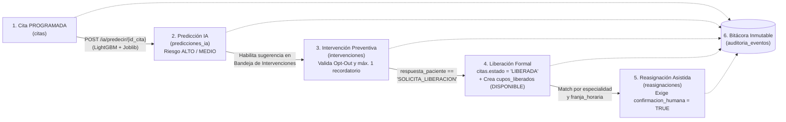

# AUDITORÍA DE CALIDAD DE SOFTWARE, TECH LEAD Y GESTIÓN DE PROYECTO — PREDICITAS CRP
**Fecha de corte de auditoría:** 28 de octubre de 2026  
**Fecha límite objetivo (Hito de control):** 04 de noviembre de 2026 (Corte de Semana 12)  
**Proyecto:** Sistema Web de Gestión Predictiva de Inasistencia, Intervención Inteligente y Reasignación Asistida de Citas Ambulatorias para la Clínica Ricardo Palma (Piloto Controlado — PrediCitas CRP)

---

## 1. FUENTES DOCUMENTALES IDENTIFICADAS

### 1.1. Rutas Exactas de la Documentación Oficial Auditada
Para la ejecución de esta auditoría se inspeccionaron la línea base de gestión del proyecto (Semana 06 - T1), los entregables técnicos actualizados (Semana 08), el documento maestro de base de datos en la raíz del workspace y el código fuente real (`backend/` y `Frontend/`):

1. **Plan de Gestión del Cronograma (Cronograma Maestro de 16 semanas):**
   - `d:\Documentos\SISTEMA\ADM. DE PROYECTOS DE SOFTWARE_Grupo5\SEMANA 06 (T1)\PREGUNTA 02\b) Documentos de Gestión del Ciclo de Vida del Proyecto\b.7. Plan de Gestión del Cronograma\Grupo05_02_b07_Gestión_Cronograma_Doc` (y su versión `.pdf`)
2. **Línea Base de Tiempo y Costos (Cronograma de Hitos, Fase III de Desarrollo y Curva S):**
   - `d:\Documentos\SISTEMA\ADM. DE PROYECTOS DE SOFTWARE_Grupo5\SEMANA 06 (T1)\PREGUNTA 02\b) Documentos de Gestión del Ciclo de Vida del Proyecto\b.9. Línea base tiempo y costos\Grupo05_02_b09_LBTiempoCostos_Doc` (y su versión `.pdf`)
3. **EDT / WBS y Diccionario de la EDT:**
   - `d:\Documentos\SISTEMA\ADM. DE PROYECTOS DE SOFTWARE_Grupo5\SEMANA 06 (T1)\PREGUNTA 02\b) Documentos de Gestión del Ciclo de Vida del Proyecto\b.6. EDT (WBS) y Diccionario\Grupo05_02_b06_EDT_Diccionario_Doc.docx`
4. **Especificación de Requisitos de Software (SRS — RF-001 a RF-104, RNF-001 a RNF-033, RN01 a RN18):**
   - `d:\Documentos\SISTEMA\ADM. DE PROYECTOS DE SOFTWARE_Grupo5\SEMANA 06 (T1)\PREGUNTA 02\c) Documentos Técnicos del Producto de Software\c.1. Especificación de Requisitos (SRS)\Grupo05_02_c01_SRS_Doc.docx`
5. **Diseño Arquitectónico del Sistema:**
   - `d:\Documentos\SISTEMA\ADM. DE PROYECTOS DE SOFTWARE_Grupo5\SEMANA 06 (T1)\PREGUNTA 02\c) Documentos Técnicos del Producto de Software\c.2. Diseño Arquitectónico\Grupo05_02_c02_Diseño_Arq_Doc.pdf`
6. **Informe de Avance del Proyecto y Cumplimiento de Objetivos (Tablas 14 y 21):**
   - `d:\Documentos\SISTEMA\ADM. DE PROYECTOS DE SOFTWARE_Grupo5\SEMANA 06 (T1)\PREGUNTA 03\Grupo05_03_Avance_Proyecto_Doc.docx`
7. **Diseño de Base de Datos y Especificación de Reportes (Semana 08 y Raíz):**
   - `d:\Documentos\SISTEMA\ADM. DE PROYECTOS DE SOFTWARE_Grupo5\SEMANA 08\PrediCitas_CRP_Diseno_BaseDatos_Reportes.docx`
   - `d:\Documentos\SISTEMA\DISEÑO_BD_PREDICCION_CITAS.md`
8. **Plan de Desarrollo e Implementación del Sistema (Semana 08 — Cronograma de Despliegue Técnico):**
   - `d:\Documentos\SISTEMA\ADM. DE PROYECTOS DE SOFTWARE_Grupo5\SEMANA 08\PrediCitas_CRP_Plan_Desarrollo_Implementacion.docx`
9. **Prototipo Funcional y Mockups de Interfaz (16 Pantallas Oficiales — Semana 08):**
   - `d:\Documentos\SISTEMA\ADM. DE PROYECTOS DE SOFTWARE_Grupo5\SEMANA 08\PrediCitas_CRP_Prototipo_Funcional_Mockups.pdf`

---

### 1.2. Hito Formal y Entregables que Vencen al 04 de Noviembre de 2026 (Corte Semana 12)
El proyecto tiene una duración oficial de **16 semanas académicas** (`18/08/2026` al `08/12/2026`), con cortes semanales los días martes/miércoles (Semana 08 = `06/10/2026`, Semana 09 = `13/10/2026`, Semana 10 = `20/10/2026`, Semana 11 = `27/10/2026`, **Semana 12 = `03/11/2026` – `04/11/2026`**).

De acuerdo con el **Cronograma Maestro (`b.7`)**, la **Línea Base de Tiempo (`b.9`)**, el **Informe de Avance (`PREGUNTA 03`, Tabla 14)** y el **Plan de Desarrollo e Implementación (`SEMANA 08`, Sección 5)**, para el **04 de noviembre de 2026** deben estar **100% cerrados y operativos** los siguientes paquetes de trabajo y compromisos:

1. **Compromisos de semanas previas (Semana 08 a Semana 11: `06/10/2026` al `27/10/2026` — Ya vencidos):**
   - **Infraestructura y Base de Datos (`Plan de Implementación`, `06/10` – `10/10/2026`):** Contenedores Docker (`Dockerfile`, `docker-compose.yml`), motor PostgreSQL 15+ con las 9 tablas oficiales, restricciones de integridad, triggers de inmutabilidad (`INSERT-ONLY`) y Row Level Security (`RLS`).
   - **EDT 3.3.4.1 (`06/10` – `07/10/2026`):** Configuración de entornos de desarrollo (Backend FastAPI + Frontend React + PostgreSQL).
   - **EDT 3.3.4.4 y 3.3.4.5 (`06/10` – `12/10/2026`):** Componente de Datos para IA (M03, `RF-028` a `RF-040`) y **Entregable E-04** (Dataset Sintético Versionado $\ge 1,000$ registros / meta $5,000$ registros, particionado en Train 70% / Val 15% / Test 15% y Ficha de Acreditación).
   - **EDT 3.3.4.7 y 3.3.4.8 (`09/10` – `13/10/2026`):** Entrenamiento del modelo baseline, prueba inicial de *data leakage* y **Entregable E-05** (Informe de Evaluación de Datos y Baseline).
   - **EDT 4.4 (`06/10` – `12/10/2026`):** **Hito Gate Go/No-Go - Semana 8** (Criterios G1 a G9).
   - **EDT 3.3.4.2 (`13/10` – `16/10/2026`, LB `20/10/2026`):** Módulo M01 — Autenticación, Usuarios y Control de Acceso RBAC (`RF-001` a `RF-008`, Pantallas 1, 2 y 3).
   - **EDT 3.3.4.3 (`13/10` – `23/10/2026`, LB `20/10/2026`):** Módulo M02 — Recepción, Registro y Seguimiento Estructurado de Citas (`RF-009` a `RF-027` y `RF-104`, Pantallas 5, 6, 7 y 8).
   - **EDT 3.3.4.9 (`20/10` – `27/10/2026`):** Módulo M05 — Intervención Inteligente (`RF-057` a `RF-068`, Pantallas 11 y 12).
   - **Plan de Implementación (`27/10/2026`):** Despliegue y verificación del servicio de inferencia predictiva serializado (`Joblib` / `LightGBM`).

2. **Compromisos que vencen en el corte de Semana 12 (`27/10/2026` al `04/11/2026`):**
   - **EDT 3.3.4.10 (`22/10` – `29/10/2026`, LB `27/10/2026`):** Módulo M06 — Lista de Espera y Reasignación Asistida (`RF-069` a `RF-082`, Pantallas 13, 14 y 15).
   - **EDT 3.3.4.11 (`27/10` – `03/11/2026`):** Módulo M07 — Panel Operativo de Recepción y Reportes Operativos (`RF-083` a `RF-089`, Pantalla 4, Reportes `REP-01` a `REP-05`).
   - **EDT 3.3.4.12 (`29/10` – `05/11/2026`, LB `03/11/2026`):** Módulo M08 — Seguridad, Privacidad, Auditoría y Trazabilidad de IA (`RF-090` a `RF-097`, `RNF-001` a `RNF-010`, Pantalla 16).
   - **EDT 3.3.4.6 / Objetivo Específico 3 (`Grupo05_03_Avance_Proyecto_Doc.docx`, Tabla 14 — Meta Semana 12):** Motor Predictivo de Inasistencia basado en IA (M04, `RF-041` a `RF-056`, Pantalla 10) generando score de riesgo (`0` a `1` o `0` a `100`), clasificación en `BAJO`, `MEDIO`, `ALTO`, explicabilidad resumida (`explicabilidad_resumen`) y cumplimiento de meta `F1-Score >= 82%` en validación controlada.

> **Síntesis del Hito al 04 de Noviembre:** Para el 04 de noviembre de 2026 debe estar **100% completada la construcción de los 8 módulos funcionales del sistema (M01 a M08)** y las **16 pantallas del prototipo funcional**, dejando el sistema listo para iniciar el **Hito de Integración End-to-End del MVP (EDT 3.3.4.13: `05/11/2026` – `10/11/2026`)** y la **Ejecución del Plan de Pruebas y QA (EDT 3.3.5.1: `05/11/2026` – `13/11/2026`)**.

---

## 2. AUDITORÍA DE FASES ANTERIORES AL 04 DE NOVIEMBRE (¿ESTÁ TODO CONFORME?)

### 2.1. Matriz de Auditoría Código Fuente vs. Cronograma Oficial y SRS

| Módulo / Requerimiento | Compromiso en Cronograma / SRS | Estado en Código (Conforme / Incompleto / No implementado) | Evidencia en Código (Ruta de archivo en backend/frontend) | Observación Técnica |
| :--- | :--- | :---: | :--- | :--- |
| **Infraestructura y Contenedores** *(EDT 3.3.4.1 / Plan Impl. Secc. 5)* | Configuración de entornos (`06/10/2026` – `07/10/2026`) y contenedores `Docker` / `Docker Compose` (`06/10/2026`). | **Incompleto** | `backend/app/main.py` `backend/app/core/config.py` `backend/requirements.txt` `Frontend/package.json` `Frontend/vite.config.js` | El entorno local FastAPI + React + PostgreSQL funciona, pero **no existen `Dockerfile` ni `docker-compose.yml`** en todo el workspace. Además, el Frontend está implementado en JavaScript (`.jsx`) y no en TypeScript (`.tsx`) como declaraba el Plan de Desarrollo. |
| **Esquema Oficial de Base de Datos (9 Tablas)** *(Diseño BD Sem 08 / Plan Impl. `10/10/2026`)* | Migración DDL de las 9 tablas (`usuarios`, `citas`, `historial_estados_cita`, `predicciones_ia`, `intervenciones`, `lista_espera`, `cupos_liberados`, `reasignaciones`, `auditoria_eventos`), `CHECK` constraints, triggers `fn_bloquear_modificacion` y `RLS`. | **Conforme** | `backend/migrations/versions/2cfdcb7d3da2_esquema_inicial_con_las_9_tablas.py` `backend/app/modules/*/models.py` `backend/tests/test_integridad_bd.py` `backend/tests/test_modelos.py` | **Cumplimiento 100% en migración Alembic y modelos SQLAlchemy.** Las 9 tablas, tipos `UUID`/`JSONB`/`NUMERIC(5,4)`, triggers `INSERT-ONLY` en `historial_estados_cita` y `auditoria_eventos`, `CHECK (confirmacion_humana IS TRUE)` y `RLS` coinciden exactamente con `DISEÑO_BD_PREDICCION_CITAS.md`. **Defecto en script auxiliar:** `backend/scripts/poblar_bd_completa.py` referencia una tabla inexistente `pacientes_perfil` y una vista inexistente `v_dataset_entrenamiento_ia`, por lo que falla al ejecutarse sobre el esquema oficial. |
| **M01 — Autenticación y Sesión RBAC** *(EDT 3.3.4.2 / RF-001, RF-002, RF-003, RNF-003, RNF-004, RNF-005 / Pantalla 1)* | Inicio de sesión (`13/10` – `16/10/2026`), JWT, hash Argon2id, control de acceso por roles (`ADMINISTRADOR`, `SUPERVISOR_OPERATIVO`, `RECEPCIONISTA`), cierre de sesión y auditoría de accesos. | **Conforme** | `backend/app/modules/auth/router.py` `backend/app/modules/auth/service.py` `backend/app/modules/auth/dependencies.py` `backend/app/core/security.py` `Frontend/src/pages/Login.jsx` `Frontend/src/context/AuthContext.jsx` `backend/tests/test_auth.py` | Endpoints `POST /auth/login`, `GET /auth/me` y `POST /auth/logout` operativos. Mitigación de *timing attacks* con `HASH_FICTICIO` en `security.py` y validación RBAC con `requiere_roles`. Registra eventos `LOGIN` (exitoso/fallido) y `LOGOUT` en `auditoria_eventos`. Falta únicamente rate-limiting/bloqueo por intentos fallidos repetidos (`RNF-005`). |
| **M01 — Administración de Usuarios y Recuperación de Acceso** *(EDT 3.3.4.2 / RF-004 a RF-008 / Pantallas 2 y 3)* | Crear usuarios (`RF-004`), actualizar datos/rol (`RF-005`), activar/desactivar (`RF-006`), gestionar roles (`RF-007`) y restablecer acceso (`RF-008`) antes del `20/10/2026`. | **No implementado** | `backend/app/modules/auth/repository.py` *(solo tiene `por_id` y `por_correo`)* | No existen endpoints CRUD de usuarios (`GET /usuarios`, `POST /usuarios`, `PATCH /usuarios/{id}`, `POST /usuarios/{id}/reset-password`) ni existen en el Frontend la **Pantalla 2 (Recuperación de Acceso)** ni la **Pantalla 3 (Gestión de Usuarios)**. Los usuarios solo se crean por script (`backend/scripts/seed.py`). |
| **M02 — Importación Estructurada de Citas (CSV)** *(EDT 3.3.4.3 / RF-009, RF-011, RF-012, RF-013, RF-014 / Pantalla 7)* | Carga por lote CSV (`13/10` – `23/10/2026`), validación de estructura y catálogos, prevención de duplicados por `id_cita_externa`, reporte de filas rechazadas y estado inicial `PROGRAMADA`. | **Conforme** | `backend/app/modules/citas/router.py` `backend/app/modules/citas/service.py` `backend/app/modules/citas/schemas.py` `Frontend/src/pages/Importar.jsx` `backend/tests/test_citas.py` | `POST /citas/importar` valida encabezados obligatorios, tipos, especialidades (`MEDICINA INTERNA`, `CARDIOLOGIA`, `ENDOCRINOLOGIA`, `NEUMOLOGIA`), franjas (`MANANA`, `TARDE`), rechaza duplicados, inserta estado inicial en `historial_estados_cita` y registra evento `IMPORT` en `auditoria_eventos`. Vista `Importar.jsx` funcional. |
| **M02 — Registro Manual de Cita Existente** *(EDT 3.3.4.3 / RF-010, RF-011, RF-012, RF-014 / Pantalla 6)* | Formulario y endpoint para registrar individualmente una cita existente (`13/10` – `23/10/2026`). | **No implementado** | *Ausente en `backend/app/modules/citas/router.py` y en `Frontend/src/pages/`* | No existe endpoint `POST /citas` para creación individual ni existe la **Pantalla 6 (Registro Manual de Cita Existente)** en el Frontend. |
| **M02 — Consulta, Filtros, Detalle y Máquina de Estados de Citas** *(EDT 3.3.4.3 / RF-015 a RF-027, RF-104 / Pantallas 5 y 8)* | Listado y filtros operativos (`RF-015` a `RF-017`), vista de detalle con historial, predicción e intervenciones (`RF-018`), transiciones válidas con bloqueo `FOR UPDATE` (`RF-019` a `RF-026`) y check-in (`RF-104`). | **Incompleto** | `backend/app/modules/citas/router.py` `backend/app/modules/citas/reglas.py` `backend/app/modules/citas/repository.py` `Frontend/src/pages/Citas.jsx` `Frontend/src/pages/CitaDetalle.jsx` | Funciona `GET /citas`, `GET /citas/{id_cita}` y `POST /citas/{id_cita}/estado` con `with_for_update()` y registro en `historial_estados_cita`. **Faltantes:** (1) `GET /citas` y `Citas.jsx` no filtran por `medico`, `nivel_riesgo`, `estado_intervencion` ni `acciones_pendientes` (`RF-017`); (2) `CitaDetalleOut` y `CitaDetalle.jsx` no incluyen `predicciones_ia`, `intervenciones` ni `reasignaciones` de la cita (`RF-018`); (3) falta acción de check-in/llegada (`RF-104`); (4) la transición a `LIBERADA` no está habilitada en `reglas.py`. |
| **M03 — Componente de Datos para IA y Gate Go/No-Go Semana 8** *(EDT 3.3.4.4, 3.3.4.5, 4.4 / Entregable E-04 / RF-028 a RF-040 / Pantalla 9)* | Generador sintético reproducible (`06/10` – `12/10/2026`), dataset acreditado $\ge 1,000$ registros (meta $5,000$), partición Train/Val/Test reservada, ficha de calidad y pantalla de consulta de datos IA. | **Incompleto** | `backend/app/modules/citas/synthetic.py` `backend/scripts/seed.py` `backend/data/citas_demo.csv` `backend/tests/test_synthetic.py` | `synthetic.py` implementa generación con semilla fija, ruido controlado y separación de variables pre-cita vs. target, pero genera por defecto `360` citas (`historicas=300, proximas=60`) y `citas_demo.csv` solo tiene `24` filas. **Faltantes:** Dataset versionado de $\ge 1,000$ / $5,000$ registros con particiones Train (70%), Val (15%) y Test (15%) persistidas, informe/ficha de acreditación (`E-04`), endpoints de consulta y la **Pantalla 9 (Datos para IA)** en el Frontend. |
| **M04 — Motor Predictivo de Inasistencia basado en IA** *(EDT 3.3.4.6, 3.3.4.7, 3.3.4.8 / Entregable E-05 / Plan Impl. `27/10/2026` / RF-041 a RF-056 / Pantalla 10)* | Baseline y prueba de leakage (`12/10/2026`), servicio de inferencia `LightGBM` serializado con `Joblib` (`27/10/2026`), score, nivel de riesgo (`BAJO`, `MEDIO`, `ALTO`), `explicabilidad_resumen`, métricas y auditoría de sesgo. | **No implementado** | `backend/app/modules/ia/models.py` *(únicamente el modelo ORM `PrediccionIA`)* | **Brecha crítica:** En `backend/app/modules/ia/` no existen `schemas.py`, `repository.py`, `service.py`, `router.py` ni pipeline de entrenamiento/inferencia `LightGBM`. Tampoco existen pruebas automatizadas de *data leakage* (`RF-048`) ni de sesgo por subgrupos (`RF-049`), ni existe la **Pantalla 10 (Resultado de Predicción de Inasistencia)** en el Frontend. |
| **M05 — Intervención Inteligente** *(EDT 3.3.4.9 / RF-057 a RF-068 / Pantallas 11 y 12)* | Comprometido del `20/10/2026` al `27/10/2026` (**vencido**): sugerencia de acción por riesgo, canal simulado, máx. 1 recordatorio adicional (`RN07`), respeto de `consentimiento_optout` (`RN08`) y paso a `LIBERADA` cuando `respuesta_paciente == 'SOLICITA_LIBERACION'` (`RN04`). | **No implementado** | `backend/app/modules/intervenciones/models.py` *(únicamente el modelo ORM `Intervencion`)* | **Brecha crítica (Entregable vencido el 27/10/2026):** En `backend/app/modules/intervenciones/` no existen `schemas.py`, `repository.py`, `service.py` ni `router.py`. No hay lógica para registrar intervenciones, validar opt-out, limitar recordatorios ni disparar la liberación formal del cupo. Faltan las **Pantallas 11 y 12** en el Frontend. |
| **M06 — Lista de Espera y Reasignación Asistida** *(EDT 3.3.4.10 / RF-069 a RF-082 / Pantallas 13, 14 y 15)* | Comprometido del `22/10/2026` al `29/10/2026`: gestión de `lista_espera`, registro automático de `cupos_liberados`, propuesta de candidatos compatibles por especialidad y franja, y reasignación con `confirmacion_humana = True` (`RN05`, `RN06`). | **No implementado** | `backend/app/modules/lista_espera/models.py` *(únicamente los modelos ORM `ListaEspera`, `CupoLiberado`, `Reasignacion`)* | En `backend/app/modules/lista_espera/` solo están declaradas las tablas SQLAlchemy. No existen `schemas.py`, `repository.py`, `service.py` ni `router.py`. Faltan las **Pantallas 13 (Lista de Espera)**, **14 (Cupos Liberados)** y **15 (Reasignación Asistida)** en el Frontend. |
| **M07 — Panel Operativo de Recepción y Reportes** *(EDT 3.3.4.11 / RF-083 a RF-089 / Pantalla 4 y Reportes REP-01 a REP-05)* | Comprometido del `27/10/2026` al `03/11/2026`: dashboard operativo principal con KPIs del día, alertas de citas de alto riesgo sin intervención, cupos liberados pendientes y los 5 reportes oficiales (`REP-01` a `REP-05`). | **No implementado** | `Frontend/src/App.jsx` *(redirige `/` a `/citas`)* `Frontend/src/components/Layout.jsx` | No existe módulo/router de panel operativo ni de reportes en el Backend, ni existe la **Pantalla 4 (Panel Operativo Principal)** en el Frontend. Al iniciar sesión, el usuario es redirigido directamente a `/citas`. |
| **M08 — Seguridad, Privacidad, Auditoría y Trazabilidad de IA** *(EDT 3.3.4.12 / RF-090 a RF-097, RNF-001 a RNF-010 / Pantalla 16)* | Comprometido del `29/10/2026` al `05/11/2026` (LB `03/11/2026`): bitácora inmutable de eventos críticos (`LOGIN`, `IMPORT`, `STATE_CHANGE`, `PREDICT`, `INTERVENCION`, `LIBERAR`, `REASIGNAR`), consulta filtrada y vista de auditoría. | **Incompleto** | `backend/app/modules/auditoria/models.py` `backend/app/modules/auditoria/service.py` `backend/tests/test_integridad_bd.py` | La tabla `auditoria_eventos`, su trigger `INSERT-ONLY` y el servicio interno `registrar_evento()` están implementados y registran eventos de `auth` y `citas`. **Faltantes:** No existe `router.py` (`GET /auditoria` con filtros `RF-096`), no se auditan aún eventos de IA/Intervenciones/Reasignación (`RF-092` a `RF-094`) y falta la **Pantalla 16 (Auditoría y Trazabilidad)** en el Frontend. |

---

### 2.2. Dictamen Técnico sobre las Fases Anteriores al 04 de Noviembre

> **DICTAMEN DE AUDITORÍA: NO CONFORME (Cumplimiento Global Acumulado al 28/10/2026: ~35% del alcance comprometido a la fecha).**

El sistema **NO cumple al 100%** con lo programado para las semanas previas (Semanas 08 a 11). Si bien los cimientos arquitectónicos están construidos con alta calidad técnica —específicamente la **migración Alembic de las 9 tablas (`2cfdcb7d3da2`)**, los **triggers de inmutabilidad en PostgreSQL**, las **restricciones `CHECK` y `RLS`**, la **autenticación JWT + Argon2id (`M01` básico)** y la **importación/listado/cambio de estado transaccional de citas (`M02` básico)** con 18 pruebas automatizadas pasando—, existe un **atraso crítico en los módulos nucleares de valor del negocio** que ya debieron haberse entregado:

1. **Entregables de Semanas 08 a 11 vencidos y ausentes en el código:**
   - **M05 (Intervención Inteligente — EDT 3.3.4.9, vencido el `27/10/2026`):** Se encuentra al **0% de lógica de negocio y 0% de interfaz gráfica** (solo existe la clase ORM `Intervencion`).
   - **Despliegue del Servicio de Inferencia Predictiva (`Plan de Implementación`, vencido el `27/10/2026`) y Baseline/Evaluación (`EDT 3.3.4.7` y `3.3.4.8`, vencidos el `13/10/2026`):** El directorio `backend/app/modules/ia/` solo contiene `models.py`. No existe modelo `LightGBM` entrenado ni serializado con `Joblib`, ni endpoints de predicción.
   - **M01 y M02 incompletos respecto al SRS y Mockups (vencidos el `20/10` – `23/10/2026`):** Se dieron por cerrados, pero omitieron la administración de usuarios (`RF-004` a `RF-008`, Pantallas 2 y 3), el registro manual de cita individual (`RF-010`, Pantalla 6), los filtros avanzados en la bandeja (`RF-017`) y el check-in (`RF-104`).
2. **Deuda Técnica Crítica Detectada en Scripts del Repositorio:**
   - El archivo `backend/scripts/poblar_bd_completa.py` **está desalineado del diseño oficial de base de datos (`DISEÑO_BD_PREDICCION_CITAS.md`)**: intenta insertar registros en una tabla inexistente `pacientes_perfil` (líneas 75–121) y consultar una vista inexistente `v_dataset_entrenamiento_ia` (línea 441), además de entrenar `RandomForestClassifier` en lugar de `LightGBM`. Su ejecución sobre una base de datos creada con `alembic upgrade head` falla inmediatamente.
   - El archivo `backend/app/main.py` solo monta dos routers: `auth_router` y `citas_router`. Los módulos `ia`, `intervenciones`, `lista_espera`, `panel` y `auditoria` no exponen ningún endpoint HTTP.
   - De las **16 pantallas comprometidas en `PrediCitas_CRP_Prototipo_Funcional_Mockups.pdf`**, el Frontend actual (`Frontend/src/pages/`) solo implementa **4 pantallas** (`Login.jsx` [P1], `Citas.jsx` [P5 parcial], `Importar.jsx` [P7] y `CitaDetalle.jsx` [P8 parcial]). **Faltan 12 pantallas completas.**

---

## 3. BRECHAS Y FALTANTES PARA EL 04 DE NOVIEMBRE (GAP ANALYSIS)

A continuación se detalla y clasifica **todo lo que falta implementar** en el código fuente para alcanzar el cumplimiento estricto al **04 de noviembre de 2026**:

### 3.1. Endpoints y Servicios Faltantes en el Backend (`backend/app/`)

#### A. Módulo M01 — Gestión de Usuarios (`backend/app/modules/auth/`)
1. `GET /usuarios` (`RF-004` a `RF-007`): Listar usuarios internos filtrando por rol y estado (`activo`), restringido a `ADMINISTRADOR`.
2. `POST /usuarios` (`RF-004`): Crear nuevo usuario interno validando correo único, rol válido (`ADMINISTRADOR`, `SUPERVISOR_OPERATIVO`, `RECEPCIONISTA`) y contraseña hasheada con Argon2id, registrando evento en `auditoria_eventos`.
3. `PATCH /usuarios/{id_usuario}` (`RF-005`, `RF-006`): Actualizar nombre, rol o estado `activo` (`True`/`False`) de un usuario, registrando valor anterior y nuevo en `auditoria_eventos`.
4. `POST /usuarios/{id_usuario}/restablecer-acceso` o `POST /auth/recuperar-acceso` (`RF-008`): Flujo controlado de restablecimiento de contraseña auditado.

#### B. Módulo M02 — Completitud de Citas (`backend/app/modules/citas/`)
5. `POST /citas` (`RF-010`, `RF-011`, `RF-012`, `RF-014`): Registrar manualmente una cita existente individual, insertando automáticamente su estado inicial `PROGRAMADA` en `historial_estados_cita` y su evento `CREATE` en `auditoria_eventos`.
6. Ampliación de `GET /citas` (`RF-017`): Incorporar parámetros de filtro `medico`, `nivel_riesgo` (`BAJO`, `MEDIO`, `ALTO`, mediante `LEFT JOIN` a la última predicción vigente en `predicciones_ia`), `estado_intervencion` y `acciones_pendientes` (booleano). Retornar en cada fila de cita el resumen de su predicción activa (`score_riesgo`, `nivel_riesgo`) y última intervención.
7. Ampliación de `GET /citas/{id_cita}` (`RF-018`): Incluir en `CitaDetalleOut` las listas/objetos de `predicciones_ia`, `intervenciones`, `cupo_liberado` y `reasignacion` asociados a la cita.
8. `POST /citas/{id_cita}/checkin` (o soporte explícito en `POST /citas/{id_cita}/estado`, `RF-104`): Registrar llegada/check-in del paciente.
9. Habilitar transición a `LIBERADA` en `backend/app/modules/citas/reglas.py` (`RN04`, `RF-024`, `RF-068`): Permitir transición desde `PROGRAMADA` o `CONFIRMADA` hacia `LIBERADA` cuando provenga de una solicitud voluntaria de liberación del paciente.

#### C. Módulo M03 y M04 — Datos para IA y Motor Predictivo (`backend/app/modules/ia/`)
10. **Pipeline de Dataset Sintético Acreditado y Entrenamiento (`RF-028` a `RF-050`):**
    - Generar y versionar el dataset sintético oficial ($\ge 1,000$ registros, meta $5,000$) con partición temporal/estratificada reservada (Train 70% / Val 15% / Test 15%).
    - Entrenar modelo baseline (`LogisticRegression`) y modelo principal (`LightGBM`), verificando no-leakage (`RF-048`), auditando sesgo por `paciente_sexo`, `paciente_rango_edad` y `especialidad` (`RF-049`), y serializando el artefacto con `Joblib` (`models/lightgbm_predicitas_v1.joblib`) junto con su archivo de metadatos/métricas (`RF-047`, `RF-050`).
11. `GET /ia/dataset-resumen` (`RF-035`, `RF-036`, `RF-040`, Pantalla 9): Retornar estadísticas del dataset sintético acreditado, volumen por partición, distribución del target, completitud de variables y estado de validación anti-leakage.
12. `POST /ia/predecir/{id_cita}` (`RF-051` a `RF-056`, `RF-092`): Ejecutar inferencia con el modelo `LightGBM` sobre una cita en estado `PROGRAMADA` o `CONFIRMADA`, calcular `score_riesgo` (`0.0000` a `1.0000`), clasificar `nivel_riesgo` (`BAJO < 0.40`, `MEDIO 0.40–0.69`, `ALTO >= 0.70`), generar `explicabilidad_resumen` (3 factores principales), persistir en `predicciones_ia` con `es_simulacion = True` y auditar evento `PREDICT`.
13. `POST /ia/predecir-lote` (`RF-051`): Ejecutar predicción masiva sobre todas las citas próximas sin predicción vigente (o tras importación CSV).
14. `GET /ia/metricas` (`RF-047`, `RF-049`, `REP-04`): Devolver métricas del modelo activo (`F1-Score`, `Precision`, `Recall`, `ROC-AUC`, `PR-AUC`, matriz de confusión, comparación contra baseline y equidad por subgrupos).

#### D. Módulo M05 — Intervención Inteligente (`backend/app/modules/intervenciones/`)
15. `GET /intervenciones` (`RF-057`, `RF-061`, Pantalla 11): Listar bandeja de citas candidatas a intervención (riesgo `ALTO` y `MEDIO`) y el historial de intervenciones ejecutadas, con filtros por nivel de riesgo, especialidad, estado de respuesta y opt-out.
16. `POST /citas/{id_cita}/intervenciones` (`RF-057` a `RF-067`, `RN02`, `RN07`, `RN08`, `RF-093`):
    - Validar si el paciente tiene `consentimiento_optout = True` en intervenciones previas (`RF-064`, `RF-065`); si es `True`, bloquear el envío de recordatorios automáticos/adicionales.
    - Validar el límite máximo de **1 recordatorio adicional por cita** (`RF-066`, `RNF-032`, `RN07`).
    - Registrar la intervención (`tipo_accion`, `canal`, `respuesta_paciente`, `consentimiento_optout`, `observacion`, `es_simulacion = True`) y auditar en `auditoria_eventos`.
17. `PATCH /intervenciones/{id_intervencion}` (o registro directo de respuesta en `POST /citas/{id_cita}/intervenciones`, `RF-062`, `RF-068`, `RN02`, `RN04`):
    - Si `respuesta_paciente == 'CONFIRMA_ASISTENCIA'`, actualizar el estado de la cita a `CONFIRMADA` (registrando en `historial_estados_cita`).
    - Si `respuesta_paciente == 'SOLICITA_LIBERACION'`, transicionar formalmente la cita a `LIBERADA`, registrar en `historial_estados_cita`, **crear automáticamente el registro en `cupos_liberados`** (`estado_cupo = 'DISPONIBLE'`) y registrar evento `LIBERAR` en `auditoria_eventos` dentro de la misma transacción.
    - Si `respuesta_paciente == 'SIN_RESPUESTA'`, **prohibir estrictamente** cancelar o liberar la cita de forma unilateral (`RN02`, `RF-067`).

#### E. Módulo M06 — Lista de Espera y Reasignación Asistida (`backend/app/modules/lista_espera/`)
18. `GET /lista-espera` (`RF-069`, `RF-072`, Pantalla 13): Listar candidatos en lista de espera filtrando por `especialidad_req`, `franja_preferida` y `estado_solicitud`, ordenados por `prioridad_registro ASC, fecha_registro ASC`.
19. `POST /lista-espera` (`RF-069`, `RF-070`): Registrar un nuevo paciente en lista de espera (`paciente_ref`, `especialidad_req`, `franja_preferida`, `prioridad_registro`).
20. `PATCH /lista-espera/{id_espera}` (`RF-071`): Actualizar disponibilidad o `estado_solicitud` (`PENDIENTE`, `ASIGNADO`, `EXPIRADO`, `CANCELADO`).
21. `GET /cupos-liberados` (`RF-073`, Pantalla 14): Listar todos los cupos liberados con los datos de la cita origen (`especialidad`, `medico_asignado`, `fecha_cita`, `hora_cita`, `franja_horaria`) y su `estado_cupo` (`DISPONIBLE`, `REASIGNADO`, `EXPIRADO`).
22. `GET /cupos-liberados/{id_cupo}/candidatos` (`RF-074`, `RF-075`, `RF-076`, Pantalla 15): Proponer automáticamente los candidatos compatibles de `lista_espera` donde `estado_solicitud == 'PENDIENTE'`, `especialidad_req == cita_origen.especialidad` y `franja_preferida IN (cita_origen.franja_horaria, 'INDIFERENTE')`, ordenados por `prioridad_registro ASC, fecha_registro ASC`, explicando el criterio de compatibilidad.
23. `POST /cupos-liberados/{id_cupo}/reasignar` (`RF-077` a `RF-082`, `RN05`, `RN06`, `RF-094`):
    - Ejecutar con bloqueo pesimista `SELECT ... FOR UPDATE` sobre `cupos_liberados` y `lista_espera` para evitar doble asignación concurrente.
    - Exigir `confirmacion_humana == True` y rol `RECEPCIONISTA` o `SUPERVISOR_OPERATIVO` (o `ADMINISTRADOR`).
    - Insertar en `reasignaciones`, actualizar `cupos_liberados.estado_cupo = 'REASIGNADO'`, actualizar `lista_espera.estado_solicitud = 'ASIGNADO'` y registrar evento `REASIGNAR` en `auditoria_eventos` en una única transacción atómica.

#### F. Módulo M07 — Panel Operativo y Reportes (`backend/app/modules/panel/` o `reportes/`)
24. `GET /panel/resumen` (`RF-083` a `RF-089`, Pantalla 4): Retornar KPIs consolidados del piloto: total de citas por estado, distribución por nivel de riesgo (`BAJO`, `MEDIO`, `ALTO`), alerta de citas de riesgo `ALTO`/`MEDIO` sin intervención registrada (`RF-085`), alerta de cupos liberados en estado `DISPONIBLE` pendientes de reasignación (`RF-086`) y bandeja rápida de acciones pendientes (`RF-087`).
25. `GET /reportes/{codigo_reporte}` (`REP-01` a `REP-05` según `PrediCitas_CRP_Diseno_BaseDatos_Reportes.docx`):
    - `REP-01`: Bandeja Operativa de Riesgo e Intervenciones del Día.
    - `REP-02`: Trazabilidad de Cupos Liberados y Reasignaciones Asistidas.
    - `REP-03`: Efectividad de Intervenciones Preventivas por Canal y Nivel de Riesgo.
    - `REP-04`: Desempeño, Calibración y Estabilidad del Modelo Predictivo IA.
    - `REP-05`: Bitácora de Auditoría de Eventos Críticos y Cumplimiento Normativo.

#### G. Módulo M08 — Consulta de Auditoría (`backend/app/modules/auditoria/`)
26. `GET /auditoria` (`RF-095`, `RF-096`, `RF-097`, Pantalla 16): Consultar eventos de `auditoria_eventos` con filtros por rango de fechas (`desde`, `hasta`), `id_usuario`, `rol_usuario`, `modulo`, `accion`, `entidad_afectada` e `id_entidad`, restringido a `ADMINISTRADOR` y `SUPERVISOR_OPERATIVO`.

---

### 3.2. Vistas e Interfaces Faltantes en el Frontend (`Frontend/src/`)

De las **16 pantallas oficiales** definidas en `PrediCitas_CRP_Prototipo_Funcional_Mockups.pdf`, faltan implementar o completar las siguientes **12 pantallas** y actualizar el enrutador (`Frontend/src/App.jsx`) y la barra lateral (`Frontend/src/components/Layout.jsx`):

1. **Pantalla 2 — Recuperación de Acceso (`Frontend/src/pages/RecuperarAcceso.jsx`):** Formulario de solicitud/restablecimiento de acceso vinculado desde `Login.jsx` (`RF-008`).
2. **Pantalla 3 — Gestión de Usuarios (`Frontend/src/pages/Usuarios.jsx`):** Tabla de usuarios internos, modal/formulario de alta de usuario, cambio de rol y activación/desactivación para el rol `ADMINISTRADOR` (`RF-004` a `RF-007`).
3. **Pantalla 4 — Panel Operativo Principal (`Frontend/src/pages/PanelOperativo.jsx`):** Vista inicial post-login (`/panel`), con tarjetas de KPIs, gráfico/resumen de citas por estado y nivel de riesgo, alertas de citas de riesgo sin intervención (`RF-085`), alertas de cupos disponibles para reasignar (`RF-086`) y accesos directos (`RF-083` a `RF-089`).
4. **Pantalla 5 (Completitud) — Bandeja de Citas (`Frontend/src/pages/Citas.jsx`):** Añadir columnas de `Nivel de Riesgo IA` (badge semafórico `BAJO`/`MEDIO`/`ALTO`), `Score`, `Estado de Intervención`, botón de `Predecir con IA` (individual y por lote) y filtros por `medico`, `nivel_riesgo`, `estado_intervencion` y `acciones_pendientes` (`RF-017`).
5. **Pantalla 6 — Registro Manual de Cita Existente (`Frontend/src/pages/NuevaCita.jsx`):** Formulario estructurado para registrar una cita individual con validaciones de catálogo (`RF-010`).
6. **Pantalla 8 (Completitud) — Detalle de Cita (`Frontend/src/pages/CitaDetalle.jsx`):** Incorporar el bloque de **Resultado de Predicción IA** (score, nivel de riesgo, 3 factores de explicabilidad, versión del modelo, badge `"Resultado simulado"`), el bloque de **Registro y Historial de Intervenciones** (con control de opt-out y límite de 1 recordatorio) y el enlace al **Cupo Liberado / Reasignación** si la cita está en estado `LIBERADA` (`RF-018`).
7. **Pantalla 9 — Datos para IA (`Frontend/src/pages/DatosIA.jsx`):** Panel de acreditación del dataset sintético (volumen total, particiones Train/Val/Test, distribución de clases, completitud, validación anti-leakage y métricas del modelo `LightGBM` vs. Baseline) (`RF-028` a `RF-049`).
8. **Pantalla 10 — Resultado de Predicción de Inasistencia (`Frontend/src/pages/PrediccionIA.jsx` o modal/vista dedicada):** Visualización detallada de la evaluación predictiva de una cita, factores explicativos (`explicabilidad_resumen`), umbral aplicado, versión del modelo y aviso ético de apoyo a la decisión (`RF-051` a `RF-056`, `RN01`).
9. **Pantalla 11 — Bandeja de Intervenciones (`Frontend/src/pages/Intervenciones.jsx`):** Lista priorizada de citas de riesgo `ALTO` y `MEDIO`, acción sugerida (`CONFIRMACION_PREVIA`, `RECORDATORIO_ADICIONAL`, `SOLICITUD_LIBERACION`, `SIN_ACCION`), estado de `consentimiento_optout` y acceso rápido para registrar la respuesta del paciente (`RF-057` a `RF-068`).
10. **Pantalla 12 — Detalle y Seguimiento de Intervención (`Frontend/src/pages/IntervencionDetalle.jsx` o panel lateral en `Intervenciones.jsx`):** Formulario de ejecución/registro de respuesta del paciente (`CONFIRMA_ASISTENCIA`, `SOLICITA_LIBERACION`, `SOLICITA_REPROGRAMACION`, `SIN_RESPUESTA`, `OPTOUT`), mostrando el aviso explícito de que `"La falta de respuesta no autoriza cancelar ni liberar la cita"` (`RN02`) y disparando la liberación del cupo cuando el paciente solicita liberación (`RN04`).
11. **Pantalla 13 — Lista de Espera (`Frontend/src/pages/ListaEspera.jsx`):** Gestión de pacientes candidatos en lista de espera (alta de solicitud, filtro por especialidad y franja horaria, cambio de estado y orden de prioridad) (`RF-069` a `RF-072`).
12. **Pantalla 14 — Cupos Liberados (`Frontend/src/pages/CuposLiberados.jsx`):** Bandeja de cupos en estado `DISPONIBLE` y `REASIGNADO`, mostrando los datos de la cita origen liberada y el botón `"Buscar Candidatos / Reasignar"` (`RF-073`).
13. **Pantalla 15 — Reasignación Asistida de Cupo (`Frontend/src/pages/ReasignacionAsistida.jsx`):** Vista comparativa entre el cupo liberado y la lista rankeada de candidatos compatibles de `lista_espera`, con casilla obligatoria de **Confirmación Humana (`confirmacion_humana = true`)** para ejecutar la reasignación asistida (`RF-074` a `RF-082`, `RN05`).
14. **Pantalla 16 — Auditoría y Trazabilidad del Sistema (`Frontend/src/pages/Auditoria.jsx`):** Visor inmutable de `auditoria_eventos` y exportación de los reportes `REP-01` a `REP-05` con filtros por fecha, usuario, rol, módulo y acción (`RF-090` a `RF-097`).

---

### 3.3. Conexiones de Flujo End-to-End Faltantes (IA $\rightarrow$ Intervención $\rightarrow$ Cupo Liberado $\rightarrow$ Reasignación $\rightarrow$ Auditoría)

Actualmente los módulos existen como tablas aisladas en PostgreSQL sin flujo de orquestación en la capa de servicios (`service.py`). Faltan enlazar las siguientes **5 cadenas transaccionales críticas**:

1. **Enlace Cita $\rightarrow$ Motor IA (`citas` $\rightarrow$ `predicciones_ia`):** Al importar o registrar citas en estado `PROGRAMADA`, o al pulsar `"Evaluar Riesgo IA"`, el servicio de IA debe transformar únicamente las variables pre-cita (`especialidad`, `canal_reserva`, `franja_horaria`, `anticipacion_dias`, `paciente_sexo`, `paciente_rango_edad`, `historial_citas_previas`, `historial_inasistencias`, `historial_cancelaciones`), invocar el modelo `LightGBM`, guardar en `predicciones_ia` y auditar `PREDICT`.
2. **Enlace Predicción IA $\rightarrow$ Intervención (`predicciones_ia` $\rightarrow$ `intervenciones`):** La bandeja de intervenciones debe leer la última predicción vigente de cada cita (`PROGRAMADA`/`CONFIRMADA`) y sugerir automáticamente la acción preventiva según el `nivel_riesgo` (`ALTO` $\rightarrow$ `CONFIRMACION_PREVIA` / `SOLICITUD_LIBERACION`; `MEDIO` $\rightarrow$ `RECORDATORIO_ADICIONAL`; `BAJO` $\rightarrow$ `SIN_ACCION`), verificando previamente en `intervenciones` que el paciente no tenga `consentimiento_optout = True` ni haya superado el límite de 1 recordatorio adicional.
3. **Enlace Intervención $\rightarrow$ Estado de Cita y Cupo Liberado (`intervenciones` $\rightarrow$ `citas` + `historial_estados_cita` + `cupos_liberados`):**
   - Cuando se registra una intervención con `respuesta_paciente == 'CONFIRMA_ASISTENCIA'`, el servicio debe invocar atómicamente el cambio de estado de la cita a `CONFIRMADA`.
   - Cuando se registra una intervención con `respuesta_paciente == 'SOLICITA_LIBERACION'`, el servicio debe: (a) cambiar `citas.estado_actual = 'LIBERADA'`, (b) insertar en `historial_estados_cita`, (c) insertar automáticamente en `cupos_liberados` (`id_cita_origen`, `id_intervencion_origen`, `estado_cupo = 'DISPONIBLE'`), y (d) registrar evento `LIBERAR` en `auditoria_eventos`.
4. **Enlace Cupo Liberado $\rightarrow$ Lista de Espera $\rightarrow$ Reasignación Asistida (`cupos_liberados` + `lista_espera` $\rightarrow$ `reasignaciones`):** Al seleccionar un cupo `DISPONIBLE`, el sistema debe filtrar `lista_espera` por `especialidad_req == cita.especialidad` y compatibilidad de `franja_preferida`, presentar los candidatos ordenados por prioridad y antigüedad, y al recibir la confirmación del operador (`confirmacion_humana = True`), crear el registro en `reasignaciones` cambiando `cupos_liberados.estado_cupo = 'REASIGNADO'` y `lista_espera.estado_solicitud = 'ASIGNADO'` en la misma transacción.
5. **Enlace Transversal $\rightarrow$ Auditoría (`auditoria_eventos`):** Todos los servicios (`ia`, `intervenciones`, `lista_espera`, `usuarios`) deben invocar `auditoria_service.registrar_evento(...)` dentro de la misma sesión de base de datos (`db: Session`) para garantizar trazabilidad 100% consistente.

---

## 4. CHECKLIST DE TRABAJO INMEDIATO (PLAN DE ACCIÓN HASTA EL 04 DE NOVIEMBRE)

### 4.1. Prioridad BLOQUEANTE (Días 1 a 3: 29/10 al 31/10/2026) — Núcleo de Negocio y Cierre de Entregables Vencidos

#### Backend y Datos/IA (`backend/`)
- [ ] **[BLOQ-B01] Corregir script de poblamiento y generar Dataset Sintético Acreditado (M03 — `RF-028` a `RF-040`):**
  - Refactorizar `backend/scripts/poblar_bd_completa.py` eliminando toda referencia a `pacientes_perfil` y `v_dataset_entrenamiento_ia`, alineándolo 100% con las 9 tablas de `DISEÑO_BD_PREDICCION_CITAS.md`.
  - Generar dataset sintético versionado de `5,000` registros (mínimo exigido $\ge 1,000$) con partición documentada Train (70%), Validación (15%) y Test (15%), asegurando cero *data leakage*.
- [ ] **[BLOQ-B02] Entrenar modelo `LightGBM`, validar ausencia de leakage/sesgo y construir el módulo `ia` (M04 — `RF-041` a `RF-056`):**
  - Crear `backend/app/modules/ia/predictor.py` (entrenamiento `LightGBM` vs. `LogisticRegression` baseline, serialización con `Joblib` y cálculo de los 3 factores principales para `explicabilidad_resumen`).
  - Crear `schemas.py`, `repository.py`, `service.py` y `router.py` en `backend/app/modules/ia/` (`POST /ia/predecir/{id_cita}`, `POST /ia/predecir-lote`, `GET /ia/metricas`, `GET /ia/dataset-resumen`) y registrar el router en `backend/app/main.py`.
- [ ] **[BLOQ-B03] Implementar módulo de Intervención Inteligente y Liberación Formal de Cupo (M05 — `RF-057` a `RF-068`):**
  - Habilitar la transición a `LIBERADA` en `backend/app/modules/citas/reglas.py` vinculada a solicitud voluntaria del paciente.
  - Crear `schemas.py`, `repository.py`, `service.py` y `router.py` en `backend/app/modules/intervenciones/` (`GET /intervenciones`, `POST /citas/{id_cita}/intervenciones`).
  - Implementar validaciones duras en `service.py`: respeto estricto de `consentimiento_optout` (`RN08`), máximo 1 recordatorio adicional por cita (`RN07`), prohibición de liberación por silencio (`RN02`), paso a `CONFIRMADA` cuando confirma asistencia, y paso transaccional a `LIBERADA` + creación de `CupoLiberado` (`DISPONIBLE`) cuando `respuesta_paciente == 'SOLICITA_LIBERACION'` (`RN04`).
- [ ] **[BLOQ-B04] Implementar módulo de Lista de Espera y Reasignación Asistida (M06 — `RF-069` a `RF-082`):**
  - Crear `schemas.py`, `repository.py`, `service.py` y `router.py` en `backend/app/modules/lista_espera/` (`GET /lista-espera`, `POST /lista-espera`, `PATCH /lista-espera/{id}`, `GET /cupos-liberados`, `GET /cupos-liberados/{id_cupo}/candidatos`, `POST /cupos-liberados/{id_cupo}/reasignar`).
  - Asegurar bloqueo `with_for_update()` al reasignar, validación de `confirmacion_humana == True` (`RN05`) y actualización atómica de `cupos_liberados` (`REASIGNADO`), `lista_espera` (`ASIGNADO`) y `auditoria_eventos` (`REASIGNAR`).

---

### 4.2. Prioridad ALTA (Días 4 a 5: 01/11 al 02/11/2026) — Panel Operativo, Auditoría, Completitud de M01/M02 y Vistas Principales

#### Backend (`backend/`)
- [ ] **[ALTA-B05] Implementar endpoints de Panel Operativo y Reportes (M07 — `RF-083` a `RF-089`, `REP-01` a `REP-05`):**
  - Crear `backend/app/modules/panel/router.py` con `GET /panel/resumen` (KPIs del día, alertas de riesgo sin intervención, alertas de cupos disponibles y acciones pendientes) y `GET /reportes/{codigo}` (`REP-01` a `REP-05`).
- [ ] **[ALTA-B06] Implementar endpoint de consulta filtrada de Auditoría (M08 — `RF-090` a `RF-097`):**
  - Crear `backend/app/modules/auditoria/schemas.py` y `router.py` (`GET /auditoria` con filtros por fecha, usuario, rol, módulo, acción y entidad, protegido con `requiere_roles(RolUsuario.ADMINISTRADOR, RolUsuario.SUPERVISOR_OPERATIVO)`).
- [ ] **[ALTA-B07] Completar endpoints faltantes de M01 y M02 (`RF-004` a `RF-008`, `RF-010`, `RF-017`, `RF-018`, `RF-104`):**
  - Añadir en `auth/router.py`: `GET /usuarios`, `POST /usuarios`, `PATCH /usuarios/{id}`, `POST /usuarios/{id}/restablecer-acceso`.
  - Añadir en `citas/router.py`: `POST /citas` (registro manual de cita existente), filtros avanzados en `GET /citas` (`medico`, `nivel_riesgo`, `estado_intervencion`, `acciones_pendientes`), enriquecimiento de `GET /citas/{id_cita}` con `predicciones`, `intervenciones` y `reasignacion`, y acción de check-in (`RF-104`).

#### Frontend (`Frontend/src/`)
- [ ] **[ALTA-F01] Construir Panel Operativo Principal (`Pantalla 4`) y actualizar navegación (`Layout.jsx` y `App.jsx`):**
  - Crear `Frontend/src/pages/PanelOperativo.jsx` con KPIs, alertas de alto riesgo sin intervención y cupos liberados pendientes. Configurar `/` para dirigir al Panel Operativo.
  - Actualizar `Frontend/src/components/Layout.jsx` con enlaces a todas las secciones según rol RBAC: `Panel Operativo`, `Citas`, `Importar CSV`, `Intervenciones`, `Lista de Espera`, `Cupos y Reasignación`, `Datos y Modelo IA`, `Auditoría y Reportes` y `Usuarios`.
- [ ] **[ALTA-F02] Construir Vistas de Predicción IA, Bandeja de Intervenciones y Detalle de Intervención (`Pantallas 9, 10, 11 y 12`):**
  - Crear `Frontend/src/pages/DatosIA.jsx` (acreditación del dataset sintético y métricas del modelo `LightGBM` vs. Baseline).
  - Crear `Frontend/src/pages/Intervenciones.jsx` (bandeja priorizada por riesgo IA, ejecución de acción preventiva, control de opt-out, registro de respuesta del paciente y liberación formal del cupo).
  - Actualizar `Frontend/src/pages/Citas.jsx` y `Frontend/src/pages/CitaDetalle.jsx` para mostrar badges de riesgo IA, factores de explicabilidad (`explicabilidad_resumen`), botón `"Predecir Riesgo IA"`, historial de intervenciones y filtros completos.
- [ ] **[ALTA-F03] Construir Vistas de Lista de Espera, Cupos Liberados y Reasignación Asistida (`Pantallas 13, 14 y 15`):**
  - Crear `Frontend/src/pages/ListaEspera.jsx` y `Frontend/src/pages/CuposLiberados.jsx` (incluyendo el flujo guiado de `Reasignación Asistida` con candidatos compatibles rankeados y casilla obligatoria de confirmación humana).

---

### 4.3. Prioridad MEDIA (Días 6 a 7: 03/11 al 04/11/2026) — Vistas Administrativas, Contenedores y Pruebas de Aceptación

#### Frontend, Infraestructura y QA
- [ ] **[MED-F04] Construir Vistas de Administración de Usuarios, Recuperación de Acceso, Registro Manual de Cita y Auditoría (`Pantallas 2, 3, 6 y 16`):**
  - Crear `Frontend/src/pages/RecuperarAcceso.jsx` (Pantalla 2), `Frontend/src/pages/Usuarios.jsx` (Pantalla 3), modal/vista `NuevaCita.jsx` (Pantalla 6) y `Frontend/src/pages/Auditoria.jsx` (Pantalla 16 + consulta de reportes `REP-01` a `REP-05`).
- [ ] **[MED-I01] Agregar configuración de contenedores Docker comprometida en el Plan de Implementación:**
  - Crear `backend/Dockerfile`, `Frontend/Dockerfile` y `docker-compose.yml` en la raíz del proyecto para levantar PostgreSQL 15 + Backend FastAPI + Frontend React de forma reproducible.
- [ ] **[MED-Q01] Ampliar suite de pruebas automatizadas (`pytest` en `backend/tests/`):**
  - Crear `test_ia.py` (inferencia, no-leakage `RF-048`, sesgo por subgrupos `RF-049`), `test_intervenciones.py` (opt-out `RN08`, máx. 1 recordatorio `RN07`, no cancelación unilateral `RN02`, liberación formal `RN04`), `test_lista_espera.py` (compatibilidad por especialidad/franja y reasignación con confirmación humana `RN05`) y `test_auditoria_panel.py`.

---

### 4.4. Criterios de Aceptación para Dar por Cumplida la Entrega del 04 de Noviembre Sin Observaciones del Docente

Para que la entrega de **Semana 12 (04 de noviembre de 2026)** sea aprobada al 100% frente al jurado/docente del curso, el sistema debe demostrar en vivo y con evidencia verificable los siguientes **8 criterios de aceptación**:

1. **Trazabilidad Documental-Código 100% Alineada:** Las 9 tablas en PostgreSQL (`alembic current` en `2cfdcb7d3da2`), los modelos SQLAlchemy y el script de poblamiento (`seed.py` / `poblar_bd_completa.py`) se ejecutan sin errores sobre una base de datos limpia y cargan el dataset sintético acreditado ($\ge 1,000$ registros / meta $5,000$).
2. **Cobertura de los 8 Módulos (M01 a M08) y las 16 Pantallas del Prototipo:** Todos los módulos comprometidos hasta el corte del 04 de noviembre responden en el Backend (documentados en `/docs` OpenAPI) y cuentan con su respectiva vista funcional en el Frontend sin enlaces rotos ni pantallas vacías.
3. **Motor Predictivo IA Operativo y Acreditado (OE3 — Meta Semana 12):** El modelo `LightGBM` serializado con `Joblib` genera en `< 3 segundos` (`RNF-011`) el `score_riesgo`, el `nivel_riesgo` (`BAJO`, `MEDIO`, `ALTO`), la `version_modelo` y los 3 factores de `explicabilidad_resumen`, alcanzando `F1-Score >= 82%` en el conjunto de evaluación sintético y pasando los tests automáticos de no-leakage (`RF-048`) y equidad (`RF-049`).
4. **Flujo Completo de Intervención Inteligente y Reglas Éticas:** El sistema sugiere acciones preventivas según el riesgo, respeta el `consentimiento_optout = True`, impide enviar más de 1 recordatorio adicional por cita (`RN07`) y **jamás** libera ni cancela una cita por falta de respuesta (`RN02`).
5. **Liberación Voluntaria y Creación Automática de Cupo (`RN04`):** Cuando el recepcionista registra que el paciente `SOLICITA_LIBERACION`, la cita cambia a `LIBERADA`, se inserta el cambio en `historial_estados_cita` y se crea automáticamente el registro en `cupos_liberados` con `estado_cupo = 'DISPONIBLE'`.
6. **Reasignación Asistida con Confirmación Humana Obligatoria (`RN05`, `RN06`):** El sistema propone candidatos de `lista_espera` compatibles por `especialidad` y `franja_horaria` ordenados por prioridad/fecha, y solo ejecuta la reasignación cuando el usuario marca explícitamente `confirmacion_humana = True`, actualizando el cupo a `REASIGNADO` y el candidato a `ASIGNADO` sin permitir doble asignación concurrente.
7. **Panel Operativo y 5 Reportes Oficiales (`REP-01` a `REP-05`):** El Panel Operativo (`Pantalla 4`) muestra en `< 5 segundos` (`RNF-012`) los KPIs del día y las alertas operativas, y permite consultar/exportar los 5 reportes especificados en el documento de Diseño de Base de Datos y Reportes de Semana 08.
8. **Inmutabilidad y Auditoría Total (`M08`):** Cada login, alta/modificación de usuario, importación CSV, registro de cita, cambio de estado, predicción IA, intervención, liberación y reasignación queda registrado en `auditoria_eventos`, verificable desde la `Pantalla 16`, y cualquier intento de `UPDATE` o `DELETE` sobre `historial_estados_cita` o `auditoria_eventos` es rechazado por el trigger de PostgreSQL (`fn_bloquear_modificacion`).

