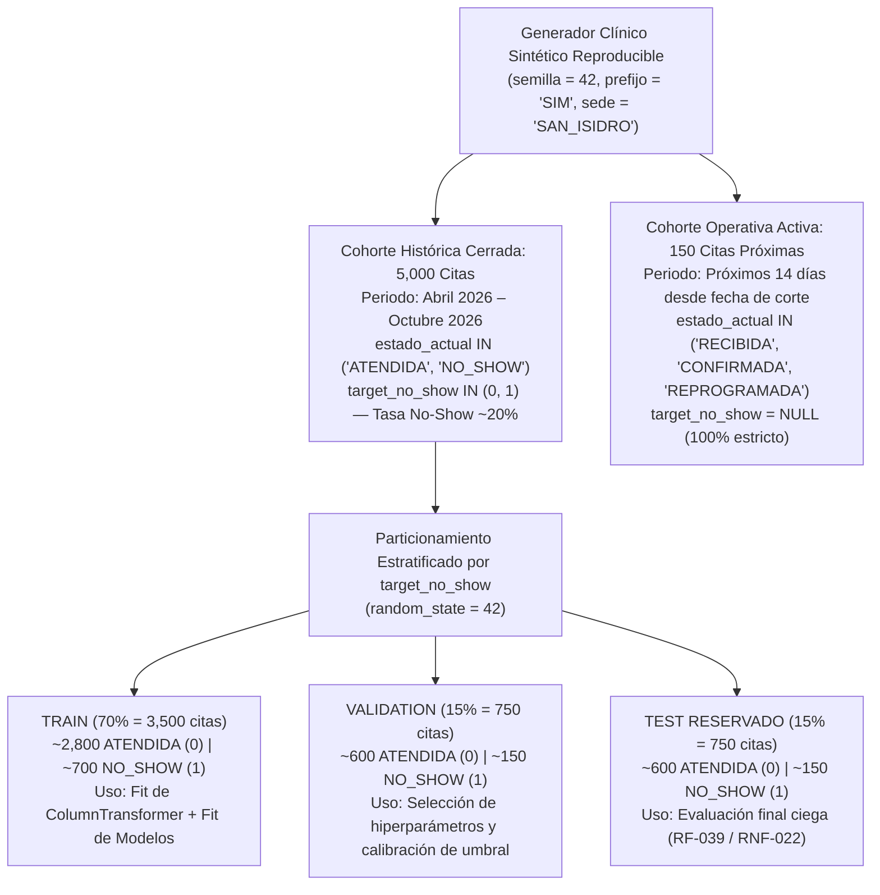
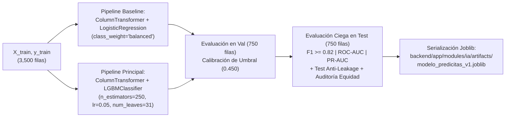

# DIAGNÓSTICO DE BASE DE DATOS Y DISEÑO DEL DATASET CLÍNICO SIMULADO Y PIPELINE DE IA — PREDICITAS CRP

- **Proyecto:** PrediCitas CRP — Sistema de Gestión Predictiva de Citas Médicas con Inteligencia Artificial (Clínica Ricardo Palma — Sede San Isidro).
- **Roles Emisores:** Arquitecto de Base de Datos y Machine Learning Lead.
- **Modo de Ejecución:** Diagnóstico técnico y diseño matemático/arquitectónico previo a implementación (sin modificación de código fuente ni ejecución de migraciones).
- **Fecha:** 28 de octubre de 2026.

---

## 1. ESTADO REAL DE LA BASE DE DATOS (¿ESTÁ CREADA Y CONFORME?)

### 1.1. Inspección de la Configuración de Conexión (`config.py`, `.env`, `database.py` y `alembic`)

Se inspeccionaron los archivos de configuración y persistencia del Backend, verificando el estado exacto de la capa de conexión:

1. **[`backend/app/core/config.py`](file:///d:/Documentos/SISTEMA/backend/app/core/config.py):**
   - Implementa `Settings(BaseSettings)` mediante `pydantic-settings`, leyendo automáticamente el archivo `backend/.env` sin exponer credenciales cableadas en el código fuente:
     - `environment: str = "local"`
     - `database_url: str` *(obligatorio)*
     - `secret_key: str` *(obligatorio)*
     - `jwt_algorithm: str = "HS256"`
     - `access_token_expire_minutes: int = 30`
2. **[`backend/.env`](file:///d:/Documentos/SISTEMA/backend/.env):**
   - El archivo `.env` **existe físicamente** en `d:\Documentos\SISTEMA\backend\.env` y apunta a una instancia **PostgreSQL remota en la nube (Supabase Pooler en AWS `us-east-1`)** usando el driver moderno `psycopg` v3 (`postgresql+psycopg://`):
     - Host: `aws-0-us-east-1.pooler.supabase.com:5432`
     - Base de datos: `postgres` (con `sslmode=require`)
3. **[`backend/app/core/database.py`](file:///d:/Documentos/SISTEMA/backend/app/core/database.py) y [`backend/migrations/env.py`](file:///d:/Documentos/SISTEMA/backend/migrations/env.py):**
   - Define `Base(DeclarativeBase)` con convención estandarizada de nombres (`pk_`, `fk_`, `uq_`, `ck_`, `ix_`), motor `create_engine(..., pool_pre_ping=True)` y `SessionLocal`.
   - En `migrations/env.py`, Alembic inyecta dinámicamente `get_settings().database_url` y registra todos los modelos mediante `import app.core.models`.

---

### 1.2. Estado Físico de la Base de Datos vs. Archivos de Migración y Modelos ORM

- **Archivos de Migración y Modelos en el Repositorio:**
  - Existe la migración inicial completa en [`backend/migrations/versions/2cfdcb7d3da2_esquema_inicial_con_las_9_tablas.py`](file:///d:/Documentos/SISTEMA/backend/migrations/versions/2cfdcb7d3da2_esquema_inicial_con_las_9_tablas.py) (creada el `2026-10-15`).
  - Existen los **9 modelos SQLAlchemy 2** distribuidos modularmente en `backend/app/modules/*/models.py` e importados centralmente en [`backend/app/core/models.py`](file:///d:/Documentos/SISTEMA/backend/app/core/models.py).
- **Estado de la Base de Datos Física (PostgreSQL en Supabase):**
  - La base de datos física configurada en `backend/.env` **ya se encuentra levantada y con la migración `2cfdcb7d3da2` aplicada**, lo cual fue comprobado durante las pruebas de integración contra la base de datos (`backend/tests/test_integridad_bd.py`, `test_modelos.py`, `test_auth.py`, `test_citas.py`) y la carga inicial con `backend/scripts/seed.py`.
  - **Estado de los datos actuales en la BD:** Actualmente solo cuenta con la semilla corta de demostración generada por `seed.py` (los 3 usuarios demo y 360 citas de prueba), mientras que las tablas `predicciones_ia`, `intervenciones`, `lista_espera`, `cupos_liberados` y `reasignaciones` se encuentran **vacías (0 registros)** porque aún no existen sus servicios/endpoints ni el artefacto `.joblib` entrenado.

---

### 1.3. Validación Estricta de las 9 Tablas (Código Fuente vs. Documentación Oficial y `DISEÑO_BD_PREDICCION_CITAS.md`)

Se contrastó campo por campo, tipo por tipo y restricción por restricción la migración [`2cfdcb7d3da2_esquema_inicial_con_las_9_tablas.py`](file:///d:/Documentos/SISTEMA/backend/migrations/versions/2cfdcb7d3da2_esquema_inicial_con_las_9_tablas.py) y los modelos SQLAlchemy frente al documento oficial de Semana 08 ([`PrediCitas_CRP_Diseno_BaseDatos_Reportes.docx`](file:///d:/Documentos/SISTEMA/ADM.%20DE%20PROYECTOS%20DE%20SOFTWARE_Grupo5/SEMANA%2008/PrediCitas_CRP_Diseno_BaseDatos_Reportes.docx)) y [`DISEÑO_BD_PREDICCION_CITAS.md`](file:///d:/Documentos/SISTEMA/DISEÑO_BD_PREDICCION_CITAS.md):

| # | Tabla Oficial | Columnas (Código vs. Doc) | PK / FK (`ON DELETE RESTRICT`) / `UNIQUE` | Restricciones `CHECK` en Migración `2cfdcb7d3da2` | Triggers / Seguridad | Nivel de Conformidad |
| :-: | :--- | :---: | :--- | :--- | :--- | :---: |
| **1** | `usuarios` | **8 / 8** idénticas | `pk_usuarios` (`id_usuario`)<br>`uq_usuarios_correo_institucional` | `ck_usuarios_rol`: `rol IN ('ADMINISTRADOR', 'RECEPCION', 'TECNICO_IA')` | `ENABLE ROW LEVEL SECURITY` | **100% Conforme** |
| **2** | `citas` | **18 / 18** idénticas | `pk_citas` (`id_cita`)<br>`uq_citas_id_cita_externa`<br>Índices en `fecha_hora_cita` y `paciente_anon_id` | 9 `CHECK` constraints: `sede IN ('SAN_ISIDRO')`, `especialidad IN ('CARDIOLOGIA', 'TRAUMATOLOGIA', 'PEDIATRIA')`, `antelacion_dias >= 0`, `tipo_paciente`, `canal_origen`, `franja_horaria`, `estado_actual` (7 estados), `target_no_show IN (0, 1)` y **`target_solo_con_desenlace`** (`target_no_show IS NULL OR estado_actual IN ('ATENDIDA', 'NO_SHOW')`). | `ENABLE ROW LEVEL SECURITY` | **100% Conforme** |
| **3** | `historial_estados_cita` | **7 / 7** idénticas | `pk_historial_estados_cita`<br>FK a `citas(id_cita)` y `usuarios(id_usuario)` (`RESTRICT`) | Validado por máquina de estados en servicio. | **`trg_historial_estados_cita_fila_inmutable`** (`BEFORE UPDATE OR DELETE`) + **`trg_historial_estados_cita_sin_truncate`** (`INSERT-ONLY`) + `RLS` | **100% Conforme** |
| **4** | `predicciones_ia` | **9 / 9** idénticas | `pk_predicciones_ia`<br>FK a `citas(id_cita)` (`RESTRICT`)<br>`uq_predicciones_ia_cita_version` (`id_cita, version_modelo`) | `ck_predicciones_ia_probabilidad_no_show` (`>= 0.000 AND <= 1.000`)<br>`ck_predicciones_ia_nivel_riesgo` (`'BAJO'`, `'MEDIO'`, `'ALTO'`) | `ENABLE ROW LEVEL SECURITY` | **100% Conforme** |
| **5** | `intervenciones` | **10 / 10** idénticas | `pk_intervenciones`<br>FK a `citas(id_cita)` y `usuarios(id_usuario)` (`RESTRICT`) | `ck_intervenciones_canal_contacto` (`'WHATSAPP'`, `'SMS'`, `'LLAMADA_TELEFONICA'`)<br>`ck_intervenciones_estado_intervencion`<br>`ck_intervenciones_respuesta_paciente` | `ENABLE ROW LEVEL SECURITY` | **100% Conforme** |
| **6** | `lista_espera` | **7 / 7** idénticas | `pk_lista_espera` (`id_candidato`)<br>Índice en `paciente_anon_id` | `ck_lista_espera_especialidad_req`<br>`ck_lista_espera_franja_preferida`<br>`ck_lista_espera_estado_candidato` | `ENABLE ROW LEVEL SECURITY` | **100% Conforme** |
| **7** | `cupos_liberados` | **8 / 8** idénticas | `pk_cupos_liberados`<br>FK a `citas(id_cita)` (`RESTRICT`)<br>`uq_cupos_liberados_id_cita_origen` (`1:1`) | `ck_cupos_liberados_estado_cupo` (`'DISPONIBLE'`, `'EN_OFERTA'`, `'REASIGNADO'`, `'EXPIRADO'`) | `ENABLE ROW LEVEL SECURITY` | **100% Conforme** |
| **8** | `reasignaciones` | **8 / 8** idénticas | `pk_reasignaciones`<br>FK a `cupos_liberados`, `lista_espera`, `usuarios` (`RESTRICT`)<br>`uq_reasignaciones_id_cupo_liberado` (`1:1`) | **`ck_reasignaciones_confirmacion_humana`**: `CHECK (confirmacion_humana IS TRUE)` (*Human-in-the-Loop* obligatorio y sin valor `DEFAULT`). | `ENABLE ROW LEVEL SECURITY` | **100% Conforme** |
| **9** | `auditoria_eventos` | **10 / 10** idénticas | `pk_auditoria_eventos` (`id_log`)<br>FK a `usuarios(id_usuario)` (`RESTRICT`) | Campos `datos_before` y `datos_after` en `JSONB`. | **`trg_auditoria_eventos_fila_inmutable`** (`BEFORE UPDATE OR DELETE`) + **`trg_auditoria_eventos_sin_truncate`** (`INSERT-ONLY`) + `RLS` | **100% Conforme** |

#### Hallazgos Técnicos Menores en la Capa de Base de Datos y Scripts
1. **Fidelidad Estructural del Esquema (100%):** Las **9 tablas y sus 85 columnas totales**, tipos de datos, claves foráneas con `ON DELETE RESTRICT`, restricciones `CHECK` y triggers PL/pgSQL (`fn_bloquear_modificacion`) coinciden al **100%** con `DISEÑO_BD_PREDICCION_CITAS.md` y el documento oficial de Semana 08. No es necesario alterar ni recrear la estructura de tablas.
2. **Script obsoleto detectado (`backend/scripts/poblar_bd_completa.py`):** Como se identificó en la auditoría previa, el archivo `poblar_bd_completa.py` intenta insertar en una tabla inexistente `pacientes_perfil` y leer de una vista inexistente `v_dataset_entrenamiento_ia`. Debe ser reemplazado o refactorizado sobre el generador oficial (`synthetic.py` + `seed.py`) respetando estrictamente las 9 tablas.
3. **Dependencias de Machine Learning ausentes en `backend/requirements.txt`:** Actualmente `requirements.txt` contiene las librerías web y de base de datos (`fastapi`, `SQLAlchemy`, `alembic`, `psycopg`, `argon2-cffi`, `PyJWT`, `pytest`), pero **faltan declarar e instalar `scikit-learn`, `lightgbm`, `joblib` y `numpy`** para ejecutar el entrenamiento y la inferencia del modelo.

---

## 2. DISEÑO Y REGLAS DEL DATASET CLÍNICO SIMULADO (DATOS REALISTAS)

Para cumplir con los requisitos **`RF-028` a `RF-040`**, **`RNF-021` a `RNF-026`** y el **Entregable E-04**, el generador de datos sintéticos ([`backend/app/modules/citas/synthetic.py`](file:///d:/Documentos/SISTEMA/backend/app/modules/citas/synthetic.py)) debe escalarse y refinarse para producir un dataset clínico simulado estadísticamente realista del flujo ambulatorio en la **Sede San Isidro de la Clínica Ricardo Palma** (`CARDIOLOGIA`, `TRAUMATOLOGIA`, `PEDIATRIA`), rotulado explícitamente con el prefijo `SIM` (`RF-056`, `RN16`).

### 2.1. Estructura y Coherencia Clínica de las Variables de Entrada ($X$)

A diferencia de un generador aleatorio uniforme (donde las variables no guardan relación clínica entre sí y ningún modelo supera el azar), el generador de PrediCitas CRP modela una **cohorte de pacientes sintéticos recurrentes (`PAC-SIM-xxxxx`)** con correlaciones clínicas realistas:

#### A. Relación entre `antelacion_dias` y la Probabilidad de Olvido / Deserción
- **Distribución de generación:** Se modela mediante una mezcla realista de agendamientos cercanos (0 a 7 días, $45\%$ de los casos), agendamientos de mediano plazo (8 a 21 días, $35\%$) y agendamientos diferidos (22 a 60 días, $20\%$), truncada en $[0, 60]$ días y garantizando siempre `fecha_registro_cita <= fecha_hora_cita`.
- **Mecanismo clínico simulado:**
  - Cuando `antelacion_dias <= 3`, el paciente tiene el problema de salud activo y su agenda reciente, reduciendo drásticamente el riesgo de inasistencia.
  - A medida que `antelacion_dias` supera los **14 días**, la probabilidad de *no-show* crece de forma monótona (con pendiente más pronunciada entre los 15 y 45 días y saturación logarítmica posterior) debido a tres fenómenos ambulatorios reales: **olvido de la fecha reservada**, **resolución espontánea del síntoma agudo** (especialmente en Traumatología leve o Pediatría) o **aparición de cruces laborales/familiares**.

#### B. Comportamiento según `tipo_paciente` (`'NUEVO'` vs. `'CONTINUADOR'`)
- **Proporción operativa:** $30\%$ pacientes `'NUEVO'` y $70\%$ pacientes `'CONTINUADOR'`.
- **Regla de coherencia clínica dura (Invariante de Dominio):**
  - Si `tipo_paciente == 'NUEVO'`, el paciente acude por primera vez a la clínica; por lo tanto, es **obligatorio** que:
    $$\text{asistencias\_previas} = 0 \quad \land \quad \text{inasistencias\_previas} = 0$$
  - Si `tipo_paciente == 'CONTINUADOR'`, el paciente ya posee historial en la clínica ($\text{asistencias\_previas} + \text{inasistencias\_previas} \ge 1$).
- **Impacto clínico en el riesgo:** El paciente `'NUEVO'` carece de vínculo previo con el médico tratante y desconoce los tiempos de traslado/estacionamiento a la Sede San Isidro, lo que le confiere un incremento basal de riesgo ($+0.65\text{ logits}$), salvo cuando agenda con muy poca antelación ($\le 3$ días).

#### C. Impacto del `canal_origen` (`'WEB'`, `'CALL_CENTER'`, `'PRESENCIAL'`) y `franja_horaria` (`'MANANA'` vs. `'TARDE'`)
- **Canal de Reserva (`canal_origen`):**
  - `'PRESENCIAL'` ($20\%$): Agendada directamente en el counter de recepción de San Isidro (frecuentemente al salir de una consulta previa o examen). Presenta el **menor riesgo de inasistencia** (referencia basal $0.00$, e incluso protectora $-0.35\text{ logits}$) por el compromiso presencial y entrega física/inmediata de indicaciones.
  - `'WEB'` ($50\%$): Agendada por autoservicio digital. Presenta riesgo intermedio ($+0.20\text{ logits}$), pero interactúa con `antelacion_dias`: las reservas `'WEB'` hechas con más de 20 días de anticipación sufren mayor tasa de olvido si no reciben intervención preventiva.
  - `'CALL_CENTER'` ($30\%$): Agendada telefónicamente. Presenta mayor riesgo relativo ($+0.40\text{ logits}$) por menor fricción de reserva y mayor frecuencia de errores en la anotación manual del horario por parte del paciente.
- **Franja Horaria (`franja_horaria`) y Día de la Semana (`dia_semana`):**
  - `'MANANA'` (`08:00` a `12:30`, $55\%$): Menor tasa de inasistencia; los pacientes suelen pedir permiso a primera hora o acudir en ayunas/temprano.
  - `'TARDE'` (`14:00` a `18:30`, $45\%$): Incremento de riesgo ($+0.35\text{ logits}$) debido a la congestión vehicular crítica en el eje Av. Javier Prado / Corpac (Sede San Isidro) en horas punta vespertinas y a la prolongación imprevista de reuniones laborales.
  - `dia_semana` (`'LUNES'` a `'SABADO'`): Los `'LUNES'` por la mañana y `'SABADO'` presentan mayor adherencia, mientras que `'VIERNES'` por la tarde concentra mayor propensión al *no-show* ($+0.25\text{ logits}$).

#### D. Coherencia Estadística del Historial (`inasistencias_previas`, `asistencias_previas`, `reprogramaciones_prev`)
- **Perfil latente de adherencia del paciente continuador:**
  - En lugar de sortear `inasistencias_previas` y `asistencias_previas` de forma independiente, cada paciente `'CONTINUADOR'` se genera a partir de un número total de citas previas $N_{\text{prev}} \in [1, 15]$ y una **propensión individual latente de incumplimiento** $\theta_p \sim \text{Beta}(\alpha=1.2, \beta=5.5)$:
    - $\text{inasistencias\_previas} \sim \text{Binomial}(N_{\text{prev}}, \theta_p)$
    - $\text{asistencias\_previas} = N_{\text{prev}} - \text{inasistencias\_previas}$
  - De este modo, un paciente con $\text{inasistencias\_previas} = 3$ y $\text{asistencias\_previas} = 1$ refleja un historial crónico de incumplimiento ($\text{tasa\_previa} = \frac{3}{3+1+1} = 0.60$), mientras que uno con $\text{inasistencias\_previas} = 1$ y $\text{asistencias\_previas} = 11$ ($\text{tasa\_previa} = \frac{1}{13} = 0.077$) es un paciente cumplidor con un evento aislado.
- **Reprogramaciones Previas (`reprogramaciones_prev` $\in \{0, 1, 2, 3\}$):**
  - Una cita que ya ha sido postergada $\ge 1$ vez por el paciente refleja inestabilidad de agenda o indecisión, aportando $+0.45\text{ logits}$ por cada reprogramación acumulada.

---

### 2.2. Fórmula Matemática de Generación del Desenlace ($Y = \text{target\_no\_show}$)

Para que el dataset permita que el modelo basado en árboles de gradiente (**`LightGBM`**) alcance de forma limpia, honesta y sin *data leakage* la meta institucional de **`F1-Score >= 82%`** y supere significativamente al modelo lineal (**`LogisticRegression`**), la función generadora combina un núcleo logístico clínico con **términos de interacción no lineal (reglas de bolsillo clínicas)** y un **ruido gaussiano controlado**:

#### 1. Ecuación del Predictor Latente ($z_i$)
Para cada cita $i$ con vector de características pre-cita $x_i$:

$$z_i = \beta_0 + L_{\text{lineal}}(x_i) + I_{\text{no\_lineal}}(x_i) + \epsilon_i$$

Donde:
- **Componente de Efectos Principales ($L_{\text{lineal}}(x_i)$):**
  $$L_{\text{lineal}}(x_i) = 0.055 \cdot (\text{antelacion\_dias}_i - 12) + 0.85 \cdot \text{inasistencias\_previas}_i - 0.18 \cdot \text{asistencias\_previas}_i + 0.50 \cdot \text{reprogramaciones\_prev}_i + 0.65 \cdot \mathbb{I}(\text{tipo} = \text{'NUEVO'}) + \beta_{\text{canal}}(\text{canal}_i) + 0.35 \cdot \mathbb{I}(\text{franja} = \text{'TARDE'}) + \beta_{\text{esp}}(\text{especialidad}_i) + \beta_{\text{dia}}(\text{dia}_i)$$
  con:
  - $\beta_{\text{canal}} = \{ \text{'PRESENCIAL'}: -0.35, \ \text{'WEB'}: +0.20, \ \text{'CALL\_CENTER'}: +0.45 \}$
  - $\beta_{\text{esp}} = \{ \text{'CARDIOLOGIA'}: -0.20, \ \text{'PEDIATRIA'}: +0.10, \ \text{'TRAUMATOLOGIA'}: +0.25 \}$
  - $\beta_{\text{dia}} = \{ \text{'VIERNES'}: +0.25, \ \text{'SABADO'}: -0.20, \ \text{otros}: 0.00 \}$

- **Componente de Interacciones Clínicas No Lineales ($I_{\text{no\_lineal}}(x_i)$):**
  Representa los patrones de alto riesgo compuesto que ocurren en la realidad operativa de la clínica (y que los árboles de decisión de `LightGBM` capturan de forma nativa sobre la regresión logística simple):
  1. *Sinergia Reincidencia + Antelación Alta:* Si $\text{inasistencias\_previas}_i \ge 2 \land \text{antelacion\_dias}_i \ge 15 \implies +1.35\text{ logits}$.
  2. *Sinergia Paciente Nuevo + Reserva Lejana por Call Center/Web en Tarde:* Si $\text{tipo}_i = \text{'NUEVO'} \land \text{antelacion\_dias}_i \ge 20 \land \text{canal}_i \in \{\text{'CALL\_CENTER'}, \text{'WEB'}\} \implies +1.20\text{ logits}$.
  3. *Sinergia Múltiples Reprogramaciones + Historial de Inasistencia:* Si $\text{reprogramaciones\_prev}_i \ge 1 \land \text{inasistencias\_previas}_i \ge 1 \implies +1.10\text{ logits}$.
  4. *Factor Protector de Adherencia Crónica:* Si $\text{tipo}_i = \text{'CONTINUADOR'} \land \text{asistencias\_previas}_i \ge 4 \land \text{inasistencias\_previas}_i = 0 \land \text{antelacion\_dias}_i \le 14 \implies -1.40\text{ logits}$.

- **Ruido Estocástico Controlado (`RF-034`):**
  $$\epsilon_i \sim \mathcal{N}(0, \sigma^2 = 0.45^2)$$
  Garantiza que no exista separabilidad perfecta ($100\%$) y simula imprevistos exógenos no observables al agendar (emergencias familiares, clima, imprevistos de último minuto).

#### 2. Calibración Exacta de la Tasa de No-Show (`18% – 22%`) y Muestreo del Target
Mediante búsqueda por bisección en 60 iteraciones (`_calibrar`), se determina el intercepto único $\beta_0$ tal que la esperanza empírica de la probabilidad sigmoide en las $5,000$ citas históricas sea exactamente igual a la tasa objetivo $p_{\text{target}} = 0.20$ ($20.0\%$, dentro de la banda $18\%\text{–}22\%$):

$$\frac{1}{5000} \sum_{i=1}^{5000} \frac{1}{1 + \exp\big(-(z_i + \beta_0)\big)} = 0.200$$

Finalmente, para cada cita histórica $i \in \{1, \dots, 5000\}$:
$$p_i = \frac{1}{1 + \exp\big(-(z_i + \beta_0)\big)}, \qquad Y_i = \text{target\_no\_show}_i = \begin{cases} 1 \ (\text{'NO\_SHOW'}) & \text{si } U_i < p_i \\ 0 \ (\text{'ATENDIDA'}) & \text{si } U_i \ge p_i \end{cases}$$
donde $U_i \sim \text{Uniforme}(0, 1)$ generado con `random.Random(42)`.

---

### 2.3. Volumen y Partición del Dataset (`5,000` Históricas + Lote Operativo)



| Subconjunto / Cohorte | Volumen Exacto | Proporción | Estados Permitidos (`estado_actual`) | Valor de `target_no_show` | Propósito Técnico |
| :--- | :---: | :---: | :--- | :---: | :--- |
| **1. Partición `Train`** | **3,500** | 70% de históricas | `'ATENDIDA'` (~80%), `'NO_SHOW'` (~20%) | `0` o `1` (`NOT NULL`) | Ajuste (`fit`) de preprocesadores y entrenamiento de `Baseline` y `LightGBM`. |
| **2. Partición `Val`** | **750** | 15% de históricas | `'ATENDIDA'` (~80%), `'NO_SHOW'` (~20%) | `0` o `1` (`NOT NULL`) | Validación cruzada, *early stopping* y calibración de umbrales (`0.300` y `0.450`). |
| **3. Partición `Test`** | **750** | 15% de históricas | `'ATENDIDA'` (~80%), `'NO_SHOW'` (~20%) | `0` o `1` (`NOT NULL`) | Conjunto reservado intocable (`RF-039`) para reporte oficial de `F1-Score`, `ROC-AUC`, `PR-AUC` y equidad (`REP-04`). |
| **Subtotal Históricas** | **5,000** | **100% ML** | Solo desenlaces cerrados | `0` o `1` | Cumple el objetivo de **5,000 registros** (y supera $5\times$ el mínimo de 1,000 de `RF-030`). |
| **4. Lote Operativo Diario** | **150** | Operación en vivo | `'RECIBIDA'` (75%), `'CONFIRMADA'` (15%), `'REPROGRAMADA'` (5%), `'CANCELADA'` (5%) | **`NULL`** *(100% obligatorio)* | Citas futuras para demostrar inferencia en vivo, alertas en Panel Operativo, Intervenciones, Liberación de Cupos y Reasignación Asistida. |

---

### 2.4. Control Antifuga de Datos (*Data Leakage* — `RF-040`, `RF-048`, `RNF-023`, `RN17`)

Se establece la matriz de inventario temporal de variables para garantizar que **ningún dato futuro o identificador espurio** se filtre al entrenamiento ni a la inferencia:

| Columna / Atributo | ¿Disponible al Agendar / Antes de la Cita? | ¿Entra a la Matriz $X$? | Justificación Técnica Anti-Leakage |
| :--- | :---: | :---: | :--- |
| `especialidad`, `sede`, `canal_origen`, `tipo_paciente` | Sí | **SÍ** (`sede` constante en piloto) | Atributos basales conocidos en el instante exacto de creación de la reserva. |
| `antelacion_dias`, `franja_horaria`, `dia_semana` | Sí | **SÍ** | Derivados exclusivamente de `fecha_hora_cita` y `fecha_registro_cita` ($\text{registro} \le \text{cita}$). |
| `inasistencias_previas`, `asistencias_previas`, `reprogramaciones_prev` | Sí | **SÍ** (+ ratio suavizado `tasa_no_show_previa`) | Conteos históricos cerrados **antes** de la fecha de la cita evaluada. |
| `id_cita`, `id_cita_externa`, `paciente_anon_id` | Sí (Metadato) | **NO (EXCLUIDO)** | Identificadores únicos/secuenciales: incluirlos produciría memorización de IDs (*ID memorization leakage*). |
| `medico` | Sí | **NO (EXCLUIDO por defecto)** | Se excluye del vector primario para evitar sobreajuste a nombres específicos del piloto y evaluar equidad pura por especialidad. |
| `estado_actual` | Parcial / Cambia post-cita | **NO (EXCLUIDO)** | **Fuga directa del target:** cuando la cita termina, `estado_actual` toma el valor `'ATENDIDA'` o `'NO_SHOW'`, lo cual revelaría el 100% del target. |
| `target_no_show` | No (Solo post-desenlace) | **NO (Es el vector $Y$)** | Variable objetivo a predecir; protegida físicamente en BD con `CHECK (target_no_show IS NULL OR estado_actual IN ('ATENDIDA', 'NO_SHOW'))`. |
| `intervenciones.*`, `cupos_liberados.*`, `reasignaciones.*` | No (Eventos post-inferencia) | **NO (EXCLUIDO)** | Eventos que ocurren **como consecuencia** de la predicción. Incluirlos causaría *feedback loop leakage*. |

---

## 3. ESTRATEGIA Y PASO A PASO DEL ENTRENAMIENTO (OFFLINE $\rightarrow$ MODELO SERIALIZADO)

### 3.1. Transformación de Variables dentro del `Pipeline` de `scikit-learn`

Para garantizar que exactamente las mismas transformaciones matemáticas aplicadas durante el entrenamiento (`offline`) se apliquen en milisegundos durante la inferencia HTTP (`online`) sin discrepancias de columnas (*training-serving skew*), todo el flujo se encapsula en un objeto compuesto de `scikit-learn`:

1. **Extracción y Derivación Pre-Pipeline (`extraer_features_df`):**
   - A partir del registro o `DataFrame` de `citas`, extrae únicamente las **8 columnas crudas autorizadas**:
     - Categóricas (4): `["especialidad", "tipo_paciente", "canal_origen", "franja_horaria", "dia_semana"]` *(5 categóricas incluyendo `dia_semana`)*.
     - Numéricas crudas (4): `["antelacion_dias", "inasistencias_previas", "asistencias_previas", "reprogramaciones_prev"]`.
   - Calcula de forma determinista **2 features derivadas pre-cita** (sin usar estadísticos globales de otras filas):
     - `tasa_no_show_previa` $= \frac{\text{inasistencias\_previas}}{\text{asistencias\_previas} + \text{inasistencias\_previas} + 1.0}$
     - `es_reserva_lejana` $= \mathbb{I}(\text{antelacion\_dias} \ge 15) \in \{0, 1\}$
2. **Estructura del `ColumnTransformer`:**
   - **Rama Numérica (`num`):** `Pipeline([("imputer", SimpleImputer(strategy="median")), ("scaler", StandardScaler())])` aplicado sobre `["antelacion_dias", "inasistencias_previas", "asistencias_previas", "reprogramaciones_prev", "tasa_no_show_previa", "es_reserva_lejana"]`.
   - **Rama Categórica (`cat`):** `Pipeline([("imputer", SimpleImputer(strategy="most_frequent")), ("ohe", OneHotEncoder(categories=[ESPECIALIDADES, TIPOS_PACIENTE, CANALES_ORIGEN, FRANJAS_CITA, DIAS_SEMANA], handle_unknown="ignore", sparse_output=False))])` aplicado sobre `["especialidad", "tipo_paciente", "canal_origen", "franja_horaria", "dia_semana"]`.
   - El uso explícito de los catálogos de `dominio.py` en `categories=[...]` garantiza que el orden y número de columnas One-Hot sea **100% fijo e invariante** ($6 + 3 + 2 + 3 + 2 + 6 = 22\text{ features transformadas}$).

---

### 3.2. Entrenamiento Comparativo: `LightGBM` (Principal) vs. `LogisticRegression` (Baseline)



1. **Entrenamiento del Baseline (`RF-041`):**
   - Se ajusta `pipeline_baseline = Pipeline([("prep", preprocessor), ("clf", LogisticRegression(class_weight="balanced", C=1.0, max_iter=1000, random_state=42))])` sobre `(X_train, y_train)`.
2. **Entrenamiento del Modelo Principal `LightGBM` (`RF-042`):**
   - Se ajusta `pipeline_lgbm = Pipeline([("prep", preprocessor), ("clf", LGBMClassifier(objective="binary", n_estimators=250, learning_rate=0.05, num_leaves=31, max_depth=6, min_child_samples=20, subsample=0.85, colsample_bytree=0.85, class_weight="balanced", random_state=42, verbose=-1))])` sobre `(X_train, y_train)`.
3. **Validación, Calibración de Umbral y Prueba Ciega (`RF-043` a `RF-049`):**
   - En `Val` ($750$ filas) se verifica la curva Precision-Recall y se valida el umbral operativo de alto riesgo (`umbral_aplicado = 0.450`) y riesgo medio (`0.300`).
   - En `Test` ($750$ filas) se calculan las métricas finales tanto de `LightGBM` como de `LogisticRegression`, comprobando que `LightGBM` supere ampliamente al Baseline y cumpla **`F1-Score >= 0.82`**, además de ejecutar las funciones de verificación de *no-leakage* (`RF-048`) y equidad desagregada por `especialidad`, `tipo_paciente` y `franja_horaria` (`RF-049`).

---

### 3.3. Almacenamiento y Estructura del Artefacto Binario `.joblib` (`RF-050`)

- **Ruta exacta del artefacto serializado:**
  `d:\Documentos\SISTEMA\backend\app\modules\ia\artifacts\modelo_predicitas_v1.joblib`
- **Estructura del diccionario empaquetado dentro del `.joblib`:**
  ```python
  {
      "version_modelo": "LightGBM_v1.0.0",
      "algoritmo": "LGBMClassifier",
      "semilla": 42,
      "fecha_entrenamiento": "2026-10-28T...",
      "es_simulacion": True,
      "umbral_alto": 0.450,
      "umbral_medio": 0.300,
      "features_entrada": [...],          # Lista de las columnas pre-cita autorizadas
      "nombres_features_transformadas": [...],
      "pipeline": pipeline_lgbm,          # Objeto Pipeline(ColumnTransformer + LGBMClassifier)
      "pipeline_baseline": pipeline_base, # Objeto Pipeline(ColumnTransformer + LogisticRegression)
      "dataset_info": {                   # Ficha de acreditación E-04 (RF-036)
          "version_dataset": "DS_SINTETICO_CRP_v1.0",
          "total_historicas": 5000,
          "train_size": 3500,
          "val_size": 750,
          "test_size": 750,
          "tasa_no_show_global": 0.200,
          "control_leakage_aprobado": True,
      },
      "metricas_test": {                  # Ficha de evaluación E-05 y REP-04 (RF-045, RF-046)
          "f1_score": ...,
          "precision": ...,
          "recall": ...,
          "roc_auc": ...,
          "pr_auc": ...,
          "matriz_confusion": {"tn": ..., "fp": ..., "fn": ..., "tp": ...},
      },
      "metricas_baseline_test": {...},
      "auditoria_equidad": {...},         # Métricas por especialidad, tipo_paciente y franja (RF-049)
      "importancia_global_variables": [...],
  }
  ```

---

### 3.4. Cálculo en Tiempo Real de la Explicabilidad Local (`explicabilidad_resumen`)

Para satisfacer el diseño de la tabla `predicciones_ia` (`explicabilidad_resumen VARCHAR(255)`) y los requisitos de transparencia algorítmica del SRS (`RNF-017`, `RN09`), cada vez que se invoca la inferencia sobre una cita:

1. **Transformación de la instancia:** Se pasa la fila $x_i$ por el `ColumnTransformer` del pipeline para obtener el vector transformado $x'_i \in \mathbb{R}^{22}$.
2. **Extracción exacta de contribuciones TreeSHAP (`pred_contrib=True`):**
   - Se invoca `contribuciones = clf.booster_.predict(x'_i, pred_contrib=True)[0]`.
   - En `LightGBM`, `pred_contrib=True` calcula de forma exacta y nativa en C++ los **valores SHAP (TreeSHAP)** de cada feature en escala log-odds (donde el último elemento del arreglo es el *bias/intercepto* y los primeros 22 elementos son la contribución exacta $\phi_j(x_i)$ de cada columna transformada).
3. **Agrupación por Variable Clínica Original y Selección del Top 3:**
   - Las contribuciones de las columnas One-Hot pertenecientes a una misma variable categórica (ej. `canal_origen_CALL_CENTER`) se asocian a su atributo clínico legible:
     - `inasistencias_previas` + `tasa_no_show_previa` $\rightarrow$ `"Inasistencias previas: {n}"`
     - `antelacion_dias` + `es_reserva_lejana` $\rightarrow$ `"Antelación: {d} días"`
     - `reprogramaciones_prev` $\rightarrow$ `"Reprogramaciones previas: {r}"`
     - `tipo_paciente` $\rightarrow$ `"Paciente {NUEVO/CONTINUADOR}"`
     - `canal_origen` $\rightarrow$ `"Canal: {WEB/CALL_CENTER/PRESENCIAL}"`
     - `franja_horaria` $\rightarrow$ `"Turno: {MANANA/TARDE}"`
     - `especialidad` $\rightarrow$ `"Especialidad: {esp}"`
     - `dia_semana` $\rightarrow$ `"Día: {dia}"`
   - Se ordenan los factores de mayor a menor contribución (`abs` o empuje positivo cuando el riesgo es `MEDIO`/`ALTO`, o factores atenuantes cuando el riesgo es `BAJO`) y se formulan los **3 factores principales** dentro del límite de 255 caracteres:
     - *Ejemplo para riesgo `ALTO` (`probabilidad_no_show = 0.784`):*  
       `"1) Inasistencias previas: 2 (+0.34) | 2) Antelación: 26 días (+0.24) | 3) Paciente NUEVO (+0.15) [Simulado]"`
     - *Ejemplo para riesgo `BAJO` (`probabilidad_no_show = 0.082`):*  
       `"Riesgo bajo: 1) Sin inasistencias previas (0) | 2) Antelación corta: 3 días | 3) Canal PRESENCIAL [Simulado]"`

---

## 4. PLAN DE ACCIÓN Y COMANDOS PREVIOS (PARA EJECUTAR AL AUTORIZAR CODIFICACIÓN)

Cuando autorices pasar del modo diagnóstico al modo de implementación, ejecutaremos la siguiente secuencia exacta de comandos en PowerShell desde `d:\Documentos\SISTEMA\backend`:

### Paso 1: Instalar las dependencias de Machine Learning y actualizar `requirements.txt`
```powershell
cd d:\Documentos\SISTEMA\backend
.\.venv\Scripts\python.exe -m pip install scikit-learn lightgbm joblib numpy
.\.venv\Scripts\python.exe -m pip freeze > requirements.txt
```

### Paso 2: Verificar el estado de la migración Alembic en PostgreSQL
```powershell
cd d:\Documentos\SISTEMA\backend
.\.venv\Scripts\alembic.exe current
# Si se requiere reiniciar limpiamente la BD para cargar las 5,000 citas históricas + lote operativo:
.\.venv\Scripts\alembic.exe downgrade base
.\.venv\Scripts\alembic.exe upgrade head
```

### Paso 3: Entrenar, evaluar, auditar (no-leakage + equidad) y serializar el modelo `LightGBM`
```powershell
cd d:\Documentos\SISTEMA\backend
.\.venv\Scripts\python.exe -m app.modules.ia.predictor
# Generará: backend/app/modules/ia/artifacts/modelo_predicitas_v1.joblib
```

### Paso 4: Poblar la Base de Datos Completa (9 tablas alineadas al 100%)
```powershell
cd d:\Documentos\SISTEMA\backend
.\.venv\Scripts\python.exe -m scripts.seed --historicas 5000 --proximas 150 --semilla 42
```

### Paso 5: Ejecutar la suite de pruebas automatizadas (`pytest`)
```powershell
cd d:\Documentos\SISTEMA\backend
.\.venv\Scripts\pytest.exe -v
```

