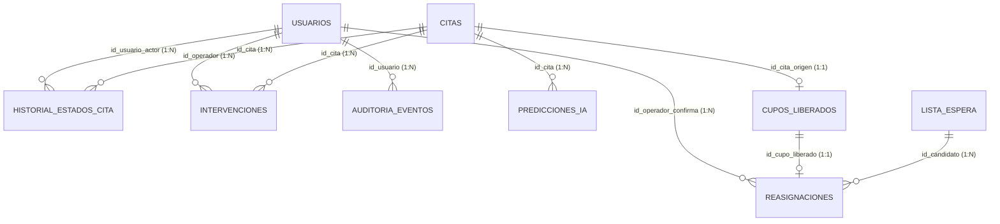

# Especificación Técnica de Base de Datos — PrediCitas CRP

- **Documento Origen Oficial:** `D:\Documentos\SISTEMA\ADM. DE PROYECTOS DE SOFTWARE_Grupo5\SEMANA 08\PrediCitas_CRP_Diseno_BaseDatos_Reportes.docx` (Versión V1.0 — Fecha de aprobación: `04/10/2026`, Sesión 07 / Semana 08).
- **Materialización Técnica en Código:** `D:\Documentos\SISTEMA\backend\migrations\versions\2cfdcb7d3da2_esquema_inicial_con_las_9_tablas.py` y modelos SQLAlchemy 2 en `D:\Documentos\SISTEMA\backend\app\modules\`.
- **Motor Relacional:** PostgreSQL 16 (Esquema normalizado en Tercera Forma Normal — 3FN).

---

## 1. Diccionario de Datos y Estructura de Tablas

### 1.1. Tabla `usuarios`
- **Ámbito:** Gestión de Usuarios y Roles (entidad 1 de 9)
- **Propósito:** Gestión de cuentas internas, credenciales criptográficas (bcrypt/Argon2) y control de acceso basado en roles (RBAC: Administrador, Recepción, Técnico IA).

| Campo | Tipo de Dato | Longitud | Clave / Restricción | Descripción |
| :--- | :--- | :--- | :--- | :--- |
| `id_usuario` | `BIGSERIAL` | 8 bytes | `PK`, `NOT NULL` | Identificador único secuencial de la cuenta de usuario interno. |
| `nombre_completo` | `VARCHAR(120)` | 120 | `NOT NULL` | Nombres y apellidos completos del colaborador. |
| `correo_institucional` | `VARCHAR(100)` | 100 | `UQ`, `NOT NULL` | Correo electrónico institucional corporativo para autenticación. |
| `password_hash` | `VARCHAR(255)` | 255 | `NOT NULL` | Hash criptográfico seguro de la contraseña (Argon2 / bcrypt). |
| `rol` | `VARCHAR(30)` | 30 | `NOT NULL`, `CHECK (rol IN ('ADMINISTRADOR', 'RECEPCION', 'TECNICO_IA'))` | Rol RBAC asignado: `'ADMINISTRADOR'`, `'RECEPCION'`, `'TECNICO_IA'`. |
| `activo` | `BOOLEAN` | 1 byte | `NOT NULL`, `DEFAULT TRUE` | Estado lógico de la cuenta (permite baja lógica sin borrado físico). |
| `creado_en` | `TIMESTAMPTZ` | 8 bytes | `NOT NULL`, `DEFAULT NOW()` | Fecha y hora exacta de registro del usuario con zona horaria. |
| `actualizado_en` | `TIMESTAMPTZ` | 8 bytes | `NULL` | Fecha y hora de última modificación del perfil. |

---

### 1.2. Tabla `citas`
- **Ámbito:** Recepción e Incorporación de Citas del Piloto (entidad 2 de 9)
- **Propósito:** Entidad central que incorpora citas externas al piloto, almacenando identificadores, datos clínicos básicos, tiempos de antelación y variables basales para IA, gobernada estrictamente por el ciclo de 7 estados operativos: `RECIBIDA`, `CONFIRMADA`, `REPROGRAMADA`, `CANCELADA`, `LIBERADA`, `ATENDIDA` y `NO_SHOW`.

| Campo | Tipo de Dato | Longitud | Clave / Restricción | Descripción |
| :--- | :--- | :--- | :--- | :--- |
| `id_cita` | `BIGSERIAL` | 8 bytes | `PK`, `NOT NULL` | Identificador primario interno de la cita en PrediCitas. |
| `id_cita_externa` | `VARCHAR(50)` | 50 | `UQ`, `NOT NULL` | Identificador único originado en el sistema externo de agendamiento/HIS. |
| `paciente_anon_id` | `VARCHAR(50)` | 50 | `NOT NULL`, `INDEX` | Identificador seudonimizado del paciente (cumplimiento Ley Protección Datos). |
| `sede` | `VARCHAR(50)` | 50 | `NOT NULL`, `CHECK (sede IN ('SAN_ISIDRO'))` | Sede de atención médica. Restringido a `'SAN_ISIDRO'` para el piloto. |
| `especialidad` | `VARCHAR(50)` | 50 | `NOT NULL`, `CHECK (especialidad IN ('CARDIOLOGIA', 'TRAUMATOLOGIA', 'PEDIATRIA'))` | Especialidad autorizada: `'CARDIOLOGIA'`, `'TRAUMATOLOGIA'`, `'PEDIATRIA'`. |
| `medico` | `VARCHAR(100)` | 100 | `NOT NULL` | Nombre del médico especialista asignado en la cita externa. |
| `fecha_hora_cita` | `TIMESTAMPTZ` | 8 bytes | `NOT NULL`, `INDEX` | Fecha y hora programada para la consulta médica. |
| `fecha_registro_cita` | `TIMESTAMPTZ` | 8 bytes | `NOT NULL` | Momento en que se generó la cita externa (para cálculo de antelación). |
| `antelacion_dias` | `INTEGER` | 4 bytes | `NOT NULL`, `CHECK (antelacion_dias >= 0)` | Variable de IA: Días transcurridos entre agendamiento y fecha de la cita. |
| `tipo_paciente` | `VARCHAR(20)` | 20 | `NOT NULL`, `CHECK (tipo_paciente IN ('NUEVO', 'CONTINUADOR'))` | Variable de IA: Tipo de afiliado: `'NUEVO'` o `'CONTINUADOR'`. |
| `canal_origen` | `VARCHAR(30)` | 30 | `NOT NULL`, `CHECK (canal_origen IN ('WEB', 'CALL_CENTER', 'PRESENCIAL'))` | Variable de IA: Canal de reserva: `'WEB'`, `'CALL_CENTER'`, `'PRESENCIAL'`. |
| `franja_horaria` | `VARCHAR(20)` | 20 | `NOT NULL`, `CHECK (franja_horaria IN ('MANANA', 'TARDE'))` | Variable de IA: Franja del turno médico: `'MANANA'`, `'TARDE'`. |
| `dia_semana` | `VARCHAR(15)` | 15 | `NOT NULL` | Variable de IA: Día de la consulta: `'LUNES'`, `'MARTES'`, ..., `'SABADO'`. |
| `inasistencias_previas` | `INTEGER` | 4 bytes | `NOT NULL`, `DEFAULT 0` | Variable de IA: Conteo histórico acumulado de no-shows del paciente. |
| `reprogramaciones_prev` | `INTEGER` | 4 bytes | `NOT NULL`, `DEFAULT 0` | Variable de IA: Número de veces que esta cita fue reprogramada. |
| `asistencias_previas` | `INTEGER` | 4 bytes | `NOT NULL`, `DEFAULT 0` | Variable de IA: Citas a las que el paciente sí asistió formalmente. |
| `estado_actual` | `VARCHAR(30)` | 30 | `NOT NULL`, `CHECK (estado_actual IN ('RECIBIDA', 'CONFIRMADA', 'REPROGRAMADA', 'CANCELADA', 'LIBERADA', 'ATENDIDA', 'NO_SHOW'))` | Estado operativo actual de la cita dentro del flujo del piloto. |
| `target_no_show` | `SMALLINT` | 2 bytes | `NULL`, `CHECK (target_no_show IN (0, 1))`, `CHECK (target_no_show IS NULL OR estado_actual IN ('ATENDIDA', 'NO_SHOW'))` | Desenlace final real (`0` = Asistió, `1` = No asistió). `NULL` hasta desenlace. |

---

### 1.3. Tabla `historial_estados_cita`
- **Ámbito:** Trazabilidad y Línea de Tiempo (entidad 3 de 9)
- **Propósito:** Registro cronológico e inmutable (`INSERT-ONLY`) de transiciones de estado de la cita, asegurando la trazabilidad de cualquier cambio entre los estados operativos válidos.

| Campo | Tipo de Dato | Longitud | Clave / Restricción | Descripción |
| :--- | :--- | :--- | :--- | :--- |
| `id_historial` | `BIGSERIAL` | 8 bytes | `PK`, `NOT NULL` | Clave primaria secuencial del registro histórico. |
| `id_cita` | `BIGINT` | 8 bytes | `FK`, `NOT NULL`, `INDEX` | Referencia obligatoria a la tabla `citas` (`citas.id_cita`). |
| `id_usuario_actor` | `BIGINT` | 8 bytes | `FK`, `NULL` | Usuario que ejecutó la transición de estado (`NULL` si es evento externo). |
| `estado_anterior` | `VARCHAR(30)` | 30 | `NULL` | Estado previo de la cita antes de la transición. |
| `estado_nuevo` | `VARCHAR(30)` | 30 | `NOT NULL` | Nuevo estado asignado tras la operación. |
| `motivo_cambio` | `VARCHAR(255)` | 255 | `NULL` | Justificación u observación del cambio de estado. |
| `fecha_hora_evento` | `TIMESTAMPTZ` | 8 bytes | `NOT NULL`, `DEFAULT NOW()` | Sello de tiempo exacto e inalterable en que ocurrió la transición. |

---

### 1.4. Tabla `predicciones_ia`
- **Ámbito:** Inferencia y Resultados del Motor Predictivo (entidad 4 de 9)
- **Propósito:** Almacena los resultados de inferencia del modelo predictivo, registrando probabilidad, score, clasificación de riesgo, umbral aplicado, snapshot de variables de entrada y el resumen desnormalizado de explicabilidad.

| Campo | Tipo de Dato | Longitud | Clave / Restricción | Descripción |
| :--- | :--- | :--- | :--- | :--- |
| `id_prediccion` | `BIGSERIAL` | 8 bytes | `PK`, `NOT NULL` | Identificador único de la inferencia predictiva ejecutada. |
| `id_cita` | `BIGINT` | 8 bytes | `FK`, `NOT NULL`, `UQ (id_cita, version_modelo)` | Referencia a la cita evaluada (`citas.id_cita`). Una cita puede conservar predicciones de distintas versiones del modelo. |
| `version_modelo` | `VARCHAR(30)` | 30 | `NOT NULL`, `UQ (id_cita, version_modelo)` | Versión técnica del modelo desplegado (ej. `'LightGBM_v1.0.0'`). Forma, junto con `id_cita`, una restricción `UNIQUE` compuesta. |
| `probabilidad_no_show` | `NUMERIC(4,3)` | 4 bytes | `NOT NULL`, `CHECK (probabilidad_no_show >= 0.000 AND probabilidad_no_show <= 1.000)` | Score continuo calculado de probabilidad de inasistencia (`0.000` a `1.000`). |
| `nivel_riesgo` | `VARCHAR(20)` | 20 | `NOT NULL`, `CHECK (nivel_riesgo IN ('BAJO', 'MEDIO', 'ALTO'))` | Categorización operativa: `'BAJO'` (<0.30), `'MEDIO'` (0.30–0.45), `'ALTO'` (>0.45). |
| `umbral_aplicado` | `NUMERIC(4,3)` | 4 bytes | `NOT NULL` | Valor de corte (threshold) activo al momento de inferir. |
| `features_snapshot` | `JSONB` | Variable | `NOT NULL` | Copia inmutable de los datos de entrada usados al momento de predecir. |
| `explicabilidad_resumen` | `VARCHAR(255)` | 255 | `NULL` | Principales variables que impulsaron el score (ej. `'Antelación alta + No-show previo'`). |
| `fecha_hora_inferencia` | `TIMESTAMPTZ` | 8 bytes | `NOT NULL`, `DEFAULT NOW()` | Estampa temporal de auditoría de la ejecución de inferencia. |

---

### 1.5. Tabla `intervenciones`
- **Ámbito:** Gestión y Seguimiento de Intervención Inteligente (entidad 5 de 9)
- **Propósito:** Gestiona el ciclo de contacto con pacientes en riesgo alto/medio, incluyendo canal de comunicación, consentimiento, derecho de oposición (opt-out) y respuesta.

| Campo | Tipo de Dato | Longitud | Clave / Restricción | Descripción |
| :--- | :--- | :--- | :--- | :--- |
| `id_intervencion` | `BIGSERIAL` | 8 bytes | `PK`, `NOT NULL` | Identificador único de la intervención realizada. |
| `id_cita` | `BIGINT` | 8 bytes | `FK`, `NOT NULL`, `INDEX` | Referencia a la cita en riesgo sobre la que se interviene (`citas.id_cita`). |
| `id_operador` | `BIGINT` | 8 bytes | `FK`, `NULL` | Operador de recepción que gestionó la comunicación (`usuarios.id_usuario`). |
| `canal_contacto` | `VARCHAR(30)` | 30 | `NOT NULL`, `CHECK (canal_contacto IN ('WHATSAPP', 'SMS', 'LLAMADA_TELEFONICA'))` | Canal utilizado: `'WHATSAPP'`, `'SMS'`, `'LLAMADA_TELEFONICA'`. |
| `plantilla_mensaje` | `VARCHAR(100)` | 100 | `NOT NULL` | Identificador de la plantilla institucional de mensaje empleada. |
| `consentimiento_optout` | `BOOLEAN` | 1 byte | `NOT NULL`, `DEFAULT FALSE` | Indicador si el paciente ejerció su derecho de oposición/exclusión. |
| `estado_intervencion` | `VARCHAR(30)` | 30 | `NOT NULL`, `CHECK (estado_intervencion IN ('PENDIENTE', 'ENVIADA', 'ENTREGADA', 'RESPONDIDA', 'FALLIDA'))` | Estado del contacto: `'PENDIENTE'`, `'ENVIADA'`, `'ENTREGADA'`, `'RESPONDIDA'`, `'FALLIDA'`. |
| `respuesta_paciente` | `VARCHAR(50)` | 50 | `NULL`, `CHECK (respuesta_paciente IN ('CONFIRMA', 'SOLICITA_LIBERACION', 'SOLICITA_REPROG', 'SIN_RESPUESTA'))` | Respuesta obtenida: `'CONFIRMA'`, `'SOLICITA_LIBERACION'`, `'SOLICITA_REPROG'`, `'SIN_RESPUESTA'`. |
| `fecha_hora_envio` | `TIMESTAMPTZ` | 8 bytes | `NOT NULL`, `DEFAULT NOW()` | Fecha y hora en que se despachó o ejecutó el contacto. |
| `fecha_hora_respuesta` | `TIMESTAMPTZ` | 8 bytes | `NULL` | Fecha y hora en que se recibió la confirmación o cancelación. |

---

### 1.6. Tabla `lista_espera`
- **Ámbito:** Candidatos para Reasignación Asistida (entidad 6 de 9)
- **Propósito:** Registro ordenado de candidatos disponibles para ocupar turnos médicos que queden vacantes en las especialidades autorizadas.

| Campo | Tipo de Dato | Longitud | Clave / Restricción | Descripción |
| :--- | :--- | :--- | :--- | :--- |
| `id_candidato` | `BIGSERIAL` | 8 bytes | `PK`, `NOT NULL` | Identificador del registro de paciente en lista de espera. |
| `paciente_anon_id` | `VARCHAR(50)` | 50 | `NOT NULL`, `INDEX` | Identificador anonimizado del paciente que requiere el cupo. |
| `especialidad_req` | `VARCHAR(50)` | 50 | `NOT NULL`, `CHECK (especialidad_req IN ('CARDIOLOGIA', 'TRAUMATOLOGIA', 'PEDIATRIA'))` | Especialidad médica solicitada por el paciente. |
| `franja_preferida` | `VARCHAR(20)` | 20 | `NOT NULL`, `CHECK (franja_preferida IN ('MANANA', 'TARDE', 'INDIFERENTE'))` | Franja de preferencia del paciente: `'MANANA'`, `'TARDE'`, `'INDIFERENTE'`. |
| `estado_candidato` | `VARCHAR(25)` | 25 | `NOT NULL`, `CHECK (estado_candidato IN ('ACTIVO', 'CONTACTADO', 'ASIGNADO', 'DESISTIDO'))` | Estado en la lista: `'ACTIVO'`, `'CONTACTADO'`, `'ASIGNADO'`, `'DESISTIDO'`. |
| `prioridad_registro` | `INTEGER` | 4 bytes | `NOT NULL`, `DEFAULT 1` | Orden o prioridad de prelación basada en fecha de inscripción. |
| `fecha_registro` | `TIMESTAMPTZ` | 8 bytes | `NOT NULL`, `DEFAULT NOW()` | Momento en que el paciente se registró en lista de espera. |

---

### 1.7. Tabla `cupos_liberados`
- **Ámbito:** Horarios Disponibles por Cancelación/Intervención (entidad 7 de 9)
- **Propósito:** Horarios formalmente liberados a través de cancelaciones previas o intervenciones exitosas, disponibles para reasignación.

| Campo | Tipo de Dato | Longitud | Clave / Restricción | Descripción |
| :--- | :--- | :--- | :--- | :--- |
| `id_cupo_liberado` | `BIGSERIAL` | 8 bytes | `PK`, `NOT NULL` | Clave primaria del cupo vacante disponible para reasignar. |
| `id_cita_origen` | `BIGINT` | 8 bytes | `FK`, `UQ`, `NOT NULL` | Cita original cuyo horario fue liberado (`citas.id_cita`). |
| `especialidad` | `VARCHAR(50)` | 50 | `NOT NULL` | Especialidad médica del cupo disponible. |
| `medico` | `VARCHAR(100)` | 100 | `NOT NULL` | Profesional de salud a cargo del turno liberado. |
| `fecha_hora_cupo` | `TIMESTAMPTZ` | 8 bytes | `NOT NULL`, `INDEX` | Fecha y hora en que se llevará a cabo la consulta liberada. |
| `estado_cupo` | `VARCHAR(25)` | 25 | `NOT NULL`, `CHECK (estado_cupo IN ('DISPONIBLE', 'EN_OFERTA', 'REASIGNADO', 'EXPIRADO'))` | Estado actual del turno: `'DISPONIBLE'`, `'EN_OFERTA'`, `'REASIGNADO'`, `'EXPIRADO'`. |
| `origen_liberacion` | `VARCHAR(40)` | 40 | `NOT NULL` | Motivo de liberación: `'INTERVENCION_VOLUNTARIA'`, `'CANCELACION_EXTERNA'`. |
| `liberado_en` | `TIMESTAMPTZ` | 8 bytes | `NOT NULL`, `DEFAULT NOW()` | Momento en que el cupo quedó formalmente libre. |

---

### 1.8. Tabla `reasignaciones`
- **Ámbito:** Materialización de Reasignación con Confirmación Humana (entidad 8 de 9)
- **Propósito:** Materializa la vinculación entre un cupo liberado y un candidato, exigiendo de forma obligatoria la confirmación explícita del operador (*Human-in-the-Loop*).

| Campo | Tipo de Dato | Longitud | Clave / Restricción | Descripción |
| :--- | :--- | :--- | :--- | :--- |
| `id_reasignacion` | `BIGSERIAL` | 8 bytes | `PK`, `NOT NULL` | Identificador único de la reasignación efectuada. |
| `id_cupo_liberado` | `BIGINT` | 8 bytes | `FK`, `UQ`, `NOT NULL` | Cupo vacante que fue cubierto (`cupos_liberados.id_cupo_liberado`). |
| `id_candidato` | `BIGINT` | 8 bytes | `FK`, `NOT NULL` | Candidato de lista de espera que aceptó el cupo (`lista_espera.id_candidato`). |
| `id_operador_confirma` | `BIGINT` | 8 bytes | `FK`, `NOT NULL` | Operador de recepción que confirmó la reasignación (`usuarios.id_usuario`). |
| `confirmacion_humana` | `BOOLEAN` | 1 byte | `NOT NULL`, `CHECK (confirmacion_humana IS TRUE)` | Se registra en `TRUE` de forma explícita cuando el operador confirma; no tiene valor por defecto. La restricción `CHECK` rechaza el registro si el valor es falso o nulo (*Human-in-the-Loop*). |
| `medio_confirmacion` | `VARCHAR(30)` | 30 | `NOT NULL` | Vía de validación con el paciente: `'LLAMADA_CONFIRMADA'`, `'PRESENCIAL'`. |
| `observaciones` | `VARCHAR(255)` | 255 | `NULL` | Notas operativas registradas por el recepcionista. |
| `fecha_hora_reasigna` | `TIMESTAMPTZ` | 8 bytes | `NOT NULL`, `DEFAULT NOW()` | Estampa de tiempo en que quedó en firme la reasignación. |

---

### 1.9. Tabla `auditoria_eventos`
- **Ámbito:** Bitácora Inmutable de Seguridad y Trazabilidad (entidad 9 de 9)
- **Propósito:** Bitácora transversal de seguridad (`INSERT-ONLY`) que registra eventos críticos, usuario responsable, sello de tiempo, dirección IP y estado previo/posterior en formato `JSONB`.

| Campo | Tipo de Dato | Longitud | Clave / Restricción | Descripción |
| :--- | :--- | :--- | :--- | :--- |
| `id_log` | `BIGSERIAL` | 8 bytes | `PK`, `NOT NULL` | Identificador secuencial del evento de auditoría. |
| `id_usuario` | `BIGINT` | 8 bytes | `FK`, `NULL` | Usuario que ejecutó la acción (`NULL` para procesos del sistema/batch). |
| `modulo` | `VARCHAR(50)` | 50 | `NOT NULL` | Módulo funcional: `'AUTENTICACION'`, `'CITAS'`, `'IA'`, `'INTERVENCION'`, `'REASIGNACION'`. |
| `accion` | `VARCHAR(50)` | 50 | `NOT NULL` | Tipo de operación: `'LOGIN'`, `'IMPORT'`, `'PREDICT'`, `'LIBERAR'`, `'REASIGNAR'`, `'UPDATE'`. |
| `entidad_afectada` | `VARCHAR(50)` | 50 | `NOT NULL` | Nombre de la tabla modificada o consultada. |
| `id_entidad` | `BIGINT` | 8 bytes | `NULL` | Identificador de la fila afectada en la entidad. |
| `datos_before` | `JSONB` | Variable | `NULL` | Instantánea del estado del registro antes de la modificación. |
| `datos_after` | `JSONB` | Variable | `NULL` | Instantánea del nuevo estado del registro tras la modificación. |
| `direccion_ip` | `VARCHAR(45)` | 45 | `NOT NULL` | Dirección IP (IPv4 o IPv6) del cliente que ejecutó la solicitud. |
| `creado_en` | `TIMESTAMPTZ` | 8 bytes | `NOT NULL`, `DEFAULT NOW()` | Sello cronológico inalterable del evento. |

---

## 2. Relaciones y Cardinalidad

Todas las claves foráneas aplican la política referencial `ON DELETE RESTRICT`.

| Nombre de Restricción FK | Relación (`tabla_origen(campo) -> tabla_destino(campo)`) | Cardinalidad (Destino : Origen) | Obligatoriedad / Notas |
| :--- | :--- | :---: | :--- |
| `fk_historial_estados_cita_id_cita_citas` | `historial_estados_cita(id_cita) -> citas(id_cita)` | `1:N` | Obligatoria (`NOT NULL`). Una cita registra múltiples transiciones de estado. |
| `fk_historial_estados_cita_id_usuario_actor_usuarios` | `historial_estados_cita(id_usuario_actor) -> usuarios(id_usuario)` | `1:N` | Opcional (`NULL` cuando la transición proviene de un evento externo/sistema). |
| `fk_predicciones_ia_id_cita_citas` | `predicciones_ia(id_cita) -> citas(id_cita)` | `1:N` | Obligatoria (`NOT NULL`). `1:N` por versión de modelo; unicidad compuesta `UNIQUE (id_cita, version_modelo)`. |
| `fk_intervenciones_id_cita_citas` | `intervenciones(id_cita) -> citas(id_cita)` | `1:N` | Obligatoria (`NOT NULL`). Una cita puede registrar múltiples intentos o contactos de intervención. |
| `fk_intervenciones_id_operador_usuarios` | `intervenciones(id_operador) -> usuarios(id_usuario)` | `1:N` | Opcional (`NULL`). Operador de recepción que gestionó la comunicación. |
| `fk_cupos_liberados_id_cita_origen_citas` | `cupos_liberados(id_cita_origen) -> citas(id_cita)` | `1:1` (`1:0..1`) | Obligatoria (`NOT NULL`) y única (`UNIQUE (id_cita_origen)`). Una cita liberada origina como máximo un cupo liberado. |
| `fk_reasignaciones_id_cupo_liberado_cupos_liberados` | `reasignaciones(id_cupo_liberado) -> cupos_liberados(id_cupo_liberado)` | `1:1` (`1:0..1`) | Obligatoria (`NOT NULL`) y única (`UNIQUE (id_cupo_liberado)`). Un cupo liberado solo puede reasignarse una única vez. |
| `fk_reasignaciones_id_candidato_lista_espera` | `reasignaciones(id_candidato) -> lista_espera(id_candidato)` | `1:N` | Obligatoria (`NOT NULL`). Candidato de la lista de espera vinculado a la reasignación. |
| `fk_reasignaciones_id_operador_confirma_usuarios` | `reasignaciones(id_operador_confirma) -> usuarios(id_usuario)` | `1:N` | Obligatoria (`NOT NULL`). Operador que ejecuta la confirmación humana (*Human-in-the-Loop*). |
| `fk_auditoria_eventos_id_usuario_usuarios` | `auditoria_eventos(id_usuario) -> usuarios(id_usuario)` | `1:N` | Opcional (`NULL` para procesos automáticos del sistema o batch). |

### Diagrama Entidad-Relación Físico (Mermaid)



---

## 3. Script DDL SQL (PostgreSQL 16)

```sql
-- ============================================================================
-- PREDICITAS CRP — ESQUEMA OFICIAL DE BASE DE DATOS (9 TABLAS)
-- Motor: PostgreSQL 16
-- ============================================================================

-- 1. CREACIÓN DE TABLAS

CREATE TABLE usuarios (
    id_usuario BIGSERIAL NOT NULL,
    nombre_completo VARCHAR(120) NOT NULL,
    correo_institucional VARCHAR(100) NOT NULL,
    password_hash VARCHAR(255) NOT NULL,
    rol VARCHAR(30) NOT NULL,
    activo BOOLEAN NOT NULL DEFAULT true,
    creado_en TIMESTAMPTZ NOT NULL DEFAULT now(),
    actualizado_en TIMESTAMPTZ NULL
);

CREATE TABLE citas (
    id_cita BIGSERIAL NOT NULL,
    id_cita_externa VARCHAR(50) NOT NULL,
    paciente_anon_id VARCHAR(50) NOT NULL,
    sede VARCHAR(50) NOT NULL,
    especialidad VARCHAR(50) NOT NULL,
    medico VARCHAR(100) NOT NULL,
    fecha_hora_cita TIMESTAMPTZ NOT NULL,
    fecha_registro_cita TIMESTAMPTZ NOT NULL,
    antelacion_dias INTEGER NOT NULL,
    tipo_paciente VARCHAR(20) NOT NULL,
    canal_origen VARCHAR(30) NOT NULL,
    franja_horaria VARCHAR(20) NOT NULL,
    dia_semana VARCHAR(15) NOT NULL,
    inasistencias_previas INTEGER NOT NULL DEFAULT 0,
    reprogramaciones_prev INTEGER NOT NULL DEFAULT 0,
    asistencias_previas INTEGER NOT NULL DEFAULT 0,
    estado_actual VARCHAR(30) NOT NULL,
    target_no_show SMALLINT NULL
);

CREATE TABLE historial_estados_cita (
    id_historial BIGSERIAL NOT NULL,
    id_cita BIGINT NOT NULL,
    id_usuario_actor BIGINT NULL,
    estado_anterior VARCHAR(30) NULL,
    estado_nuevo VARCHAR(30) NOT NULL,
    motivo_cambio VARCHAR(255) NULL,
    fecha_hora_evento TIMESTAMPTZ NOT NULL DEFAULT now()
);

CREATE TABLE predicciones_ia (
    id_prediccion BIGSERIAL NOT NULL,
    id_cita BIGINT NOT NULL,
    version_modelo VARCHAR(30) NOT NULL,
    probabilidad_no_show NUMERIC(4, 3) NOT NULL,
    nivel_riesgo VARCHAR(20) NOT NULL,
    umbral_aplicado NUMERIC(4, 3) NOT NULL,
    features_snapshot JSONB NOT NULL,
    explicabilidad_resumen VARCHAR(255) NULL,
    fecha_hora_inferencia TIMESTAMPTZ NOT NULL DEFAULT now()
);

CREATE TABLE intervenciones (
    id_intervencion BIGSERIAL NOT NULL,
    id_cita BIGINT NOT NULL,
    id_operador BIGINT NULL,
    canal_contacto VARCHAR(30) NOT NULL,
    plantilla_mensaje VARCHAR(100) NOT NULL,
    consentimiento_optout BOOLEAN NOT NULL DEFAULT false,
    estado_intervencion VARCHAR(30) NOT NULL,
    respuesta_paciente VARCHAR(50) NULL,
    fecha_hora_envio TIMESTAMPTZ NOT NULL DEFAULT now(),
    fecha_hora_respuesta TIMESTAMPTZ NULL
);

CREATE TABLE lista_espera (
    id_candidato BIGSERIAL NOT NULL,
    paciente_anon_id VARCHAR(50) NOT NULL,
    especialidad_req VARCHAR(50) NOT NULL,
    franja_preferida VARCHAR(20) NOT NULL,
    estado_candidato VARCHAR(25) NOT NULL,
    prioridad_registro INTEGER NOT NULL DEFAULT 1,
    fecha_registro TIMESTAMPTZ NOT NULL DEFAULT now()
);

CREATE TABLE cupos_liberados (
    id_cupo_liberado BIGSERIAL NOT NULL,
    id_cita_origen BIGINT NOT NULL,
    especialidad VARCHAR(50) NOT NULL,
    medico VARCHAR(100) NOT NULL,
    fecha_hora_cupo TIMESTAMPTZ NOT NULL,
    estado_cupo VARCHAR(25) NOT NULL,
    origen_liberacion VARCHAR(40) NOT NULL,
    liberado_en TIMESTAMPTZ NOT NULL DEFAULT now()
);

CREATE TABLE reasignaciones (
    id_reasignacion BIGSERIAL NOT NULL,
    id_cupo_liberado BIGINT NOT NULL,
    id_candidato BIGINT NOT NULL,
    id_operador_confirma BIGINT NOT NULL,
    confirmacion_humana BOOLEAN NOT NULL,
    medio_confirmacion VARCHAR(30) NOT NULL,
    observaciones VARCHAR(255) NULL,
    fecha_hora_reasigna TIMESTAMPTZ NOT NULL DEFAULT now()
);

CREATE TABLE auditoria_eventos (
    id_log BIGSERIAL NOT NULL,
    id_usuario BIGINT NULL,
    modulo VARCHAR(50) NOT NULL,
    accion VARCHAR(50) NOT NULL,
    entidad_afectada VARCHAR(50) NOT NULL,
    id_entidad BIGINT NULL,
    datos_before JSONB NULL,
    datos_after JSONB NULL,
    direccion_ip VARCHAR(45) NOT NULL,
    creado_en TIMESTAMPTZ NOT NULL DEFAULT now()
);

-- 2. CLAVES PRIMARIAS (PRIMARY KEY)

ALTER TABLE usuarios
    ADD CONSTRAINT pk_usuarios PRIMARY KEY (id_usuario);

ALTER TABLE citas
    ADD CONSTRAINT pk_citas PRIMARY KEY (id_cita);

ALTER TABLE historial_estados_cita
    ADD CONSTRAINT pk_historial_estados_cita PRIMARY KEY (id_historial);

ALTER TABLE predicciones_ia
    ADD CONSTRAINT pk_predicciones_ia PRIMARY KEY (id_prediccion);

ALTER TABLE intervenciones
    ADD CONSTRAINT pk_intervenciones PRIMARY KEY (id_intervencion);

ALTER TABLE lista_espera
    ADD CONSTRAINT pk_lista_espera PRIMARY KEY (id_candidato);

ALTER TABLE cupos_liberados
    ADD CONSTRAINT pk_cupos_liberados PRIMARY KEY (id_cupo_liberado);

ALTER TABLE reasignaciones
    ADD CONSTRAINT pk_reasignaciones PRIMARY KEY (id_reasignacion);

ALTER TABLE auditoria_eventos
    ADD CONSTRAINT pk_auditoria_eventos PRIMARY KEY (id_log);

-- 3. RESTRICCIONES DE UNICIDAD (UNIQUE)

ALTER TABLE usuarios
    ADD CONSTRAINT uq_usuarios_correo_institucional UNIQUE (correo_institucional);

ALTER TABLE citas
    ADD CONSTRAINT uq_citas_id_cita_externa UNIQUE (id_cita_externa);

ALTER TABLE predicciones_ia
    ADD CONSTRAINT uq_predicciones_ia_cita_version UNIQUE (id_cita, version_modelo);

ALTER TABLE cupos_liberados
    ADD CONSTRAINT uq_cupos_liberados_id_cita_origen UNIQUE (id_cita_origen);

ALTER TABLE reasignaciones
    ADD CONSTRAINT uq_reasignaciones_id_cupo_liberado UNIQUE (id_cupo_liberado);

-- 4. RESTRICCIONES DE DOMINIO Y REGLAS DE NEGOCIO (CHECK)

ALTER TABLE usuarios
    ADD CONSTRAINT ck_usuarios_rol
    CHECK (rol IN ('ADMINISTRADOR', 'RECEPCION', 'TECNICO_IA'));

ALTER TABLE citas
    ADD CONSTRAINT ck_citas_sede
    CHECK (sede IN ('SAN_ISIDRO'));

ALTER TABLE citas
    ADD CONSTRAINT ck_citas_especialidad
    CHECK (especialidad IN ('CARDIOLOGIA', 'TRAUMATOLOGIA', 'PEDIATRIA'));

ALTER TABLE citas
    ADD CONSTRAINT ck_citas_antelacion_dias
    CHECK (antelacion_dias >= 0);

ALTER TABLE citas
    ADD CONSTRAINT ck_citas_tipo_paciente
    CHECK (tipo_paciente IN ('NUEVO', 'CONTINUADOR'));

ALTER TABLE citas
    ADD CONSTRAINT ck_citas_canal_origen
    CHECK (canal_origen IN ('WEB', 'CALL_CENTER', 'PRESENCIAL'));

ALTER TABLE citas
    ADD CONSTRAINT ck_citas_franja_horaria
    CHECK (franja_horaria IN ('MANANA', 'TARDE'));

ALTER TABLE citas
    ADD CONSTRAINT ck_citas_estado_actual
    CHECK (estado_actual IN ('RECIBIDA', 'CONFIRMADA', 'REPROGRAMADA', 'CANCELADA', 'LIBERADA', 'ATENDIDA', 'NO_SHOW'));

ALTER TABLE citas
    ADD CONSTRAINT ck_citas_target_no_show
    CHECK (target_no_show IN (0, 1));

ALTER TABLE citas
    ADD CONSTRAINT ck_citas_target_solo_con_desenlace
    CHECK (target_no_show IS NULL OR estado_actual IN ('ATENDIDA', 'NO_SHOW'));

ALTER TABLE predicciones_ia
    ADD CONSTRAINT ck_predicciones_ia_probabilidad_no_show
    CHECK (probabilidad_no_show >= 0.000 AND probabilidad_no_show <= 1.000);

ALTER TABLE predicciones_ia
    ADD CONSTRAINT ck_predicciones_ia_nivel_riesgo
    CHECK (nivel_riesgo IN ('BAJO', 'MEDIO', 'ALTO'));

ALTER TABLE intervenciones
    ADD CONSTRAINT ck_intervenciones_canal_contacto
    CHECK (canal_contacto IN ('WHATSAPP', 'SMS', 'LLAMADA_TELEFONICA'));

ALTER TABLE intervenciones
    ADD CONSTRAINT ck_intervenciones_estado_intervencion
    CHECK (estado_intervencion IN ('PENDIENTE', 'ENVIADA', 'ENTREGADA', 'RESPONDIDA', 'FALLIDA'));

ALTER TABLE intervenciones
    ADD CONSTRAINT ck_intervenciones_respuesta_paciente
    CHECK (respuesta_paciente IN ('CONFIRMA', 'SOLICITA_LIBERACION', 'SOLICITA_REPROG', 'SIN_RESPUESTA'));

ALTER TABLE lista_espera
    ADD CONSTRAINT ck_lista_espera_especialidad_req
    CHECK (especialidad_req IN ('CARDIOLOGIA', 'TRAUMATOLOGIA', 'PEDIATRIA'));

ALTER TABLE lista_espera
    ADD CONSTRAINT ck_lista_espera_franja_preferida
    CHECK (franja_preferida IN ('MANANA', 'TARDE', 'INDIFERENTE'));

ALTER TABLE lista_espera
    ADD CONSTRAINT ck_lista_espera_estado_candidato
    CHECK (estado_candidato IN ('ACTIVO', 'CONTACTADO', 'ASIGNADO', 'DESISTIDO'));

ALTER TABLE cupos_liberados
    ADD CONSTRAINT ck_cupos_liberados_estado_cupo
    CHECK (estado_cupo IN ('DISPONIBLE', 'EN_OFERTA', 'REASIGNADO', 'EXPIRADO'));

ALTER TABLE reasignaciones
    ADD CONSTRAINT ck_reasignaciones_confirmacion_humana
    CHECK (confirmacion_humana IS TRUE);

-- 5. CLAVES FORÁNEAS (FOREIGN KEY — ON DELETE RESTRICT)

ALTER TABLE historial_estados_cita
    ADD CONSTRAINT fk_historial_estados_cita_id_cita_citas
    FOREIGN KEY (id_cita) REFERENCES citas (id_cita) ON DELETE RESTRICT;

ALTER TABLE historial_estados_cita
    ADD CONSTRAINT fk_historial_estados_cita_id_usuario_actor_usuarios
    FOREIGN KEY (id_usuario_actor) REFERENCES usuarios (id_usuario) ON DELETE RESTRICT;

ALTER TABLE predicciones_ia
    ADD CONSTRAINT fk_predicciones_ia_id_cita_citas
    FOREIGN KEY (id_cita) REFERENCES citas (id_cita) ON DELETE RESTRICT;

ALTER TABLE intervenciones
    ADD CONSTRAINT fk_intervenciones_id_cita_citas
    FOREIGN KEY (id_cita) REFERENCES citas (id_cita) ON DELETE RESTRICT;

ALTER TABLE intervenciones
    ADD CONSTRAINT fk_intervenciones_id_operador_usuarios
    FOREIGN KEY (id_operador) REFERENCES usuarios (id_usuario) ON DELETE RESTRICT;

ALTER TABLE cupos_liberados
    ADD CONSTRAINT fk_cupos_liberados_id_cita_origen_citas
    FOREIGN KEY (id_cita_origen) REFERENCES citas (id_cita) ON DELETE RESTRICT;

ALTER TABLE reasignaciones
    ADD CONSTRAINT fk_reasignaciones_id_cupo_liberado_cupos_liberados
    FOREIGN KEY (id_cupo_liberado) REFERENCES cupos_liberados (id_cupo_liberado) ON DELETE RESTRICT;

ALTER TABLE reasignaciones
    ADD CONSTRAINT fk_reasignaciones_id_candidato_lista_espera
    FOREIGN KEY (id_candidato) REFERENCES lista_espera (id_candidato) ON DELETE RESTRICT;

ALTER TABLE reasignaciones
    ADD CONSTRAINT fk_reasignaciones_id_operador_confirma_usuarios
    FOREIGN KEY (id_operador_confirma) REFERENCES usuarios (id_usuario) ON DELETE RESTRICT;

ALTER TABLE auditoria_eventos
    ADD CONSTRAINT fk_auditoria_eventos_id_usuario_usuarios
    FOREIGN KEY (id_usuario) REFERENCES usuarios (id_usuario) ON DELETE RESTRICT;

-- 6. ÍNDICES DE RENDIMIENTO (INDEX)

CREATE INDEX ix_citas_paciente_anon_id ON citas (paciente_anon_id);
CREATE INDEX ix_citas_fecha_hora_cita ON citas (fecha_hora_cita);
CREATE INDEX ix_historial_estados_cita_id_cita ON historial_estados_cita (id_cita);
CREATE INDEX ix_intervenciones_id_cita ON intervenciones (id_cita);
CREATE INDEX ix_lista_espera_paciente_anon_id ON lista_espera (paciente_anon_id);
CREATE INDEX ix_cupos_liberados_fecha_hora_cupo ON cupos_liberados (fecha_hora_cupo);

-- 7. INMUTABILIDAD DE BITÁCORAS (INSERT-ONLY) Y SEGURIDAD (RLS)

CREATE OR REPLACE FUNCTION fn_bloquear_modificacion() RETURNS trigger
LANGUAGE plpgsql
SET search_path = ''
AS $$
BEGIN
    RAISE EXCEPTION 'La tabla % es de solo inserción (% no permitido)', TG_TABLE_NAME, TG_OP
        USING ERRCODE = 'integrity_constraint_violation';
END;
$$;

CREATE TRIGGER trg_historial_estados_cita_fila_inmutable
    BEFORE UPDATE OR DELETE ON historial_estados_cita
    FOR EACH ROW EXECUTE FUNCTION fn_bloquear_modificacion();

CREATE TRIGGER trg_historial_estados_cita_sin_truncate
    BEFORE TRUNCATE ON historial_estados_cita
    FOR EACH STATEMENT EXECUTE FUNCTION fn_bloquear_modificacion();

CREATE TRIGGER trg_auditoria_eventos_fila_inmutable
    BEFORE UPDATE OR DELETE ON auditoria_eventos
    FOR EACH ROW EXECUTE FUNCTION fn_bloquear_modificacion();

CREATE TRIGGER trg_auditoria_eventos_sin_truncate
    BEFORE TRUNCATE ON auditoria_eventos
    FOR EACH STATEMENT EXECUTE FUNCTION fn_bloquear_modificacion();

ALTER TABLE usuarios ENABLE ROW LEVEL SECURITY;
ALTER TABLE citas ENABLE ROW LEVEL SECURITY;
ALTER TABLE historial_estados_cita ENABLE ROW LEVEL SECURITY;
ALTER TABLE predicciones_ia ENABLE ROW LEVEL SECURITY;
ALTER TABLE intervenciones ENABLE ROW LEVEL SECURITY;
ALTER TABLE lista_espera ENABLE ROW LEVEL SECURITY;
ALTER TABLE cupos_liberados ENABLE ROW LEVEL SECURITY;
ALTER TABLE reasignaciones ENABLE ROW LEVEL SECURITY;
ALTER TABLE auditoria_eventos ENABLE ROW LEVEL SECURITY;
```
