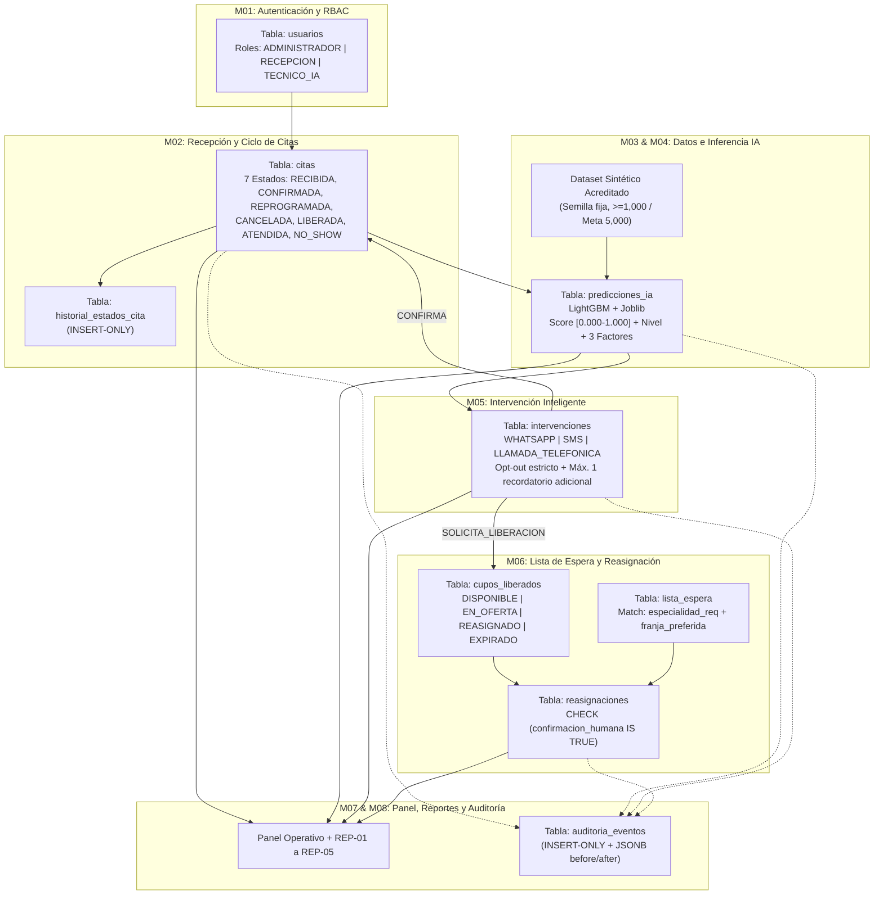
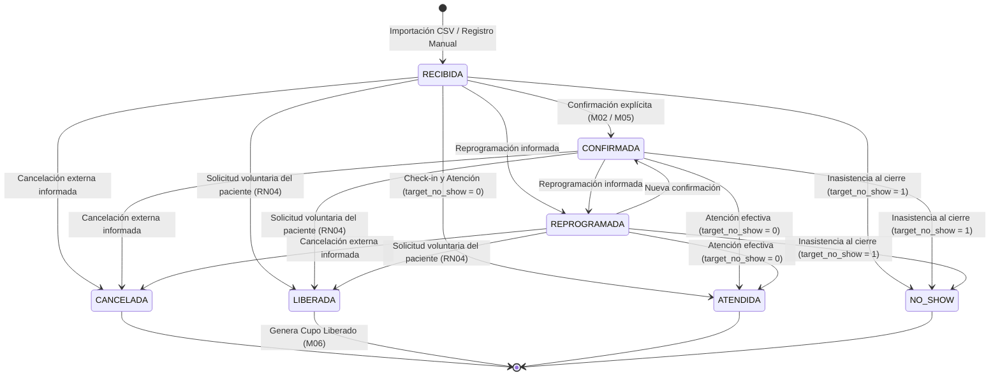
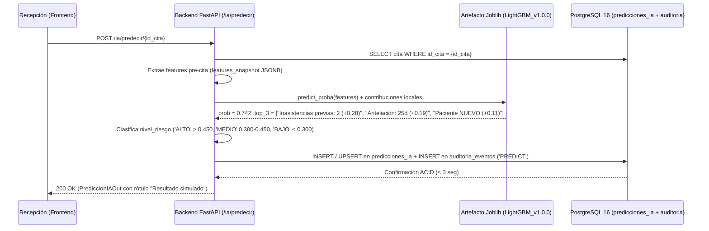
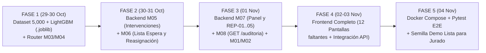

# ESPECIFICACIÓN INTEGRAL DEL SISTEMA, ARQUITECTURA DE MACHINE LEARNING Y ESTADO ACTUAL — PREDICITAS CRP

- **Proyecto:** PrediCitas CRP — Sistema Web de Gestión Predictiva de Inasistencia, Intervención Inteligente y Reasignación Asistida de Citas Médicas con Inteligencia Artificial para la Clínica Ricardo Palma (Piloto Controlado — Sede San Isidro).
- **Roles Emisores del Documento:** Tech Lead, Arquitecto de Software y Lead de Machine Learning.
- **Fecha de Emisión:** 28 de octubre de 2026 (Rumbo al Hito de Corte del **04 de noviembre de 2026 — Semana 12**).
- **Fuentes Base de Trazabilidad:**
  - Especificación de Requisitos de Software (`Grupo05_02_c01_SRS_Doc.docx` — `RF-001` a `RF-104`, `RNF-001` a `RNF-033`, `RN01` a `RN18`).
  - Diseño Arquitectónico (`Grupo05_02_c02_Diseño_Arq_Doc.pdf`).
  - Diseño de Base de Datos y Especificación de Reportes (`PrediCitas_CRP_Diseno_BaseDatos_Reportes.docx` y `DISEÑO_BD_PREDICCION_CITAS.md`).
  - Plan de Desarrollo e Implementación (`PrediCitas_CRP_Plan_Desarrollo_Implementacion.docx`).
  - Prototipo Funcional y Mockups (`PrediCitas_CRP_Prototipo_Funcional_Mockups.pdf` — 16 Pantallas Oficiales).
  - Auditoría de Cronograma (`AUDITORIA_CRONOGRAMA_04_NOVIEMBRE.md`) e inspección directa de `@backend` y `@Frontend`.

---

## SECCIÓN 1: ALCANCE FUNCIONAL COMPLETO DEL SISTEMA (¿QUÉ TIENE QUE HACER EL SISTEMA?)

**Principio Rector de Alcance (`RN03`, `RNF-030`, `RNF-031`):**  
PrediCitas CRP opera **exclusivamente después del agendamiento** (*post-booking*) sobre un perímetro controlado: **Sede San Isidro (`'SAN_ISIDRO'`)** y **tres especialidades ambulatorias autorizadas (`'CARDIOLOGIA'`, `'TRAUMATOLOGIA'`, `'PEDIATRIA'`)**. El sistema no crea reservas iniciales, no reemplaza el HIS/ERP de la clínica ni modifica el Portal del Paciente; recibe citas previamente agendadas, predice el riesgo de inasistencia (*no-show*), orquesta intervenciones preventivas respetando el consentimiento del paciente, gestiona la liberación voluntaria de cupos y ejecuta la reasignación asistida con **confirmación humana obligatoria (*Human-in-the-Loop*)**.

---

### 1.1. M01 — Autenticación, Usuarios y Control de Acceso (RBAC)
- **Requisitos SRS y Reglas:** `RF-001` a `RF-008`, `RNF-001` a `RNF-005`.
- **Tablas Involucradas:** `usuarios` (`id_usuario`, `nombre_completo`, `correo_institucional`, `password_hash`, `rol`, `activo`, `creado_en`, `actualizado_en`) y `auditoria_eventos`.
- **Flujo de Autenticación y Sesión JWT:**
  1. El usuario ingresa `correo_institucional` y contraseña en la pantalla de Login (`Pantalla 1`).
  2. El Backend busca el correo (normalizado a minúsculas) en `usuarios`. Para mitigar *timing attacks* de enumeración de cuentas, incluso si el correo no existe se ejecuta `verificar_password(password, HASH_FICTICIO)` con Argon2id.
  3. Si las credenciales son inválidas o `activo == False`, se registra un evento `LOGIN` con `datos_after = {"exito": False, "motivo": ...}` en `auditoria_eventos` y se retorna `HTTP 401`. Ante intentos fallidos repetidos, se aplica control/bloqueo configurable (`RNF-005`).
  4. Si las credenciales son válidas y `activo == True`, se emite un token **JWT firmado (`HS256`)** con tiempo de expiración (`exp`, por defecto 480 min) y `sub = str(id_usuario)`, registrando el evento `LOGIN` exitoso en `auditoria_eventos`.
  5. En cada petición protegida, la dependencia `usuario_actual` decodifica el JWT, verifica que el usuario exista y siga `activo == True`, e inyecta el contexto `SET LOCAL app.rol_actual` en PostgreSQL para satisfacer las políticas de **Row Level Security (`RLS`)**.
- **Matriz de Roles RBAC (`dominio.py` / `usuarios.rol`):**
  - `'ADMINISTRADOR'`: Gestión completa de usuarios internos (`crear`, `actualizar`, `activar/desactivar`, `restablecer acceso`), consulta de auditoría inmutable (`REP-05`) y acceso global de supervisión.
  - `'RECEPCION'` *(cubre las funciones operativas de Recepción/Secretaría y Supervisión Operativa del SRS)*: Operación del Panel Principal, importación CSV y registro manual de citas, actualización de estados/check-in, ejecución de predicciones en bandeja, envío y registro de intervenciones preventivas, gestión de lista de espera, confirmación humana de reasignaciones asistidas y emisión de reportes operativos (`REP-01` a `REP-03`).
  - `'TECNICO_IA'`: Gestión y acreditación del dataset sintético (`M03`), ejecución y evaluación del pipeline predictivo (`M04`), consulta de métricas/calibración (`REP-04`) y disparadores técnicos de inferencia.
- **Gestión Administrativa de Cuentas (`RF-004` a `RF-008`):**
  - Prohibido el borrado físico (`DELETE`) de usuarios (`ON DELETE RESTRICT` en todas las tablas hijas). La deshabilitación de acceso se realiza exclusivamente mediante baja lógica (`activo = False`, `RF-006`) para preservar la integridad histórica de `historial_estados_cita`, `intervenciones`, `reasignaciones` y `auditoria_eventos`.

---

### 1.2. M02 — Recepción, Importación y Ciclo de Estados de Citas
- **Requisitos SRS y Reglas:** `RF-009` a `RF-027`, `RF-104`, `RN01`, `RN02`, `RN03`, `RN14`.
- **Tablas Involucradas:** `citas`, `historial_estados_cita` (`INSERT-ONLY`) y `auditoria_eventos`.
- **Perímetro Estricto del Piloto (`RF-013`, `RN14`):**
  - `sede`: Exclusivamente `'SAN_ISIDRO'`. Cualquier otra sede (ej. `'MIRAFLORES'`) es rechazada por validación de servicio y por `CHECK (sede IN ('SAN_ISIDRO'))`.
  - `especialidad`: Exclusivamente `'CARDIOLOGIA'`, `'TRAUMATOLOGIA'` o `'PEDIATRIA'`.
  - Días hábiles del piloto: `'LUNES'` a `'SABADO'`. Las citas en domingo (`weekday == 6`) son rechazadas.
- **Mecanismos de Ingesta de Citas Pre-Agendadas:**
  1. **Importación por Lote CSV (`POST /citas/importar` — `RF-009`, `Pantalla 7`):**
     - Recibe un archivo CSV codificado en UTF-8 con las 13 columnas obligatorias: `id_cita_externa`, `paciente_anon_id`, `sede`, `especialidad`, `medico`, `fecha_hora_cita`, `fecha_registro_cita`, `tipo_paciente`, `canal_origen`, `inasistencias_previas`, `reprogramaciones_prev`, `asistencias_previas`, `estado_actual`.
     - Procesa fila por fila mediante `SAVEPOINT` (`db.begin_nested()`), de modo que las filas válidas se insertan y las inválidas o duplicadas (`id_cita_externa` repetido, `fecha_registro_cita > fecha_hora_cita`, fuera de perímetro) se rechazan reportando el número de fila y motivo exacto sin abortar el lote válido.
     - Calcula automáticamente en zona horaria `America/Lima` las variables derivadas: `antelacion_dias = (fecha_hora_cita.date() - fecha_registro_cita.date()).days`, `franja_horaria` (`'MANANA'` si `hora < 13`, de lo contrario `'TARDE'`) y `dia_semana`.
  2. **Registro Manual de Cita Existente (`POST /citas` — `RF-010`, `Pantalla 6`):**
     - Permite a `'RECEPCION'` incorporar individualmente una cita ya agendada en el sistema externo, aplicando exactamente las mismas validaciones de catálogo, unicidad de `id_cita_externa` y derivación de variables que el importador, asignando `estado_actual = 'RECIBIDA'`.
- **Máquina de Estados Estricta (Ciclo de los 7 Estados Operativos — `RN01`, `RN02`):**
  Toda cita pertenece en todo momento a uno de los 7 estados oficiales:
  1. `'RECIBIDA'` *(Estado inicial de incorporación al piloto de una cita programada externamente)*.
  2. `'CONFIRMADA'` *(El paciente o personal autorizado confirmó explícitamente que asistirá)*.
  3. `'REPROGRAMADA'` *(Se informó que la cita fue reprogramada en el sistema externo)*.
  4. `'CANCELADA'` *(Se informó que la cita fue cancelada externamente; nunca por decisión unilateral de PrediCitas)*.
  5. `'LIBERADA'` *(El paciente titular solicitó voluntariamente liberar su horario durante una intervención, habilitando un registro en `cupos_liberados`)*.
  6. `'ATENDIDA'` *(Estado terminal de desenlace: el paciente asistió; asigna automáticamente `target_no_show = 0`)*.
  7. `'NO_SHOW'` *(Estado terminal de desenlace: el paciente no se presentó ni avisó; asigna automáticamente `target_no_show = 1`)*.

- **Control Transaccional y Trazabilidad de Estados (`RF-025`, `RNF-014`):**
  - Todo cambio de estado adquiere bloqueo pesimista de fila (`SELECT ... FOR UPDATE` sobre `citas`), verifica que la transición sea legal, actualiza `estado_actual` (y `target_no_show` si el nuevo estado es `'ATENDIDA'` o `'NO_SHOW'`), inserta un registro inmutable en `historial_estados_cita` (`estado_anterior`, `estado_nuevo`, `id_usuario_actor`, `motivo_cambio`, `fecha_hora_evento`) y escribe en `auditoria_eventos`.

---

### 1.3. M03 — Componente de Datos para IA
- **Requisitos SRS y Reglas:** `RF-028` a `RF-040`, `RNF-021`, `RNF-022`, `RNF-023`, `RNF-026`, `RN08`, `RN16`, `RN17`.
- **Comportamiento y Reglas de Negocio:**
  1. **Generación Sintética Reproducible y Rotulado Simulado (`RF-028`, `RF-029`, `RF-056`, `RN16`):**
     - Ante la restricción ética y legal de no emplear datos personales reales de pacientes sin autorización formal (`RNF-007`, Ley N.° 29733), el sistema genera un dataset sintético gobernado por una semilla pseudoaleatoria fija (`semilla = 42`), con identificadores explícitamente prefijados con `SIM` (`CIT-SIM-xxxxxx`, `PAC-SIM-xxxxx`).
     - Toda vista, reporte o predicción generada a partir de este componente debe exhibir el rótulo visible **"Resultado simulado — Dataset sintético"** (`RF-056`).
  2. **Seudonimización y Minimización de Datos (`RNF-006`, `RN08`):**
     - No se almacenan nombres reales de pacientes, DNI, teléfonos reales, direcciones ni diagnósticos clínicos (CIE-10). El paciente se referencia únicamente mediante `paciente_anon_id`.
  3. **Separación Estricta de Variables Pre-Cita vs. Post-Cita (`RF-040`, `RNF-023`, `RN17`):**
     - El esquema físico de `citas` impone el constraint `CHECK (target_no_show IS NULL OR estado_actual IN ('ATENDIDA', 'NO_SHOW'))`. Mientras una cita se encuentra en estado operativo (`RECIBIDA`, `CONFIRMADA`, `REPROGRAMADA`, `CANCELADA`, `LIBERADA`), su `target_no_show` es obligatoriamente `NULL`.
  4. **Acreditación y Versionado del Dataset (`RF-030` a `RF-039`, Entregable `E-04`):**
     - Volumen mínimo obligatorio: **$\ge 1,000$ citas históricas con desenlace**, con **meta operativa de $5,000$ registros**.
     - El componente expone el inventario temporal de variables, reporte de calidad (nulos, duplicados, balance de clases `ATENDIDA` vs. `NO_SHOW`) y la partición estratificada fija en **Entrenamiento (70%)**, **Validación (15%)** y **Prueba/Test reservado (15%)**.

---

### 1.4. M04 — Motor Predictivo de Inasistencia basado en IA
- **Requisitos SRS y Reglas:** `RF-041` a `RF-056`, `RF-098` a `RF-103`, `RNF-010`, `RNF-012`, `RNF-024`, `RNF-025`, `RNF-027`, `RN06`, `RN09`, `RN10`, `RN12`, `RN18`.
- **Tablas Involucradas:** `citas`, `predicciones_ia` y `auditoria_eventos`.
- **Comportamiento Funcional:**
  1. **Elegibilidad para Inferencia (`RF-052`):**
     - Se evalúan las citas activas en estados previos al desenlace (`'RECIBIDA'`, `'CONFIRMADA'`, `'REPROGRAMADA'`).
  2. **Cálculo de Probabilidad Continua y Categorización de Riesgo (`RF-052`, `RF-053`):**
     - El servicio de inferencia carga el artefacto serializado (`.joblib`) de la versión activa del modelo (`version_modelo`, ej. `'LightGBM_v1.0.0'`) y calcula `probabilidad_no_show` en el rango cerrado `[0.000, 1.000]` (`NUMERIC(4,3)`).
     - Aplicando los umbrales calibrados del proyecto (`umbral_aplicado = 0.450` para riesgo alto y `0.300` para riesgo medio, conforme al documento oficial de Diseño de Base de Datos, Sección 4.4 y Reporte `REP-04`), clasifica cada cita en:
       - **`'BAJO'`**: `probabilidad_no_show < 0.300`
       - **`'MEDIO'`**: `0.300 <= probabilidad_no_show <= 0.450`
       - **`'ALTO'`**: `probabilidad_no_show > 0.450`
  3. **Snapshot Inmutable y Explicabilidad Resumida (`RF-054`, `RNF-010`, `RN09`):**
     - Guarda en `features_snapshot` (`JSONB`) el diccionario exacto de variables de entrada utilizadas en el instante de la predicción.
     - Genera y almacena en `explicabilidad_resumen` (`VARCHAR(255)`) los **3 factores de mayor contribución local** al riesgo de esa cita específica (ej. `"1. Inasistencias previas (2) | 2. Antelación alta (24 días) | 3. Turno TARDE"`).
     - Respeta la restricción `UNIQUE (id_cita, version_modelo)`: si se re-evalúa una cita con la misma versión tras una actualización operativa (ej. reprogramación), se actualiza o versiona trazablemente registrando el evento `PREDICT` en `auditoria_eventos`.
  4. **Salvaguarda Ética y Manejo de Fallos (`RF-103`, `RNF-015`, `RNF-027`, `RN10`, `RN12`):**
     - El score **jamás** desprioriza, penaliza ni cancela la atención médica de un paciente; su único efecto es habilitar acciones preventivas de acompañamiento en `M05`.
     - Si el motor de IA no está disponible o falla, el sistema registra el incidente y mantiene la cita operativa sin alterar su estado.

---

### 1.5. M05 — Intervención Inteligente y Notificaciones Preventivas
- **Requisitos SRS y Reglas:** `RF-057` a `RF-068`, `RNF-032`, `RN02`, `RN04`, `RN07`, `RN13`.
- **Tablas Involucradas:** `intervenciones`, `citas`, `historial_estados_cita`, `cupos_liberados` y `auditoria_eventos`.
- **Reglas Operativas y de Negocio en Código:**
  1. **Elegibilidad y Sugerencia de Acción según Riesgo (`RF-057`, `RF-100`):**
     - Citas con `nivel_riesgo == 'ALTO'` (> 0.450): Acción prioritaria sugerida de **Confirmación Previa + Opción de Liberación Voluntaria** por `'LLAMADA_TELEFONICA'` o `'WHATSAPP'` (plantilla `PLANTILLA_CONFIRMACION_ALTO_RIESGO`).
     - Citas con `nivel_riesgo == 'MEDIO'` (0.300–0.450): Acción sugerida de **Recordatorio Preventivo con Solicitud de Confirmación** por `'WHATSAPP'` o `'SMS'` (plantilla `PLANTILLA_RECORDATORIO_PREVENTIVO`).
     - Citas con `nivel_riesgo == 'BAJO'` (< 0.300): Sin intervención adicional sugerida (seguimiento estándar).
  2. **Canales y Estados de Intervención (`dominio.py`):**
     - `canal_contacto`: `'WHATSAPP'`, `'SMS'`, `'LLAMADA_TELEFONICA'`.
     - `estado_intervencion`: `'PENDIENTE'`, `'ENVIADA'`, `'ENTREGADA'`, `'RESPONDIDA'`, `'FALLIDA'`.
  3. **Respeto Absoluto del Derecho de Oposición — Opt-Out (`RF-064`, `RF-065`, `RN07`, `RN13`):**
     - Si el paciente registra `consentimiento_optout = True` en cualquier intervención asociada a su `id_cita` o `paciente_anon_id`, el sistema **bloquea automáticamente** el envío de cualquier nueva intervención preventiva para esa cita (`HTTP 409 Conflict`).
  4. **Límite Estricto de Máximo 1 Mensaje Adicional por Cita (`RF-066`, `RNF-032`, `RN07`):**
     - Además de la comunicación inicial de confirmación, el sistema permite **como máximo un (1) recordatorio adicional de intervención por cita**. Si ya existen 2 intervenciones enviadas/entregadas para el mismo `id_cita`, el backend rechaza cualquier intento de envío adicional (`HTTP 409 Conflict`).
  5. **Efectos Transaccionales según la Respuesta del Paciente (`RF-062`, `RF-067`, `RF-068`, `RN02`, `RN04`):**
     - **`'CONFIRMA'`**: Actualiza `intervenciones.estado_intervencion = 'RESPONDIDA'`, cambia `citas.estado_actual = 'CONFIRMADA'`, inserta en `historial_estados_cita` y audita en `auditoria_eventos`.
     - **`'SOLICITA_LIBERACION'` (`RN04`)**: Actualiza la intervención a `'RESPONDIDA'`, transiciona `citas.estado_actual` a `'LIBERADA'`, inserta en `historial_estados_cita`, **crea automáticamente en la misma transacción un registro en `cupos_liberados`** con `id_cita_origen = cita.id_cita`, `especialidad = cita.especialidad`, `medico = cita.medico`, `fecha_hora_cupo = cita.fecha_hora_cita`, `estado_cupo = 'DISPONIBLE'` y `origen_liberacion = 'INTERVENCION_VOLUNTARIA'`, y registra el evento `'LIBERAR'` en `auditoria_eventos`.
     - **`'SOLICITA_REPROG'`**: Registra la solicitud de reprogramación para gestión por recepción, pudiendo transicionar la cita a `'REPROGRAMADA'` cuando el operador lo confirme.
     - **`'SIN_RESPUESTA'` (`RN02`, `RF-067`)**: **Prohibición absoluta de cancelación o liberación unilateral.** Si el paciente no responde, la cita **permanece intacta** en su estado (`'RECIBIDA'` o `'CONFIRMADA'`) y **no** se genera ningún cupo liberado.

---

### 1.6. M06 — Lista de Espera y Reasignación Asistida
- **Requisitos SRS y Reglas:** `RF-069` a `RF-082`, `RNF-028`, `RNF-029`, `RN04`, `RN05`, `RN11`.
- **Tablas Involucradas:** `lista_espera`, `cupos_liberados`, `reasignaciones` y `auditoria_eventos`.
- **Comportamiento y Reglas de Negocio:**
  1. **Gestión de Candidatos en Lista de Espera (`RF-069` a `RF-072`):**
     - Cada registro en `lista_espera` almacena `paciente_anon_id`, `especialidad_req` (`'CARDIOLOGIA'`, `'TRAUMATOLOGIA'`, `'PEDIATRIA'`), `franja_preferida` (`'MANANA'`, `'TARDE'`, `'INDIFERENTE'`), `estado_candidato` (`'ACTIVO'`, `'CONTACTADO'`, `'ASIGNADO'`, `'DESISTIDO'`), `prioridad_registro` (entero $\ge 1$, predefinido administrativamente o por personal clínico autorizado sin que el sistema infiera urgencia clínica, `RN05` / `RNF-028`) y `fecha_registro`.
  2. **Algoritmo de Emparejamiento y Propuesta de Candidatos (`RF-074`, `RF-075`, `RF-076`):**
     - Para un cupo en `cupos_liberados` con `estado_cupo IN ('DISPONIBLE', 'EN_OFERTA')`, cuya cita origen tiene `especialidad = E` y `franja_horaria = F` (`'MANANA'` si `fecha_hora_cupo.hour < 13` en hora Lima, sino `'TARDE'`), el sistema selecciona los candidatos de `lista_espera` que cumplen simultáneamente:
       - `estado_candidato IN ('ACTIVO', 'CONTACTADO')`
       - `especialidad_req == E`
       - `franja_preferida IN (F, 'INDIFERENTE')`
     - Orden de prelación determinista (`ORDER BY`):
       1. `prioridad_registro ASC` (prioridad 1 antes que 2).
       2. `CASE WHEN franja_preferida = F THEN 0 ELSE 1 END ASC` (coincidencia exacta de franja antes que `'INDIFERENTE'`).
       3. `fecha_registro ASC` (FIFO: mayor antigüedad de espera primero).
  3. **Ejecución de Reasignación Asistida con Confirmación Humana Obligatoria (`RF-079` a `RF-082`, `RNF-029`, `RN11`):**
     - **Bloqueo sin liberación previa (`RF-080`):** Solo pueden reasignarse registros existentes en `cupos_liberados` con `estado_cupo` en `'DISPONIBLE'` o `'EN_OFERTA'`.
     - **Prevención de doble asignación concurrente (`RF-081`):** La transacción ejecuta `SELECT ... FOR UPDATE` tanto sobre la fila de `cupos_liberados` como sobre la fila de `lista_espera`, además de estar protegida por la restricción física `UNIQUE (id_cupo_liberado)` en `reasignaciones`.
     - **Confirmación Humana (*Human-in-the-Loop*):** El payload debe incluir `confirmacion_humana = True`, `medio_confirmacion` (`'LLAMADA_CONFIRMADA'` o `'PRESENCIAL'`) y el `id_operador_confirma` autenticado. Si `confirmacion_humana` no es `True`, el servicio y el `CHECK (confirmacion_humana IS TRUE)` de PostgreSQL rechazan la operación.
     - Al confirmarse, en una sola transacción ACID: se inserta la fila en `reasignaciones`, se actualiza `cupos_liberados.estado_cupo = 'REASIGNADO'`, se actualiza `lista_espera.estado_candidato = 'ASIGNADO'` y se inserta el evento `'REASIGNAR'` en `auditoria_eventos`.

---

### 1.7. M07 — Panel Operativo Principal y Módulo de Reportes
- **Requisitos SRS y Reglas:** `RF-083` a `RF-089`, `RNF-011`, `RNF-016`, `RNF-017` y Sección 6 de `PrediCitas_CRP_Diseno_BaseDatos_Reportes.docx`.
- **Dashboard de Monitoreo en Tiempo Real (`Pantalla 4`):**
  - **KPIs Operativos Consolidados (`RF-083`):** Total de citas en el periodo/día desglosadas por los 7 estados, distribución por nivel de riesgo (`ALTO`, `MEDIO`, `BAJO`), total de intervenciones enviadas/respondidas, cupos liberados y cupos efectivamente reasignados (tasa de recuperación).
  - **Alertas Operativas Activas (`RF-085`, `RF-086`, `RF-087`):**
    1. *Alerta de Citas de Alto/Medio Riesgo Pendientes de Intervención:* Citas en estado `'RECIBIDA'` con predicción `'ALTO'` o `'MEDIO'` que aún no tienen ninguna intervención registrada y no tienen opt-out.
    2. *Alerta de Cupos Liberados sin Reasignar:* Registros en `cupos_liberados` con `estado_cupo == 'DISPONIBLE'` cuya `fecha_hora_cupo` es futura.
    3. *Consolidado de Acciones Pendientes:* Intervenciones en estado `'ENVIADA'`/`'ENTREGADA'` pendientes de respuesta y ofertas de cupo en curso.
- **Especificación de los 5 Reportes Oficiales (`REP-01` a `REP-05`):**

| Código | Nombre Oficial del Reporte | Rol Destinatario | Contenido, Campos Clave y Filtros |
| :--- | :--- | :--- | :--- |
| **`REP-01`** | **Reporte Operativo Diario de Citas y Riesgo de Inasistencia** | `RECEPCION` | **Campos:** Hora, `id_cita_externa`, especialidad, médico, `antelacion_dias`, `probabilidad_no_show`, `nivel_riesgo`, `estado_intervencion`, `respuesta_paciente`. **Filtros:** Fecha, especialidad, nivel de riesgo. **Agrupamiento:** Especialidad y franja horaria. |
| **`REP-02`** | **Efectividad de Intervenciones y Liberación de Cupos** | `RECEPCION` / Calidad | **Campos:** `id_intervencion`, `canal_contacto`, `estado_intervencion`, `respuesta_paciente`, tiempo de respuesta, cupo liberado (`Sí/No`). **KPIs:** Tasa de respuesta, tasa de confirmación y tasa de liberación voluntaria por canal y nivel de riesgo. |
| **`REP-03`** | **Reasignación Asistida y Optimización de Capacidad** | `RECEPCION` / Dirección | **Campos:** `id_cupo_liberado`, `fecha_hora_cupo`, especialidad, médico, `origen_liberacion`, candidato asignado (`paciente_anon_id`), operador (`nombre_completo`), `medio_confirmacion`, `estado_cupo`. **KPIs:** Tasa de recuperación de cupos (%) y tiempo promedio de matching. |
| **`REP-04`** | **Calibración y Desempeño del Motor IA** | `TECNICO_IA` / Calidad | **Campos:** `version_modelo`, fecha de evaluación, `ROC-AUC`, `PR-AUC`, `Precision`, `Recall`, `F1-Score` en el umbral vigente (`0.450`), matriz de confusión en Test, importancia de features, auditoría de equidad por subgrupos y estado del test anti-leakage. |
| **`REP-05`** | **Trazabilidad y Cumplimiento de Auditoría** | `ADMINISTRADOR` / Calidad | **Campos:** `id_log`, `creado_en`, usuario, rol, `modulo`, `accion`, `entidad_afectada`, `id_entidad`, `datos_before` (`JSONB`), `datos_after` (`JSONB`), `direccion_ip`. **Filtros:** Rango de fechas, usuario, módulo y acción. Orden cronológico descendente. |

---

### 1.8. M08 — Seguridad, Auditoría Inmutable y Trazabilidad
- **Requisitos SRS y Reglas:** `RF-090` a `RF-097`, `RNF-001` a `RNF-010`, `RN08`, `RN09`.
- **Arquitectura de Inmutabilidad Forense (`INSERT-ONLY`):**
  1. **Triggers a Nivel de Motor PostgreSQL (`fn_bloquear_modificacion`):**
     - Las tablas `auditoria_eventos` e `historial_estados_cita` tienen asociados los triggers `trg_historial_inmutable` y `trg_auditoria_inmutable` (`BEFORE UPDATE OR DELETE FOR EACH ROW`), que abortan cualquier intento de alteración o borrado con `RAISE EXCEPTION 'Operación % prohibida en % (tabla INSERT-ONLY)'`.
  2. **Row Level Security (`RLS`) en PostgreSQL:**
     - `auditoria_eventos` tiene `ENABLE ROW LEVEL SECURITY` y `FORCE ROW LEVEL SECURITY` con dos políticas: `auditoria_insert` (`WITH CHECK (true)` para permitir el registro transversal de eventos desde cualquier flujo) y `auditoria_select_admin` (`USING (current_setting('app.rol_actual', true) = 'ADMINISTRADOR')`).
  3. **Cobertura Obligatoria de Eventos Críticos (`RF-090` a `RF-094`):**
     - `modulo = 'AUTENTICACION'`: `LOGIN` (exitoso y fallido), `LOGOUT`, `CREATE_USER`, `UPDATE_USER`, `RESET_PASSWORD`.
     - `modulo = 'CITAS'`: `IMPORT`, `CREATE`, `UPDATE` (cambio de estado con `datos_before` y `datos_after`), `CHECKIN`.
     - `modulo = 'IA'`: `PREDICT`, `PREDICT_BATCH`, `TRAIN_MODEL`.
     - `modulo = 'INTERVENCION'`: `CREATE_INTERVENCION`, `RESPUESTA_INTERVENCION`, `OPTOUT`, `LIBERAR`.
     - `modulo = 'REASIGNACION'`: `CREATE_CANDIDATO`, `UPDATE_CANDIDATO`, `REASIGNAR`.

---

## SECCIÓN 2: ESPECIFICACIÓN DETALLADA DE DATOS, DATASET Y ENTRENAMIENTO DE IA (¿QUÉ SE HACE ACÁ?)

Esta sección consolida la especificación técnica exacta de Machine Learning establecida en el **SRS (`RF-028` a `RF-056`, `RNF-021` a `RNF-026`)**, el **Plan de Desarrollo e Implementación (`Sección 3 y 4`)**, el **Diseño de Base de Datos (`Sección 4.2, 4.4 y REP-04`)** y el generador base existente en [`backend/app/modules/citas/synthetic.py`](file:///d:/Documentos/SISTEMA/backend/app/modules/citas/synthetic.py).

### 2.1. Definición y Estructura del Dataset Sintético Acreditado (`Entregable E-04`)

1. **Origen, Volumen y Reproducibilidad (`RF-028`, `RF-029`, `RF-030`, `RNF-021`):**
   - **Origen:** Generador sintético paramétrico determinista gobernado por semilla fija (`semilla = 42`), calibrado por bisección sobre función logística ($\sigma(z + \beta_0)$) con ruido gaussiano controlado ($\epsilon \sim \mathcal{N}(0, 0.6^2)$) para evitar un dataset artificialmente determinista (`RF-034`) y mantener una tasa media basal de *no-show* documentada como supuesto de modelado ($\approx 16\%$ a $22\%$, `RF-033`).
   - **Volumen:** Mínimo obligatorio de **$1,000$ registros con desenlace cerrado** (`ATENDIDA` o `NO_SHOW`), y **objetivo operativo de $5,000$ registros históricos con desenlace** más un lote operativo de citas próximas (`RECIBIDA` / `CONFIRMADA`) para demostración en vivo en la bandeja de recepción.
2. **Catálogo Exacto de Features (Variables de Entrada Pre-Cita — `RF-032`, `RF-040`):**
   Todas las variables de entrada del modelo provienen exclusivamente de atributos conocidos **antes** de la fecha/hora de la cita y están mapeadas 1 a 1 con las columnas de la tabla `citas`:

| # | Nombre de Columna en BD (`citas`) | Categoría | Tipo de Dato / Dominio Exacto | Rol en el Modelo e Impacto Esperado |
| :-: | :--- | :--- | :--- | :--- |
| 1 | `antelacion_dias` | Temporal | `INTEGER` ($\ge 0$, típico `0` a `60` días) | **Numérica continua.** Mayor antelación incrementa la probabilidad de olvido o cambio de planes del paciente. |
| 2 | `franja_horaria` | Temporal | `VARCHAR(20)`: `'MANANA'` (`08:00–12:30`), `'TARDE'` (`14:00–18:30`) | **Categórica binaria.** Los turnos de `'TARDE'` presentan mayor fricción horaria/tráfico. |
| 3 | `dia_semana` | Temporal | `VARCHAR(15)`: `'LUNES'`, `'MARTES'`, `'MIERCOLES'`, `'JUEVES'`, `'VIERNES'`, `'SABADO'` | **Categórica nominal.** Captura variaciones de asistencia según el día laborable o sábado. |
| 4 | `tipo_paciente` | Paciente | `VARCHAR(20)`: `'NUEVO'`, `'CONTINUADOR'` | **Categórica binaria.** Pacientes `'NUEVO'` sin vínculo previo tienen mayor propensión al *no-show*. |
| 5 | `inasistencias_previas` | Historial Paciente | `INTEGER` ($\ge 0$, `DEFAULT 0`) | **Numérica discreta.** Principal predictor individual de reincidencia en inasistencia. |
| 6 | `asistencias_previas` | Historial Paciente | `INTEGER` ($\ge 0$, `DEFAULT 0`) | **Numérica discreta.** Permite capturar adherencia histórica y calcular el ratio histórico de cumplimiento. |
| 7 | `reprogramaciones_prev` | Historial Cita | `INTEGER` ($\ge 0$, `DEFAULT 0`) | **Numérica discreta.** Número de veces que la cita fue postergada previamente. |
| 8 | `especialidad` | Cita | `VARCHAR(50)`: `'CARDIOLOGIA'`, `'TRAUMATOLOGIA'`, `'PEDIATRIA'` | **Categórica nominal.** Diferencia el comportamiento basal entre las 3 especialidades del piloto. |
| 9 | `canal_origen` | Cita | `VARCHAR(30)`: `'WEB'`, `'CALL_CENTER'`, `'PRESENCIAL'` | **Categórica nominal.** Las reservas por `'CALL_CENTER'` o `'WEB'` difieren en tasa de abandono frente a `'PRESENCIAL'`. |
| 10 | *`tasa_no_show_previa`* *(Feature derivada en pipeline)* | Derivada Pre-Cita | `FLOAT` $\in [0.0, 1.0]$: $\frac{\text{inasistencias\_previas}}{\text{asistencias\_previas} + \text{inasistencias\_previas} + 1}$ | **Numérica continua suavizada (Laplace).** Sintetiza la proporción histórica de incumplimiento del paciente sin división por cero. |

3. **Definición Formal del Target (`RF-031`):**
   - Columna `target_no_show` (`SMALLINT`):
     - `0` = **Asistió** (`estado_actual == 'ATENDIDA'`).
     - `1` = **No asistió / No-show** (`estado_actual == 'NO_SHOW'`).
4. **Controles Anti-Fuga de Datos (*Data Leakage* — `RF-040`, `RF-048`, `RNF-023`, `RN17`):**
   - **Lista Negra de Columnas Prohibidas en `X` (Features):** Queda estrictamente prohibido incluir en la matriz de entrenamiento o inferencia: `id_cita`, `id_cita_externa`, `paciente_anon_id`, `estado_actual`, `target_no_show`, `fecha_hora_evento` de desenlace, o resultados posteriores de `intervenciones` / `reasignaciones`.
   - **Verificación Automática (`test_leakage`):** El pipeline incluye un test automatizado que: (a) verifica que el conjunto de columnas de entrada del `ColumnTransformer` sea subconjunto estricto de las 10 variables pre-cita autorizadas, (b) comprueba que `fecha_registro_cita <= fecha_hora_cita` en el 100% de las filas, y (c) verifica que la intersección de `id_cita_externa` entre los conjuntos de `Train`, `Val` y `Test` sea exactamente el conjunto vacío ($\emptyset$).

---

### 2.2. Estrategia de Particionamiento y Preprocesamiento (`RF-038`, `RF-039`, `RNF-022`)

1. **Particionamiento Estratificado con Reserva Estricta de Test (`70% / 15% / 15%`):**
   - Sobre el universo de citas históricas cerradas (`estado_actual IN ('ATENDIDA', 'NO_SHOW')`, $N = 5,000$), se aplica `train_test_split` estratificado por `target_no_show` con `random_state = 42`:
     - **Entrenamiento (`Train` — 70%, $3,500$ filas):** Ajuste de transformadores (`fit`) y aprendizaje de pesos de los modelos.
     - **Validación (`Val` — 15%, $750$ filas):** Selección de hiperparámetros, parada temprana (*early stopping*) y calibración del umbral operativo (`umbral_aplicado`).
     - **Prueba Reservada (`Test` — 15%, $750$ filas):** Partición bloqueada (`RF-039`, `RNF-022`), utilizada **una única vez** al final para reportar las métricas oficiales del modelo frente al baseline (`RF-044`).
2. **Pipeline de Preprocesamiento (`scikit-learn ColumnTransformer`):**
   - **Variables Numéricas (`antelacion_dias`, `inasistencias_previas`, `asistencias_previas`, `reprogramaciones_prev`, `tasa_no_show_previa`):** Imputación mediana (`SimpleImputer(strategy="median")`) + escalamiento estándar (`StandardScaler`) para el modelo Baseline (e imputación directa para `LightGBM`).
   - **Variables Categóricas (`especialidad`, `tipo_paciente`, `canal_origen`, `franja_horaria`, `dia_semana`):** Imputación por moda + `OneHotEncoder(handle_unknown="ignore", sparse_output=False)`.
   - Todo el `ColumnTransformer` se ajusta (`fit`) **únicamente sobre `X_train`** para impedir *preprocessing leakage* hacia `Val` y `Test`.
3. **Manejo del Desbalance de Clases:**
   - Dado que la clase positiva (`target_no_show = 1`) representa entre el $16\%$ y el $25\%$ del dataset, se aplica **ponderación de clases balanceada (`class_weight="balanced"`)** o `scale_pos_weight` calibrado sobre `Train`, optimizando directamente la sensibilidad (`Recall`) y el `F1-Score` sobre la clase minoritaria sin distorsionar la distribución natural de `Val` y `Test`.

---

### 2.3. Estrategia de Modelado y Algoritmos (`RF-041` a `RF-047`, `Entregable E-05`)

1. **Modelo Baseline de Referencia (`RF-041`):**
   - **Algoritmo:** `LogisticRegression(class_weight="balanced", max_iter=1000, random_state=42)` acoplado al `ColumnTransformer`.
   - **Propósito:** Establecer el piso mínimo de desempeño lineal interpretable sobre las mismas particiones `Val` y `Test`.
2. **Modelo Principal de Producción (`RF-042`, Plan de Desarrollo Sección 3):**
   - **Algoritmo Oficial:** **`LightGBM` (`lightgbm.LGBMClassifier`)** dentro de un `sklearn.pipeline.Pipeline`.
   - **Configuración de Hiperparámetros Basales:**
     - `objective="binary"`, `n_estimators=300`, `learning_rate=0.05`, `num_leaves=31`, `max_depth=6`, `min_child_samples=20`, `subsample=0.8`, `colsample_bytree=0.8`, `class_weight="balanced"`, `random_state=42`.
   - **Criterio de Selección y Calibración de Umbral (`RF-046`, `RF-047`):**
     - El modelo `LightGBM` debe superar al Baseline en `F1-Score` y `ROC-AUC` en la partición de validación.
     - Se calibra el umbral de decisión (`umbral_aplicado`, establecido en `0.450` para el segmento de alto riesgo y `0.300` para el segmento elegible de intervención preventiva) maximizando el $F_1\text{-Score}$ en `Val`.

---

### 2.4. Métricas de Evaluación, Matriz de Confusión y Auditoría de Equidad (`RF-045`, `RF-049`, `RNF-024`, `RNF-025`)

1. **Métricas Obligatorias en Partición de Prueba Independiente (`Test`):**
   - **`F1-Score`:** Meta objetivo del proyecto **$\ge 0.82$ ($82\%$)** en evaluación controlada acreditada (`RNF-025`, Tabla 14 del Informe de Avance).
   - **`Precision` (Valor Predictivo Positivo):** Proporción de citas alertadas como *no-show* que efectivamente no asisten (controla el sobrecosto de intervenciones innecesarias).
   - **`Recall` (Sensibilidad):** Proporción de *no-shows* reales capturados por el modelo (maximiza la recuperación oportuna de cupos).
   - **`ROC-AUC` y `PR-AUC` (Área bajo la curva Precision-Recall):** Evaluación global de discriminación en presencia de desbalance.
   - **Matriz de Confusión:** Conteo explícito de Verdaderos Negativos ($TN$), Falsos Positivos ($FP$), Falsos Negativos ($FN$) y Verdaderos Positivos ($TP$).
2. **Auditoría de Sesgo y Equidad Algorítmica (`RF-049`, `RNF-024`, `RN18`):**
   - Antes de habilitar el modelo para el piloto, el pipeline calcula las métricas desagregadas (`F1-Score`, `Recall`, `False Positive Rate`) por subgrupos de:
     - `especialidad` (`'CARDIOLOGIA'`, `'TRAUMATOLOGIA'`, `'PEDIATRIA'`)
     - `tipo_paciente` (`'NUEVO'`, `'CONTINUADOR'`)
     - `franja_horaria` (`'MANANA'`, `'TARDE'`)
   - Se verifica que la brecha máxima de desempeño entre subgrupos no supere el umbral de tolerancia ($\Delta F_1 \le 0.10$), documentando el resultado en el reporte `REP-04`.

---

### 2.5. Artefacto Serializado, Servicio de Inferencia y Explicabilidad Local (`RF-050` a `RF-056`)

1. **Serialización del Artefacto (`.joblib` — `RF-050`):**
   - El pipeline completo (`ColumnTransformer` + `LGBMClassifier`) junto con su diccionario de metadatos (`version_modelo = "LightGBM_v1.0.0"`, `semilla = 42`, `fecha_entrenamiento`, `umbral_alto = 0.450`, `umbral_medio = 0.300`, `metricas_test`, `metricas_baseline`, `prueba_leakage_ok = True`, `auditoria_equidad`) se empaqueta con `joblib.dump()` en `backend/app/modules/ia/artifacts/modelo_predicitas_v1.joblib`.
2. **Servicio de Inferencia de Baja Latencia (`RNF-011`, `RNF-012`):**
   - Se carga en memoria al iniciar el servicio (singleton caché) para responder cada inferencia individual en **$< 100\text{ ms}$** (cumpliendo holgadamente los límites de $\le 3\text{ s}$ de `RNF-011` y $\le 5\text{ s}$ de `RNF-012`).
3. **Algoritmo de Explicabilidad Local (`explicabilidad_resumen` — `VARCHAR(255)`):**
   - Para cada cita evaluada, se extraen las contribuciones locales a nivel de instancia (`pred_contrib=True` nativo de LightGBM / valores TreeSHAP sobre el árbol ensamblado, o producto de importancia por desviación estandarizada en el fallback).
   - Se ordenan las variables de entrada por magnitud de impacto positivo hacia la clase `1` (*no-show*), se seleccionan los **3 factores principales** y se formulan en lenguaje claro para el operador de recepción en el campo `explicabilidad_resumen` (máx. 255 caracteres), por ejemplo:
     - `"Factores clave: 1) Inasistencias previas: 2 | 2) Antelación: 28 días | 3) Paciente NUEVO (Resultado simulado)"`.

---

## SECCIÓN 3: ESTADO ACTUAL Y DIAGNÓSTICO (¿EN QUÉ PUNTO ESTAMOS AL 28 DE OCTUBRE DE 2026?)

### 3.1. Diagnóstico de la Base de Datos (`PostgreSQL 16` + `SQLAlchemy 2` + `Alembic`)
- **Estado:** **100% CONFORME Y OPERATIVA en esquema y migraciones.**
- **Evidencia verificada en código:**
  - Migración oficial: [`backend/migrations/versions/2cfdcb7d3da2_esquema_inicial_con_las_9_tablas.py`](file:///d:/Documentos/SISTEMA/backend/migrations/versions/2cfdcb7d3da2_esquema_inicial_con_las_9_tablas.py).
  - Modelos ORM: [`auth/models.py`](file:///d:/Documentos/SISTEMA/backend/app/modules/auth/models.py), [`citas/models.py`](file:///d:/Documentos/SISTEMA/backend/app/modules/citas/models.py), [`ia/models.py`](file:///d:/Documentos/SISTEMA/backend/app/modules/ia/models.py), [`intervenciones/models.py`](file:///d:/Documentos/SISTEMA/backend/app/modules/intervenciones/models.py), [`lista_espera/models.py`](file:///d:/Documentos/SISTEMA/backend/app/modules/lista_espera/models.py), [`auditoria/models.py`](file:///d:/Documentos/SISTEMA/backend/app/modules/auditoria/models.py).
  - Las **9 tablas oficiales** (`usuarios`, `citas`, `historial_estados_cita`, `predicciones_ia`, `intervenciones`, `lista_espera`, `cupos_liberados`, `reasignaciones`, `auditoria_eventos`), todas las claves foráneas con `ON DELETE RESTRICT`, todos los `CHECK` constraints (incluyendo `target_solo_con_desenlace` y `confirmacion_humana IS TRUE`), los triggers `fn_bloquear_modificacion` (`INSERT-ONLY`) y las políticas de `ROW LEVEL SECURITY` están creados y validados por [`backend/tests/test_integridad_bd.py`](file:///d:/Documentos/SISTEMA/backend/tests/test_integridad_bd.py).
- **Incidente puntual en script auxiliar:** El archivo [`backend/scripts/poblar_bd_completa.py`](file:///d:/Documentos/SISTEMA/backend/scripts/poblar_bd_completa.py) pertenece a un esquema antiguo descartado (invoca `pacientes_perfil` y `v_dataset_entrenamiento_ia`, que no existen en la migración `2cfdcb7d3da2`), mientras que [`backend/scripts/seed.py`](file:///d:/Documentos/SISTEMA/backend/scripts/seed.py) sí está alineado con el esquema oficial pero solo puebla `usuarios` y `citas` (sin poblar `predicciones_ia`, `intervenciones`, `lista_espera`, `cupos_liberados` ni `reasignaciones`).

---

### 3.2. Diagnóstico del Backend (`FastAPI` — Routers y Endpoints por Módulo)

En [`backend/app/main.py`](file:///d:/Documentos/SISTEMA/backend/app/main.py) actualmente solo están montados **2 routers** (`auth_router` y `citas_router`) más `/health`:

| Módulo | Archivos Existentes en `backend/app/modules/<modulo>/` | Endpoints Montados en `main.py` | Endpoints y Lógica Faltantes | Estado del Módulo |
| :--- | :--- | :--- | :--- | :---: |
| **`M01 — auth`** | `models.py`, `schemas.py`, `repository.py`, `service.py`, `dependencies.py`, `router.py` | `POST /auth/login` `GET /auth/me` `POST /auth/logout` | CRUD de administración de usuarios (`GET /usuarios`, `POST /usuarios`, `PATCH /usuarios/{id}`, `POST /usuarios/{id}/restablecer-acceso`) y bloqueo por intentos fallidos (`RNF-005`). | **Parcial (60%)** |
| **`M02 — citas`** | `models.py`, `schemas.py`, `repository.py`, `service.py`, `reglas.py`, `synthetic.py`, `router.py` | `POST /citas/importar` `GET /citas` `GET /citas/{id_cita}` `POST /citas/{id_cita}/estado` | Registro manual individual (`POST /citas`), filtros avanzados en `GET /citas` (`medico`, `nivel_riesgo`, `estado_intervencion`, `acciones_pendientes`), inclusión de predicciones/intervenciones/reasignación en `GET /citas/{id_cita}`, y transición a `LIBERADA`. | **Parcial (70%)** |
| **`M03 — Datos IA`** | `citas/synthetic.py` *(genera 360 citas por defecto)* | *Ninguno* | Escalar dataset acreditado a $\ge 1,000$ / $5,000$ registros con partición `Train/Val/Test` (`70/15/15`), ficha de calidad y endpoint `GET /ia/dataset-resumen`. | **Parcial (35%)** |
| **`M04 — ia`** | Solo `models.py` (`PrediccionIA`) | *Ninguno* | Crear `predictor.py` (`LightGBM` + `Baseline` + tests de leakage y equidad + `.joblib`), `schemas.py`, `repository.py`, `service.py`, `router.py` (`POST /ia/predecir/{id_cita}`, `POST /ia/predecir-lote`, `GET /ia/metricas`). | **No implementado (10% — solo ORM)** |
| **`M05 — intervenciones`** | Solo `models.py` (`Intervencion`) | *Ninguno* | Crear `schemas.py`, `repository.py`, `service.py`, `router.py` (`GET /intervenciones`, `POST /citas/{id_cita}/intervenciones`, `PATCH /intervenciones/{id}`), validación de opt-out, límite de 1 recordatorio y disparo automático de `CupoLiberado` al solicitar liberación. | **No implementado (10% — solo ORM)** |
| **`M06 — lista_espera`** | Solo `models.py` (`ListaEspera`, `CupoLiberado`, `Reasignacion`) | *Ninguno* | Crear `schemas.py`, `repository.py`, `service.py`, `router.py` (`GET /lista-espera`, `POST /lista-espera`, `PATCH /lista-espera/{id}`, `GET /cupos-liberados`, `GET /cupos-liberados/{id}/candidatos`, `POST /cupos-liberados/{id}/reasignar` con `confirmacion_humana = True`). | **No implementado (10% — solo ORM)** |
| **`M07 — Panel y Reportes`** | *No existe carpeta de módulo* | *Ninguno* | Crear módulo `panel` / `reportes` con `GET /panel/resumen` (KPIs y alertas `RF-083` a `RF-087`) y `GET /reportes/{codigo}` (`REP-01` a `REP-05`). | **No implementado (0%)** |
| **`M08 — auditoria`** | `models.py`, `service.py` (`registrar_evento`) | *Ninguno* | Crear `schemas.py` y `router.py` con `GET /auditoria` (filtros por fecha, usuario, módulo, acción y entidad, restringido por rol) e invocar `registrar_evento` desde `M04`, `M05` y `M06`. | **Parcial (50%)** |

---

### 3.3. Diagnóstico del Frontend (`React 19` + `Vite` + `Tailwind CSS 4`)

El documento oficial [`PrediCitas_CRP_Prototipo_Funcional_Mockups.pdf`](file:///d:/Documentos/SISTEMA/ADM.%20DE%20PROYECTOS%20DE%20SOFTWARE_Grupo5/SEMANA%2008/PrediCitas_CRP_Prototipo_Funcional_Mockups.pdf) compromete **16 pantallas operativas y administrativas**. En [`Frontend/src/pages/`](file:///d:/Documentos/SISTEMA/Frontend/src/pages) solo existen **4 archivos**:

| # | Pantalla Oficial en Prototipo (`Mockups Sem 08`) | Módulo | Estado Actual en `Frontend/src/` | Diagnóstico Técnico |
| :-: | :--- | :---: | :--- | :--- |
| **P01** | Inicio de Sesión (Login) | M01 | [`pages/Login.jsx`](file:///d:/Documentos/SISTEMA/Frontend/src/pages/Login.jsx) | **Implementada (95%).** Falta enlace funcional a P02 (Recuperación de acceso). |
| **P02** | Recuperación de Acceso | M01 | *No existe* | **Falta crear** (`RecuperarAcceso.jsx`). |
| **P03** | Gestión de Usuarios y Roles | M01 | *No existe* | **Falta crear** (`Usuarios.jsx`). |
| **P04** | Panel Operativo Principal (Dashboard Recepción) | M07 | *No existe* (`App.jsx` redirige `/` a `/citas`) | **Falta crear** (`PanelOperativo.jsx`). |
| **P05** | Bandeja Operativa de Citas del Piloto | M02 | [`pages/Citas.jsx`](file:///d:/Documentos/SISTEMA/Frontend/src/pages/Citas.jsx) | **A medias (60%).** Filtra por fecha, especialidad, estado y código, pero no muestra columna de `Nivel de Riesgo IA`, `Score`, `Intervención` ni filtros por médico/riesgo/intervención (`RF-017`). |
| **P06** | Registro Manual de Cita Existente | M02 | *No existe* | **Falta crear** (`NuevaCita.jsx` o modal en `Citas.jsx`). |
| **P07** | Importación Controlada de Citas (CSV) | M02 | [`pages/Importar.jsx`](file:///d:/Documentos/SISTEMA/Frontend/src/pages/Importar.jsx) | **Implementada (100%).** |
| **P08** | Detalle Trazable de Cita y Máquina de Estados | M02 | [`pages/CitaDetalle.jsx`](file:///d:/Documentos/SISTEMA/Frontend/src/pages/CitaDetalle.jsx) | **A medias (65%).** Muestra datos de cita, transición de estados e historial, pero no muestra el bloque de Predicción IA, Explicabilidad, Intervenciones ni Cupo Liberado/Reasignación (`RF-018`). |
| **P09** | Gestión y Acreditación de Datos para IA | M03 | *No existe* | **Falta crear** (`DatosIA.jsx`). |
| **P10** | Resultado de Predicción de Inasistencia y Calibración | M04 | *No existe* | **Falta crear** (vista/sección de inferencia, explicabilidad y reporte `REP-04`). |
| **P11** | Bandeja de Intervención Inteligente | M05 | *No existe* | **Falta crear** (`Intervenciones.jsx`). |
| **P12** | Detalle, Respuesta, Consentimiento y Opt-out de Intervención | M05 | *No existe* | **Falta crear** (panel/modal de ejecución y respuesta en `Intervenciones.jsx` / `CitaDetalle.jsx`). |
| **P13** | Gestión de Lista de Espera | M06 | *No existe* | **Falta crear** (`ListaEspera.jsx`). |
| **P14** | Bandeja de Cupos Liberados | M06 | *No existe* | **Falta crear** (`CuposLiberados.jsx`). |
| **P15** | Confirmación de Reasignación Asistida (*Human-in-the-Loop*) | M06 | *No existe* | **Falta crear** (`ReasignacionAsistida.jsx` o flujo integrado en `CuposLiberados.jsx`). |
| **P16** | Visor de Auditoría, Trazabilidad y Reportes (`REP-01` a `REP-05`) | M08 / M07 | *No existe* | **Falta crear** (`Auditoria.jsx` y `Reportes.jsx`). |

---

### 3.4. Estado de los Flujos Integrados End-to-End y Porcentaje Real de Avance Global

- **Estado de los Flujos End-to-End:**
  - **Flujo 1 (Login $\rightarrow$ Importación CSV $\rightarrow$ Bandeja de Citas $\rightarrow$ Cambio Manual de Estado $\rightarrow$ Historial en BD):** **OPERATIVO (100%).**
  - **Flujo 2 (Cita $\rightarrow$ Inferencia `LightGBM` $\rightarrow$ Persistencia de Score y Explicabilidad en `predicciones_ia`):** **INTERRUMPIDO (0%).**
  - **Flujo 3 (Predicción de Riesgo Alto/Medio $\rightarrow$ Intervención Preventiva $\rightarrow$ Control Opt-out / Máx. 1 Recordatorio $\rightarrow$ Respuesta `'SOLICITA_LIBERACION'` $\rightarrow$ Cita `'LIBERADA'` + Creación de `CupoLiberado`):** **INTERRUMPIDO (0%).**
  - **Flujo 4 (Cupo Liberado $\rightarrow$ Propuesta de Candidatos de `lista_espera` $\rightarrow$ Confirmación Humana `confirmacion_humana = True` $\rightarrow$ Registro en `reasignaciones`):** **INTERRUMPIDO (0%).**
  - **Flujo 5 (Consolidación en Panel Operativo + 5 Reportes + Visor de Auditoría):** **INTERRUMPIDO (0%).**

| Capa / Dimensión del Proyecto | Peso Ponderado | % Completado Actual | Contribución al Avance Global |
| :--- | :---: | :---: | :---: |
| **1. Base de Datos, Migraciones Alembic, Constraints, Triggers y RLS** | 20% | **100%** | 20.0% |
| **2. Backend API — Módulos Base (M01 Auth, M02 Citas, M08 Servicio Auditoría)** | 20% | **65%** | 13.0% |
| **3. Pipeline de Datos Sintéticos y Motor Predictivo IA (`LightGBM` + `Joblib` — M03/M04)** | 20% | **15%** | 3.0% |
| **4. Backend API — Módulos de Valor Operativo (M05 Intervenciones, M06 Reasignación, M07 Panel/Reportes)** | 20% | **5%** | 1.0% |
| **5. Frontend Web Responsivo (16 Pantallas del Prototipo Funcional)** | 20% | **25%** | 5.0% |
| **TOTAL AVANCE TÉCNICO REAL AL 28/10/2026** | **100%** | — | **42.0% (~35%–42%)** |

---

## SECCIÓN 4: HOJA DE RUTA CRÍTICA HACIA EL HITO DEL 04 DE NOVIEMBRE

Para llegar al **miércoles 04 de noviembre de 2026 (Semana 12)** con el **100% de los 8 módulos funcionales, el modelo `LightGBM` entrenado y serializado, las 16 pantallas operativas y la suite de pruebas pasando sin observaciones**, se establece la siguiente secuencia de ejecución inmediata en **5 Fases Técnicas Cronológicas**:

### Paso 1 — Capa de Datos para IA y Motor Predictivo `LightGBM` (`M03` y `M04` — 29 y 30 de Octubre)
1. **Ampliar `synthetic.py` y acreditar el Dataset Sintético (`Entregable E-04`):**
   - Parametrizar la generación de **5,000 citas históricas con desenlace** (`semilla = 42`) + **120 citas próximas operativas**, guardando las particiones estratificadas `Train (70%)`, `Val (15%)` y `Test (15%)`.
2. **Construir el Pipeline de Entrenamiento, Evaluación y Explicabilidad (`backend/app/modules/ia/predictor.py` — `Entregable E-05`):**
   - Entrenar `LogisticRegression` (Baseline) y `LGBMClassifier` (Modelo Principal) con `ColumnTransformer`.
   - Ejecutar y persistir los resultados de la **prueba automática anti-leakage (`RF-048`)** y la **auditoría de equidad por subgrupos (`RF-049`)**.
   - Serializar el artefacto con `joblib` en `backend/app/modules/ia/artifacts/modelo_predicitas_v1.joblib` e implementar la extracción de los **3 factores principales** para `explicabilidad_resumen`.
3. **Exponer el Router de IA (`backend/app/modules/ia/router.py`) y montarlo en `main.py`:**
   - Implementar `GET /ia/dataset-resumen`, `GET /ia/metricas`, `POST /ia/predecir/{id_cita}` y `POST /ia/predecir-lote`, registrando cada inferencia en `predicciones_ia` y `auditoria_eventos`.

### Paso 2 — Orquestación Transaccional de Intervenciones, Liberación y Reasignación Asistida (`M05` y `M06` — 30 y 31 de Octubre)
1. **Habilitar la transición a `'LIBERADA'` en `backend/app/modules/citas/reglas.py`** cuando sea invocada por respuesta voluntaria `'SOLICITA_LIBERACION'`.
2. **Construir `backend/app/modules/intervenciones/` (`schemas.py`, `repository.py`, `service.py`, `router.py`):**
   - Implementar `GET /intervenciones`, `POST /citas/{id_cita}/intervenciones` y `PATCH /intervenciones/{id_intervencion}`.
   - Codificar las 4 reglas críticas: (a) bloqueo si `consentimiento_optout == True`, (b) máximo 1 recordatorio adicional por cita (`RN07`), (c) prohibición de cancelar/liberar ante `'SIN_RESPUESTA'` (`RN02`), y (d) creación automática de `CupoLiberado` (`'DISPONIBLE'`) + cambio de cita a `'LIBERADA'` ante `'SOLICITA_LIBERACION'` (`RN04`).
3. **Construir `backend/app/modules/lista_espera/` (`schemas.py`, `repository.py`, `service.py`, `router.py`):**
   - Implementar `GET /lista-espera`, `POST /lista-espera`, `PATCH /lista-espera/{id_candidato}`, `GET /cupos-liberados`, `GET /cupos-liberados/{id_cupo}/candidatos` y `POST /cupos-liberados/{id_cupo}/reasignar`.
   - Garantizar bloqueo `with_for_update()`, obligatoriedad de `confirmacion_humana = True` (`RN11`), cambio de cupo a `'REASIGNADO'`, candidato a `'ASIGNADO'` y registro en `auditoria_eventos`.

### Paso 3 — Cierre de Backend: Panel Operativo, 5 Reportes, Auditoría y Usuarios (`M07`, `M08`, `M01`, `M02` — 01 de Noviembre)
1. **Construir `backend/app/modules/panel/router.py`:**
   - `GET /panel/resumen` (KPIs del día, alertas de citas en riesgo sin intervención y alertas de cupos liberados disponibles).
   - `GET /reportes/{codigo_reporte}` (`REP-01`, `REP-02`, `REP-03`, `REP-04` y `REP-05`).
2. **Construir `backend/app/modules/auditoria/router.py`:**
   - `GET /auditoria` con filtros por rango de fechas, usuario, módulo, acción y entidad afectada.
3. **Completar `M01` y `M02`:**
   - Agregar endpoints CRUD de `usuarios` en `auth/router.py` (`GET /usuarios`, `POST /usuarios`, `PATCH /usuarios/{id}`, `POST /usuarios/{id}/restablecer-acceso`).
   - Agregar `POST /citas` (registro manual de cita existente), enriquecer `GET /citas` con filtros de médico, nivel de riesgo e intervención, y enriquecer `GET /citas/{id_cita}` con sus predicciones, intervenciones y reasignación.

### Paso 4 — Construcción e Integración de las 12 Pantallas Faltantes en Frontend (`02 y 03 de Noviembre`)
1. **Navegación y Dashboard (`Layout.jsx`, `App.jsx`, `PanelOperativo.jsx` [P04]):** Establecer el Panel Operativo como pantalla principal con KPIs, alertas interactivas y navegación completa según rol (`ADMINISTRADOR`, `RECEPCION`, `TECNICO_IA`).
2. **Flujo Operativo Nuclear (`Citas.jsx` [P05], `NuevaCita.jsx` [P06], `CitaDetalle.jsx` [P08], `Intervenciones.jsx` [P11/P12], `ListaEspera.jsx` [P13], `CuposLiberados.jsx` [P14/P15]):** Conectar de punta a punta la predicción con un clic, el badge de riesgo y explicabilidad, el envío/respuesta de intervención, la liberación del cupo y el modal/vista de reasignación asistida con casilla obligatoria de confirmación humana.
3. **Vistas Técnicas y Administrativas (`DatosIA.jsx` [P09/P10], `Auditoria.jsx` [P16 + `REP-01` a `REP-05`], `Usuarios.jsx` [P03], `RecuperarAcceso.jsx` [P02]).**

### Paso 5 — Contenerización, Semilla Integral End-to-End y Certificación QA (`04 de Noviembre`)
1. **Unificar y reparar el script de poblamiento (`backend/scripts/seed.py` / `poblar_bd_completa.py`):** Hacer que un único comando pueble usuarios de los 3 roles, las 5,000 citas históricas acreditadas, el lote de citas operativas del día, sus predicciones `LightGBM`, intervenciones de ejemplo, candidatos en lista de espera, cupos liberados y reasignaciones auditadas.
2. **Agregar `Dockerfile` y `docker-compose.yml`** en la raíz del workspace para cumplir el compromiso de infraestructura del Plan de Implementación.
3. **Ejecutar la batería completa de pruebas (`pytest`):** Verificar que pasen al 100% las pruebas de integridad de BD, autenticación, citas, no-leakage, equidad de IA, límite de intervenciones/opt-out, liberación voluntaria, reasignación con confirmación humana y auditoría inmutable.

