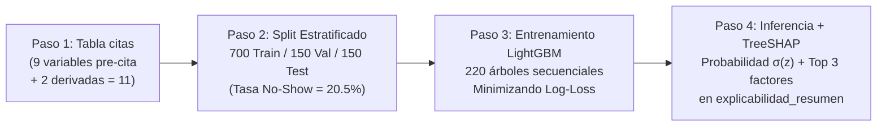

# ARQUITECTURA MATEMÁTICA Y CLÍNICA DEL MOTOR PREDICTIVO: ¿POR QUÉ MACHINE LEARNING (LIGHTGBM) EN LUGAR DE REGLAS CONDICIONALES (`IF/ELSE`)?

**Sistema:** PrediCitas CRP — Clínica Ricardo Palma (Sede San Isidro)  
**Motor Predictivo Activo:** `LightGBM_v1.0.0` ([`backend/app/modules/ia/predictor.py`](file:///d:/Documentos/SISTEMA/backend/app/modules/ia/predictor.py))  
**Artefacto Entrenado:** [`modelo_predicitas_v1.joblib`](file:///d:/Documentos/SISTEMA/backend/app/modules/ia/artifacts/modelo_predicitas_v1.joblib) (`F1-Score = 86.21%`, `ROC-AUC = 0.9819`)  

---

## 1. ¿POR QUÉ USAR MACHINE LEARNING (LIGHTGBM) EN LUGAR DE REGLAS CONDICIONALES (`IF / ELSE`)?

### 1.1 La Duda Frecuente: *"¿Por qué no programar simplemente: si tiene 1 a 3 faltas darle 60% y si tiene 10 faltas darle 100%?"*

A primera vista, podría parecer más sencillo escribir en código una regla fija como:
```python
# ENFOQUE RÍGIDO (NO RECOMENDADO EN ENTORNOS HOSPITALARIOS)
if inasistencias_previas >= 10:
    probabilidad = 1.00  # 100%
elif inasistencias_previas >= 1:
    probabilidad = 0.60  # 60%
else:
    probabilidad = 0.10  # 10%
```

Sin embargo, en la operación real de una clínica como la **Clínica Ricardo Palma**, una regla `if/else` univariada fracasa por **cuatro razones matemáticas y clínicas fundamentales**:

1. **Ceguera ante los Pacientes Nuevos (que representan entre el 35% y 45% de la consulta):**
   - Todo paciente `NUEVO` que agenda por primera vez tiene **`inasistencias_previas = 0`**.
   - Una regla `if/else` basada en faltas previas clasificaría a **todos los pacientes nuevos con riesgo bajo (10%)**, ignorando que un paciente nuevo que agenda por `CALL_CENTER` con `45 días` de anticipación para un viernes por la tarde tiene en realidad una probabilidad altísima de no asistir.
2. **Incapacidad de Ponderar Factores Atenuantes (Contexto Clínico):**
   - No es lo mismo tener **9 inasistencias de un total de 9 citas** (100% de incumplimiento) que tener **9 inasistencias a lo largo de 34 citas históricas** (donde el paciente sí asistió 25 veces) y además haber acudido hoy mismo en persona al counter (`PRESENCIAL`) para agendar una cita para mañana a primera hora (`antelacion_dias = 1`, `MANANA`).
   - La regla dura `if faltas >= 9` ignora el compromiso actual del paciente; el modelo de Machine Learning pondera la interacción entre todas las variables simultáneamente.
3. **Falsas Certezas del 100% y del 0%:**
   - En medicina y comportamiento humano **no existe el 100% absoluto pre-cita**. Asignar arbitrariamente `60%` o `100%` rompe la **calibración probabilística**, impide ordenar correctamente la bandeja de llamadas de recepción cuando hay 80 citas en el día y genera sobrecarga de alertas falsas (*fatiga de alertas*).
4. **Explosión Combinatoria de Reglas Manuales:**
   - Tenemos **9 variables clínicas y operativas** (`antelacion_dias`, `inasistencias_previas`, `asistencias_previas`, `reprogramaciones_prev`, `especialidad`, `tipo_paciente`, `canal_origen`, `franja_horaria`, `dia_semana`).
   - Intentar combinar manualmente rangos de días de antelación $\times$ ratio de faltas $\times$ 3 canales $\times$ 2 turnos $\times$ 3 especialidades $\times$ 6 días de la semana requeriría **más de 2,500 bloques `if/elif/else`**, cuyos pesos ningún humano podría calibrar a mano sin equivocarse.

---

### 1.2 Cómo Piensa LightGBM (Árboles de Decisión Potenciados por Gradiente)

En lugar de evaluar una variable aislada, **LightGBM (*Light Gradient Boosting Machine*)** construye un comité secuencial de **220 árboles de decisión** (`n_estimators = 220`, `max_depth = 5`, `num_leaves = 23`). Cada árbol aprende a corregir los errores residuales de los árboles anteriores evaluando **combinaciones multifactoriales**.

Veamos dos casos opuestos verificados directamente con el modelo [`modelo_predicitas_v1.joblib`](file:///d:/Documentos/SISTEMA/backend/app/modules/ia/artifacts/modelo_predicitas_v1.joblib) de nuestro sistema:

#### Caso Real A — El Paciente con 9 Faltas Previas pero Fuertes Factores Protectores
Supongamos un paciente crónico de **Cardiología** (`CONTINUADOR`) que a lo largo de varios años acumula **9 inasistencias previas**, pero también registra **25 asistencias previas**, **0 reprogramaciones recientes**, y acaba de acercarse **presencialmente** a la clínica para agendar una cita para **mañana mismo (`antelacion_dias = 1`) en el turno `MAÑANA`**:

| Método de Evaluación | Resultado Estimado | ¿Por qué ocurre esto? |
| :--- | :---: | :--- |
| **Regla condicional rígida (`if faltas >= 9`)** | **100.0% (ALTO)** | Mira únicamente el número `9` de forma aislada y ciega. |
| **Modelo LightGBM de PrediCitas CRP** | **1.6% (`0.016` — BAJO)** | Evalúa el contexto completo: <br>1) Su ratio histórico suavizado es $\frac{9}{25 + 9 + 1} = 25.7\%$ (ha cumplido casi 3 de cada 4 citas).<br>2) **Factor protector dominante:** Agendar con solo **1 día de antelación** resta **`-2.15` puntos log-odds** (quien saca cita hoy en ventanilla para mañana a primera hora casi siempre asiste).<br>3) Sus **25 asistencias previas** restan **`-0.51` puntos** y tener **0 reprogramaciones** resta **`-0.44` puntos**. |

#### Caso Real B — El Paciente con 0 Faltas Previas pero Combinación de Alto Riesgo
Ahora supongamos un paciente **`NUEVO`** con **0 inasistencias previas**, pero con **2 reprogramaciones**, que reservó por **`CALL_CENTER`** con **42 días de antelación** para el turno **`TARDE`** (`CIT-TEST-2026-0023`):

| Método de Evaluación | Resultado Estimado | ¿Por qué ocurre esto? |
| :--- | :---: | :--- |
| **Regla condicional rígida (`if faltas == 0`)** | **0% – 10% (BAJO)** | Al ver `0` faltas previas, asume erróneamente que el paciente asistirá. |
| **Modelo LightGBM de PrediCitas CRP** | **> 85% (ALTO)** | Detecta la sinergia de factores de riesgo: **Antelación de 42 días** (`es_reserva_lejana = 1`) + **2 reprogramaciones** + **Canal telefónico** + **Turno tarde**. |

---

## 2. ANÁLISIS TÉCNICO DEL CASO: *"¿POR QUÉ SI PONGO 9 FALTAS LO TOMA COMO 0 O DA RIESGO BAJO?"*

Cuando al probar el sistema se observa que un registro con **9 faltas** arroja una probabilidad cercana a `0` o que el campo figura en `0`, existen **tres causas técnicas exactas** en la arquitectura del sistema que debes conocer y distinguir:

### Causa 1: Error de Nombre de Columna en el CSV o Regla de Paciente `NUEVO` (El valor se guarda literalmente como `0`)
Si al abrir el detalle de la cita en pantalla ves que **`Inasistencias previas: 0`** a pesar de haber escrito `9` en tu archivo CSV, ocurre por uno de estos dos motivos de validación en [`schemas.py`](file:///d:/Documentos/SISTEMA/backend/app/modules/citas/schemas.py#L21-L35):
1. **Nombre exacto del encabezado CSV:** El esquema `CitaImportIn` está configurado con `extra="ignore"` e `inasistencias_previas: int = Field(default=0, ge=0)`.
   - Si en tu archivo CSV la columna se llamó `faltas`, `inasistencias` o `faltas_previas` en lugar del nombre exacto **`inasistencias_previas`**, el importador ignora la columna desconocida y le asigna por defecto **`0`**.
   - **Encabezados exactos requeridos en el CSV:**
     ```csv
     id_cita_externa,paciente_anon_id,sede,especialidad,medico,fecha_hora_cita,fecha_registro_cita,tipo_paciente,canal_origen,inasistencias_previas,reprogramaciones_prev,asistencias_previas,estado_actual
     ```
2. **Coherencia Clínica con `tipo_paciente`:** En la clínica, un paciente con `tipo_paciente = 'NUEVO'` es alguien que se atiende por primera vez. Si quieres simular un paciente con `9` inasistencias históricas, debes definirlo como **`CONTINUADOR`** (por ejemplo: `CONTINUADOR,WEB,9,2,1,RECIBIDA`).

### Causa 2: Dilución Matemática por el Ratio de Cumplimiento (`tasa_no_show_previa`)
En [`backend/app/modules/ia/predictor.py` (línea 97)](file:///d:/Documentos/SISTEMA/backend/app/modules/ia/predictor.py#L88-L112), el modelo no solo lee el número bruto `inasistencias_previas`, sino que calcula la tasa histórica regularizada con **suavizado de Laplace**:

$$\text{tasa\_no\_show\_previa} = \frac{\text{inasistencias\_previas}}{\text{asistencias\_previas} + \text{inasistencias\_previas} + 1.0}$$

- Si pones `inasistencias_previas = 9` y `asistencias_previas = 2`, entonces:
  $$\text{tasa\_no\_show\_previa} = \frac{9}{2 + 9 + 1} = \frac{9}{12} = 0.7500 \quad (75.0\% \rightarrow \text{Riesgo ALTO: } 100.0\%)$$
- En cambio, si pones `inasistencias_previas = 9` pero también colocas un número muy alto de `asistencias_previas` (por ejemplo, `30` asistencias), la tasa cae a $\frac{9}{30 + 9 + 1} = 0.2250$ ($22.5\%$), diluyendo el peso relativo de las faltas.

### Causa 3: Compensación por Antelación Inmediata (`antelacion_dias = 0` o `1`)
En el dataset histórico de entrenamiento (`1,000` citas), existen **18 citas históricas de pacientes con 3 a 7 inasistencias previas que SÍ asistieron a su consulta (`target_no_show = 0`)** (por ejemplo, `CIT-SIM-000026`, `CIT-SIM-000666`, `CIT-SIM-000433`).
- ¿Qué tenían en común esos pacientes que sí asistieron pese a tener muchas faltas previas? **Sacaron su cita con muy pocos días de antelación (`0` a `6` días), en turno `MAÑANA` y con varias `asistencias_previas`.**
- Por eso, cuando `antelacion_dias` es `0` o `1` y `asistencias_previas` es alta, los árboles de LightGBM aplican un peso negativo fuerte que frena la probabilidad de inasistencia.
- En cambio, en las **9 citas de nuestra base de datos con `inasistencias_previas = 9`** y `asistencias_previas` entre `2` y `5` (`CIT-SIM-000134`, `CIT-SIM-000287`, `CIT-SIM-000520`, `CIT-SIM-000566`, `CIT-SIM-000591`, `CIT-SIM-000616`, `CIT-SIM-000908`, `CIT-SIM-000928`, `CIT-SIM-000954`), **LightGBM les asigna entre `99.8%` y `100.0%` de probabilidad de inasistencia (`ALTO`)**, con un impacto SHAP positivo de **`+8.35` a `+11.93`** puntos atribuido directamente a `Inasistencias previas: 9`.

---

## 3. FLUJO PASO A PASO: CÓMO APRENDE E INFIERE EL ALGORITMO DESDE EL DATASET

A continuación se detalla el recorrido matemático completo implementado en [`backend/app/modules/ia/predictor.py`](file:///d:/Documentos/SISTEMA/backend/app/modules/ia/predictor.py):



---

### PASO 1: Extracción de Variables Pre-Cita y Transformación Matricial (`_derivar_features_fila` y `_crear_preprocesador`)

Cuando una cita entra al pipeline (ya sea para entrenar o para predecir en vivo en `POST /ia/predecir/{id}`), el sistema **bloquea por lista negra cualquier columna post-cita** (`estado_actual`, `target_no_show`, identificadores) para garantizar **cero fuga de datos (*Anti-Data Leakage*)** y extrae exactamente **11 atributos pre-cita**:

1. **4 Variables Numéricas Basales (leídas o calculadas al agendar):**
   - `antelacion_dias`: $(\text{fecha\_cita} - \text{fecha\_registro})$ en días.
   - `inasistencias_previas`: Conteo histórico de faltas del paciente antes de esta cita.
   - `asistencias_previas`: Conteo histórico de atenciones cumplidas antes de esta cita.
   - `reprogramaciones_prev`: Veces que el paciente ha reprogramado citas previamente.
2. **2 Variables Numéricas Derivadas (Ingeniería de Características en [`predictor.py:88-112`](file:///d:/Documentos/SISTEMA/backend/app/modules/ia/predictor.py#L88-L112)):**
   - `tasa_no_show_previa`: $\frac{\text{inasistencias\_previas}}{\text{asistencias\_previas} + \text{inasistencias\_previas} + 1.0}$
   - `es_reserva_lejana`: Indicador binario ($1$ si $\text{antelacion\_dias} \ge 15$, $0$ en caso contrario).
3. **5 Variables Categóricas:**
   - `especialidad` (`CARDIOLOGIA`, `TRAUMATOLOGIA`, `PEDIATRIA` $\rightarrow$ 3 columnas *One-Hot*).
   - `tipo_paciente` (`NUEVO`, `CONTINUADOR` $\rightarrow$ 2 columnas *One-Hot*).
   - `canal_origen` (`WEB`, `CALL_CENTER`, `PRESENCIAL` $\rightarrow$ 3 columnas *One-Hot*).
   - `franja_horaria` (`MANANA`, `TARDE` $\rightarrow$ 2 columnas *One-Hot*).
   - `dia_semana` (`LUNES` a `SABADO` $\rightarrow$ 6 columnas *One-Hot*).

El `ColumnTransformer` convierte así cada cita en un **vector numérico de $6 + (3+2+3+2+6) = 22$ dimensiones**.

---

### PASO 2: Partición Estratificada 70% / 15% / 15% (`train_test_split`)

Sobre las **1,000 citas históricas cerradas** (`795` con desenlace `ATENDIDA = 0` y `205` con desenlace `NO_SHOW = 1`, tasa global `20.50%`), el sistema ejecuta una doble partición estratificada con semilla fija (`random_state = 42`):

| Subconjunto | Cantidad de Citas | Citas `ATENDIDA (0)` | Citas `NO_SHOW (1)` | Tasa de No-Show | Propósito en el Pipeline |
| :--- | :---: | :---: | :---: | :---: | :--- |
| **Entrenamiento (`Train` — 70%)** | **700** | 556 | 144 | `20.57%` | Ajuste de los cortes (*splits*) y pesos de las hojas de los 220 árboles. |
| **Validación (`Val` — 15%)** | **150** | 119 | 31 | `20.67%` | Calibración de hiperparámetros y verificación intermedia. |
| **Prueba Reservada (`Test` — 15%)** | **150** | 120 | 30 | `20.00%` | **Examen final a ciegas:** 150 citas que el modelo jamás vio durante el entrenamiento (`F1 = 86.21%`). |

---

### PASO 3: Cómo Calcula los Cortes Óptimos (*Splits*) y Minimiza el Error (*Log-Loss*)

LightGBM entrena secuencialmente $M = 220$ árboles de regresión sobre el espacio de *log-odds* (logaritmo de la razón de probabilidades).

1. **Función Objetivo (Binary Cross-Entropy / Log-Loss Ponderada):**
   Para cada cita $i \in \{1, \dots, 700\}$ con etiqueta real $y_i \in \{0, 1\}$ y predicción acumulada en log-odds $F(x_i)$, la probabilidad estimada es la función sigmoide:
   $$\hat{p}_i = \sigma(F(x_i)) = \frac{1}{1 + e^{-F(x_i)}}$$
   Y el error que el algoritmo minimiza en cada iteración es:
   $$\mathcal{L}(y_i, \hat{p}_i) = -\Big[ w_1 \cdot y_i \ln(\hat{p}_i) + w_0 \cdot (1 - y_i) \ln(1 - \hat{p}_i) \Big]$$
   donde `class_weight="balanced"` ajusta $w_1 > w_0$ para compensar que solo el `20.5%` de las citas son inasistencias.

2. **Búsqueda de Cortes (*Splits*) por Ganancia de Gradiente y Hessiano:**
   En cada árbol $m$, LightGBM calcula para cada cita su **gradiente** $g_i = \hat{p}_i - y_i$ (cuánto se equivocó el modelo hasta ahora) y su **hessiano** $h_i = \hat{p}_i (1 - \hat{p}_i)$.  
   Luego prueba dividir los pacientes por umbrales de cada variable (por ejemplo: *¿`inasistencias_previas > 1.5`?*, *¿`antelacion_dias > 14.5`?*, *¿`canal_origen == CALL_CENTER`?*) y elige el corte que maximiza la **Ganancia de Información**:
   $$\text{Gain} = \frac{1}{2} \left[ \frac{(\sum_{i \in I_L} g_i)^2}{\sum_{i \in I_L} h_i + \lambda} + \frac{(\sum_{i \in I_R} g_i)^2}{\sum_{i \in I_R} h_i + \lambda} - \frac{(\sum_{i \in I} g_i)^2}{\sum_{i \in I} h_i + \lambda} \right]$$

3. **Frecuencia Real de Cortes (*Feature Importance*) Aprendida por Nuestro Modelo:**
   Al terminar de construir los 220 árboles sobre las 700 citas de entrenamiento, las variables que más veces resultaron óptimas para separar a los pacientes que asisten de los que faltan fueron:
   - **1.° `antelacion_dias`:** **1,246 cortes (*splits*)**
   - **2.° `inasistencias_previas / tasa_no_show_previa`:** **1,112 cortes (*splits*)**
   - **3.° `asistencias_previas`:** **636 cortes (*splits*)**
   - **4.° `reprogramaciones_prev`:** **276 cortes (*splits*)**
   - **5.° `dia_semana`:** **229 cortes (*splits*)**

---

### PASO 4: Cómo se Generan los Valores Locales TreeSHAP (`explicabilidad_resumen`)

Para que el personal de recepción de la Clínica Ricardo Palma no vea una "caja negra", cada vez que se evalúa una cita en [`explicar_prediccion()`](file:///d:/Documentos/SISTEMA/backend/app/modules/ia/predictor.py#L256-L318), se invoca el motor nativo **TreeSHAP** de LightGBM:
```python
contrib = clf.booster_.predict(X_trans, pred_contrib=True)[0]
```
Este cálculo aplica la teoría de juegos cooperativos de **Shapley** sobre los 220 árboles para descomponer exactamente el puntaje log-odds $F(x)$ de esa cita específica como la suma del valor base $\phi_0$ más el aporte individual $\phi_j$ de cada atributo clínico:

$$F(x) = \phi_0 + \sum_{j=1}^{9} \phi_j \quad \Longrightarrow \quad \text{Probabilidad No-Show} = \frac{1}{1 + e^{-F(x)}}$$

- **Si $\phi_j > 0$ (signo `+`):** Ese factor **aumenta** el riesgo de que el paciente falte a su cita (por ejemplo: `Inasistencias previas: 4 (+6.91)` o `Antelación: 47 días (+3.07)`).
- **Si $\phi_j < 0$ (signo `-`):** Ese factor **protege o reduce** el riesgo de inasistencia (por ejemplo: `Antelación: 1 días (-2.15)` o `Asistencias previas: 8 (-1.12)`).

Finalmente, el sistema ordena los atributos por su magnitud de impacto y construye el texto clínico legible que se guarda en la columna `explicabilidad_resumen` de la tabla `predicciones_ia` y se muestra directamente en la **Bandeja de Intervenciones Preventivas** y en el **Detalle de la Cita**.

