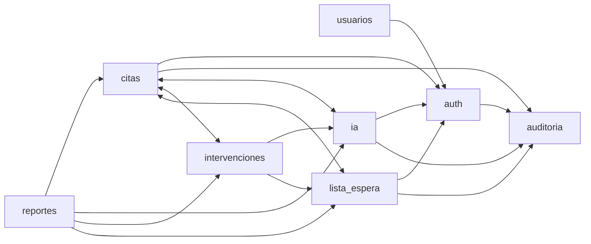

# Acoplamiento y plan de límites internos

Inventario reproducible en `docs/migracion/fase-01/dependencias_y_persistencia.json`: **74 imports entre módulos/desde composición**, **90 sitios `db.*`** y **27 llamadas `db.commit()`** en el árbol actual. Las búsquedas incluyen imports dentro de funciones, en particular la ruta alias de Citas. `get/execute` pueden ser lectura: 90 no significa 90 escrituras. No es un análisis completo de SQL dinámico o alias de sesión.

## Grafo actual relevante

Es un grafo agregado por funcionalidad, no prueba de que Python falle por import circular de archivos. Hay dependencias bidireccionales de negocio aunque los modelos importados permitan iniciar hoy.

## Lecturas, escrituras y destino

| Origen actual | Dependencia/efecto observado | Tratamiento definido |
|---|---|---|
| `core/models.py`, `main.py` | Registro de modelos/router de todos los módulos | Composición legítima; llevar registro ORM a bootstrap fase 4, actualizar Alembic/scripts/tests |
| `usuarios/service.py:15–19` y repository | Usa reloj, repositorio, modelo, validador y auditoría de Auth | Contrato público de identidad; Usuario físico propiedad Usuarios sin cambiar tabla |
| `auth/service.py` | Lee/modifica usuario y estado de sesión/bloqueo/revocación; audita | Preservar seguridad y transacción de fallos; no copiar repositorio privado a otros módulos |
| `citas/repository.py` | JOIN/consultas de predicción, intervención, auditoría, cupos/candidatos | Adaptador explícito de lectura compuesta permitido; no escritura ajena |
| `citas/service.py:268–310` | Lee Intervencion y crea CupoLiberado al cancelar con liberar_cupo | Workflow con validación pública de Intervenciones y operación propia de Lista de espera |
| `citas/service.py:204–231` | Transición + historial + auditoría; helper `transicionar` ya no hace commit | Base componible a consolidar; quien llama bloquea/coordina transacción |
| `citas/router.py:149` | Import local `app.modules.ia.service.predecir_cita` | Registrar en mapa, no olvidar al extraer predictor; llamada por contrato/cableado backend |
| `intervenciones/router.py:13` | Importa reloj del router Citas | Mover dependencia de tiempo a core; actualizar overrides, no hacer wrapper HTTP entre módulos |
| `intervenciones/service.py:448–526,565–638` | Cambia Cita, crea HistorialEstadoCita/CupoLiberado y audita | Workflow: operaciones públicas de propietarios con un solo commit; conservar distinción POST/PATCH |
| `intervenciones/repository.py` | Lee Cita/PrediccionIA y CupoLiberado; opt-out cruza citas del paciente | Contratos de consulta o adaptador de lectura; no perder bloqueo de opt-out transversal |
| `lista_espera/service.py:23–40` | Lee Cita para franja/id externo | Consulta pública Citas o proyección de lectura; no acceso de escritura a Cita |
| `lista_espera/router.py:218–259` | Oferta/rechazo/desistimiento modifican Cupo/ListaEspera y hacen commit | Llevar a caso de uso propio, locks, validaciones y trazabilidad en fase 4 |
| `lista_espera/service.py:200–294` | Bloquea cupo/candidato y crea Reasignacion/auditoría | Conservar atomicidad, compatibilidad, orden/FIFO y confirmación humana; no score clínico |
| `ia/service.py` y repository | Lee Cita, calcula local, guarda predicción/auditoría | Puerto predictivo HTTP en backend; snapshots/revalidación y persistencia siguen aquí |
| `ia/predictor.py:42,320–362` | Importa generador Citas; consulta opcional ORM o fallback sintético | Extraer IA sin imports backend/DSN; una fuente explícita por entrenamiento |
| `reportes/service.py` | Consultas de varias tablas | Excepción de lectura; no mutar tablas operativas |
| `reportes/router.py:59–68` | Audita exportación y hace commit en router | Caso de uso de exportación; no «solo lectura» por ser GET |
| `auditoria/service.py` | Agrega evento sin commit | Mantener append componible y restricciones BD |

No trasladar callbacks a un `core` global que conozca todos los módulos: movería el acoplamiento de carpeta, no lo resolvería. DTOs públicos describen intención/datos mínimos; modelos y sesión ORM no cruzan aplicaciones.

## Invariantes de escritura por workflow

- Transición de cita: exactamente un historial por transición efectiva y sus eventos requeridos; sin dobles inserciones entre service antiguo/nuevo.
- Liberar: cupo único vinculado a origen, transición permitida y solicitud voluntaria o cancelación externa informada; silencio no habilita cupo.
- Reasignar: bloquear cupo/candidato, validar estado/especialidad/franja, confirmación humana y no doble asignación; historia/auditoría consistentes.
- Predicción: no mantener la transacción de lectura abierta durante HTTP; revisar snapshot/estado al guardar. La IA no toma locks ni escribe BD.
- Importación: validación parcial como baseline, commit único de válidas/historial/auditoría; no introducir commits por fila que cambien atomicidad de error SQL.
- Eventos de login fallido y bloqueo deben sobrevivir al 401/429 en una transacción explícita, sin confirmar cambios de otro caso de uso.

## Orden de intervención futura

1. Fase 2 cambia solo rutas físicas/configuración; mantener imports `app.*` y mismo contexto lógico.
2. Fase 4: reloj y bootstrap → contratos internos/DTO → operaciones componibles → workflows → quitar commits/SQL de routers → pruebas de rollback/concurrencia.
3. Fases 5–7: extraer matemática/generador → registry/pipeline → adaptar **todos** los consumidores IA, incluido alias Citas, métricas/resumen y tests.
4. Fase 8: consolidar frontend según grafo actual y comparación funcional; conservar fixture test-only de ranuras.

Excepciones de lectura y composición se registran en tests de arquitectura con justificación. El mapa generado no es una whitelist permanente de acoplamientos: registra lo que hay que controlar, no lo autoriza como diseño final.
